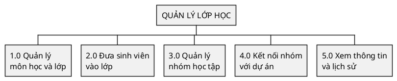
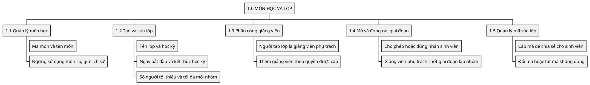
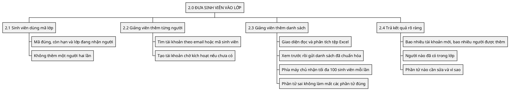
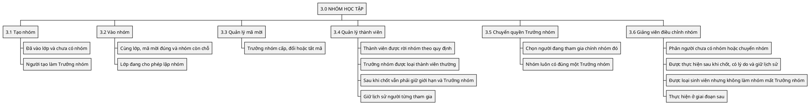
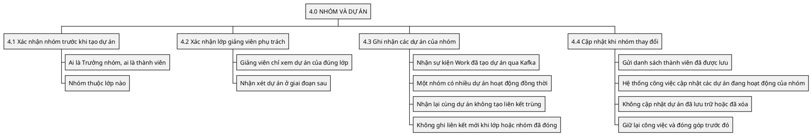
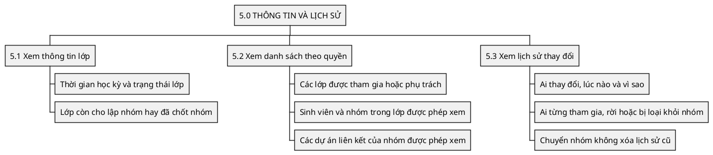

# Classroom Service — Sơ đồ chức năng quản lý lớp học

**Trạng thái: Thiết kế mục tiêu.** Đây là chức năng cần xây dựng, chưa phải
chức năng của một dịch vụ đã chạy.

Nguồn: yêu cầu nghiệp vụ (đầu vào local `UTask - Phân tích thiết kế yêu cầu.md`),
[kiến trúc](../../architecture/README.md), [quyền sở hữu dữ liệu](../../system/data-ownership.md).

## 1. Hiểu nghiệp vụ trước khi đọc sơ đồ

Giảng viên tạo lớp và đưa sinh viên vào lớp. Sinh viên lập nhóm, tự chọn đề
tài; Trưởng nhóm tạo dự án ở hệ thống công việc. Một nhóm được có nhiều dự án
hoạt động đồng thời. Hệ thống lớp học quản lý **lớp, nhóm và liên kết dự án**;
hệ thống công việc quản lý **đề tài, dự án và công việc của nhóm**.

Ví dụ minh họa: cô Lan tạo lớp Công nghệ phần mềm. An và Bình lập Nhóm A.
Nhóm tự chọn hai đề tài Quản lý thư viện và Đặt phòng khách sạn; An tạo hai dự
án để thực hiện đồng thời. Đây là ví dụ thiết kế, không phải dữ liệu đã có.

Sơ đồ chức năng trả lời **hệ thống cần làm những việc gì**. Đọc từ ô trên
xuống các nhánh. Các mã 1.0, 1.1… chỉ dùng để tra cứu giữa các tài liệu.

## 2. Năm nhóm chức năng chính

> Hệ thống cần quản lý lớp, sinh viên, nhóm, liên kết với dự án và việc tra cứu.
> Chọn sơ đồ chi tiết bên dưới để biết từng nhóm chức năng gồm những gì.

## 3. Chi tiết từng nhóm chức năng

### 3.1. Môn học, lớp và mã tham gia

> Giảng viên tạo lớp theo học kỳ, quy định thời gian học và giới hạn nhóm.
> Mã tham gia giúp sinh viên vào đúng lớp; giảng viên có thể đổi hoặc tắt mã.

### 3.2. Đưa sinh viên vào lớp

> Sinh viên tự vào lớp bằng mã, hoặc giảng viên thêm từng người hay gửi một danh sách.
> Giao diện đọc Excel và chuẩn bị danh sách; phía máy chủ không nhận hoặc phân tích tệp.
> Vào lớp chưa có nghĩa là vào nhóm. Kết quả phải chỉ rõ người được thêm, người trùng và người bị lỗi.

### 3.3. Nhóm, thành viên và Trưởng nhóm

> Sinh viên chỉ được tham gia một nhóm đang hoạt động trong cùng lớp.
> Trưởng nhóm mời người, quản lý thành viên và chuyển quyền; muốn rời nhóm phải chuyển quyền trước.

### 3.4. Nhóm học tập liên quan gì đến dự án?

> Nhóm tự chọn đề tài; Trưởng nhóm tạo nhiều dự án ở hệ thống công việc.
> Hệ thống lớp học xác nhận nhóm rồi nhận sự kiện qua Kafka để ghi liên kết.
> Khi thành viên nhóm thay đổi, danh sách thành viên dự án cũng phải được cập nhật.

### 3.5. Xem thông tin và lịch sử

> Sinh viên xem thông tin lớp, nhóm và các mã dự án được liên kết của nhóm mình.
> Giảng viên xem danh sách, nhóm và lịch sử thay đổi của các lớp mình phụ trách.

## 4. Đối chiếu yêu cầu và phạm vi

| Chức năng | Căn cứ | Thời điểm |
| --- | --- | --- |
| 1.0 Môn học và lớp | Baseline 4.3, US-1.2 | Bản đầu |
| 2.0 Sinh viên trong lớp | US-1.3, US-1.4 | Bản đầu |
| 3.1–3.5 Nhóm và thành viên | US-2.1–2.3, vòng đời vai trò mục 1.2 | Bản đầu |
| 3.6 Điều chỉnh nhóm ngoại lệ, kể cả sau khi chốt | US-2.5 | Giai đoạn sau |
| 4.1, 4.3, 4.4 Nhóm và nhiều dự án tự chọn đề tài | US-2.4 | Bản đầu |
| 4.2 Quyền xem lớp của Giảng viên | US-4.4; nhận xét theo US-4.5 | Xem ở bản đầu; nhận xét ở giai đoạn sau |
| 5.0 Tra cứu và lịch sử | US-1.3, US-2.5, nguyên tắc kiểm toán mục 2.3 | Theo chức năng tương ứng |

“Bản đầu” tương ứng P0, “giai đoạn sau” ở đây tương ứng P1. Điểm danh và điểm
số thuộc P2, chưa bổ sung vào các sơ đồ trên. Quản lý môn học/phân công chỉ
gồm phần tối thiểu cần cho lớp; quyền sửa danh mục và phân công phải được chốt.

## 5. Chuyển từ chức năng sang thiết kế

[Sơ đồ quyền](usecase.md) cho biết ai thực hiện mỗi việc; [sơ đồ trình tự](sequence.md)
cho biết một yêu cầu đi qua các bước nào; [ERD](erd.md) giải thích 10 bảng cần lưu.
Classroom sở hữu lớp/nhóm; Work sở hữu dự án/công việc; Identity sở hữu tài khoản.
Các service trao đổi qua API hoặc sự kiện, không đọc cơ sở dữ liệu của nhau.
