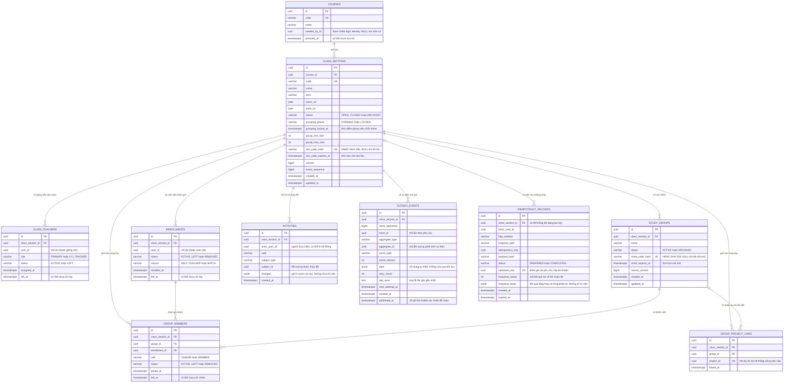

# Các bảng dữ liệu cần có cho dịch vụ lớp học

**Trạng thái: Thiết kế mục tiêu, đã có model/migration backend tương ứng.**
Đối chiếu ngày 16/10/2026 tại `apps/classroom-service/apps/{courses,groups,messaging}`.
Kiểm thử ràng buộc, khóa và migration được ghi tại
nghiệm thu backend (bản local `backend-validation.md`); sơ đồ không thay kết quả chạy.

## 1. Sơ đồ quan hệ — 10 bảng

Bảy bảng nghiệp vụ lưu môn học, lớp, giảng viên phụ trách, sinh viên đăng ký,
nhóm, thành viên nhóm và liên kết dự án. Ba bảng hỗ trợ lưu lịch sử thay đổi,
thông báo đang chờ gửi và kết quả các yêu cầu đã xử lý.

Mã tài khoản và mã dự án do hệ thống khác cấp chỉ được lưu để đối chiếu; chúng
không tạo liên kết cơ sở dữ liệu sang hệ thống khác. Các liên kết trong hình
này đều nằm trong cơ sở dữ liệu lớp học. Điểm danh và điểm số để dành giai đoạn
sau, chưa có bảng trong thiết kế hiện tại.

> Một môn có nhiều lớp; mỗi lớp có sinh viên, giảng viên và nhóm. Nhóm tự chọn
> đề tài và có nhiều dự án hoạt động đồng thời. Mỗi dự án chỉ liên kết một
> lớp/nhóm; tên đề tài và công việc nằm ở Work.

`Course.created_by_id` đã có trong model và migration `0002`; API chỉ trả
trường này, không nhận giá trị từ payload. Teacher chỉ quản lý môn mình tạo;
Admin quản lý được mọi môn, gồm môn cũ có `created_by_id=NULL`. Đây là
tham chiếu logic tới Identity, không phải khóa ngoại liên service.

## 2. Mỗi bảng dùng để làm gì?

| Tên bảng trong sơ đồ | Dùng để | Quy tắc dễ nhớ |
| --- | --- | --- |
| COURSES — Môn học | Danh mục dùng chung cho các lớp | Môn đã có lớp sử dụng thì ngừng dùng, không xóa lịch sử |
| CLASS_SECTIONS — Lớp học | Tên lớp, học kỳ, ngày và giới hạn nhóm | Ngày bắt đầu không sau ngày kết thúc; Giảng viên phụ trách là người chuyển giai đoạn lập nhóm sang đã chốt |
| CLASS_TEACHERS — Giảng viên phụ trách | Người được giao quản lý từng lớp | Mỗi người có một lần phân công trong mỗi lớp; chỉ người đang phụ trách mới quản lý được lớp |
| ENROLLMENTS — Sinh viên trong lớp | Người nào tham gia lớp nào | Mỗi sinh viên có một hồ sơ trong mỗi lớp; gửi lại yêu cầu không tạo bản sao |
| STUDY_GROUPS — Nhóm học tập | Các nhóm và mã mời trong từng lớp | Mỗi mã mời đang dùng xác định đúng một nhóm; nhóm không giữ trực tiếp một dự án duy nhất |
| GROUP_MEMBERS — Thành viên nhóm | Ai từng tham gia nhóm và giữ vai trò nào | Mỗi lần vào nhóm tạo một dòng; kết thúc lần cũ trước khi ghi lần mới |
| GROUP_PROJECT_LINKS — Các dự án của nhóm | Mã dự án do Work tạo và lớp/nhóm tương ứng | Mã dự án duy nhất; mã nhóm không duy nhất để có nhiều dự án hoạt động đồng thời |
| ACTIVITIES — Lịch sử thay đổi | Người thực hiện, thời điểm và nội dung thay đổi | Chỉ thêm lịch sử mới; không lưu mã lớp, mã mời hoặc thông tin bí mật |
| OUTBOX_EVENTS — Thông báo đang chờ gửi | Thay đổi đã lưu nhưng Kafka chưa xác nhận nhận sự kiện | Thứ tự không lặp trong từng lớp; lưu cùng thay đổi; Kafka xác nhận không có nghĩa dịch vụ nhận đã xử lý xong |
| IDEMPOTENCY_RECORDS — Kết quả yêu cầu đã xử lý | Kết quả cũ để gửi lại không tạo dữ liệu trùng | Cùng khóa và cùng nội dung trả lại kết quả cũ; dùng khóa cũ với nội dung khác thì bị từ chối |

### Lịch sử thay đổi

Bảng lịch sử ghi lại đối tượng nào đã thay đổi và các giá trị trước, sau thay
đổi. Dùng một bảng chung cho lớp, nhóm, liên kết dự án và việc sinh viên tham
gia lớp. Mã đối tượng do chương trình kiểm tra; cơ sở dữ liệu không tự bảo đảm mã ấy trỏ đến
dòng có thật. Vì vậy, mỗi lần thay đổi phải kiểm tra đối tượng thuộc đúng lớp
trước khi ghi. Đối tượng đã có lịch sử được lưu trữ hoặc đánh dấu đã rời, không
xóa hẳn. Mã tham gia, mã mời và thông tin bí mật không được ghi vào lịch sử.

### Mã tham gia và mã mời

Mã vào lớp và mã mời là chuỗi ngẫu nhiên sinh bằng bộ tạo số ngẫu nhiên mật
mã. Phía máy chủ chuẩn hóa đúng một dạng ký tự rồi tính HMAC-SHA-256 bằng khóa
bí mật riêng của Classroom; cơ sở dữ liệu chỉ lưu kết quả 64 ký tự, không lưu
mã gốc. Không dùng hàm băm nhanh không có khóa cho mã ngắn do có thể dò ngoại
tuyến khi dữ liệu bị lộ.

`join_code_hash` và `invite_code_hash` có ràng buộc duy nhất một phần khi giá
trị khác `NULL`. Vì vậy, người dùng nhập một mã là xác định đúng một lớp hoặc
một nhóm; không cần gửi kèm mã đối tượng. Khi sinh mã trùng cực hiếm, chương
trình sinh lại. Mã vào lớp và mã mời nằm ở hai cột/bảng khác nhau nên không
cần duy nhất chung giữa hai loại.

Đổi mã làm mã cũ hết hiệu lực; tắt mã xóa giá trị đã lưu. Khi tạo lớp hoặc
nhóm, giao diện cấp mã ngay sau khi tạo thành công. Nếu cấp mã lỗi, cấp lại
trên lớp hoặc nhóm vừa tạo; không tạo thêm đối tượng. Nếu người dùng gửi lại
yêu cầu tạo cũ, không tự ý đổi mã. Mã gốc chỉ trả ở phản hồi lệnh cấp/đổi mã
và không nằm trong lịch sử, nhật ký hoặc kết quả lưu để chống tạo trùng.

### Liên kết nhóm với nhiều dự án

Nhóm tự chọn đề tài; Trưởng nhóm tạo dự án ở Work. Một nhóm có nhiều dự án
hoạt động đồng thời. Classroom nhận `project.created` qua Kafka rồi lưu mã dự
án, nhóm và lớp vào `GROUP_PROJECT_LINKS`; không sao chép tên đề tài, mục tiêu
hoặc trạng thái dự án. Việc tạo dự án và việc ghi liên kết là hai lần lưu ở
hai hệ thống, nên liên kết có thể xuất hiện chậm hơn phản hồi tạo dự án.

Nhận lại cùng mã dự án và đúng lớp/nhóm không tạo thêm dòng hoặc lịch sử trùng.
Cùng mã dự án nhưng lớp/nhóm khác phải được cách ly để kiểm tra, không ghi đè.
Khóa duy nhất trên mã dự án bảo vệ cả khi hai sự kiện đến đồng thời. Chỉ xác
nhận đã xử lý sau khi lưu thành công; lỗi chưa xử lý phải được thử lại hoặc
cách ly bền vững trước khi xác nhận. Không cần bảng nhận sự kiện riêng chỉ để
chống tạo trùng liên kết này.

Liên kết được giữ khi dự án đã lưu trữ; mã liên kết không tự chứng minh dự án
còn hoạt động và không tự cấp quyền xem. Dự án và quyền được kiểm ở Work.

Cách khôi phục khi một trong hai hệ thống gặp lỗi được giải thích trong
[luồng tạo dự án](sequence.md#sq-cl-07--nhóm-tự-chọn-đề-tài-và-tạo-dự-án).

## 3. Đặc tả ràng buộc để tạo migration

Tên dưới đây là tên mục tiêu của ràng buộc PostgreSQL. Migration Django phải
tạo đúng ý nghĩa này; khóa ngoại gồm nhiều cột có thể cần `RunSQL` nếu phiên
bản Django chưa biểu diễn được bằng model API. Mọi khóa ngoại dùng `PROTECT`/
`RESTRICT`, không xóa dây chuyền dữ liệu lớp, nhóm hoặc lịch sử.

### 3.1. Mã trạng thái lưu trong cơ sở dữ liệu

| Cột | Giá trị cho phép |
| --- | --- |
| `CLASS_SECTIONS.status` | `OPEN`, `CLOSED`, `ARCHIVED` |
| `CLASS_SECTIONS.grouping_phase` | `FORMING`, `LOCKED` |
| `CLASS_TEACHERS.role` | `PRIMARY`, `CO_TEACHER` |
| `CLASS_TEACHERS.status` | `ACTIVE`, `LEFT` |
| `ENROLLMENTS.status` | `ACTIVE`, `LEFT`, `REMOVED` |
| `ENROLLMENTS.source` | `SELF`, `TEACHER`, `BATCH` |
| `STUDY_GROUPS.status` | `ACTIVE`, `ARCHIVED` |
| `GROUP_MEMBERS.role` | `LEADER`, `MEMBER` |
| `GROUP_MEMBERS.status` | `ACTIVE`, `LEFT`, `REMOVED` |
| `IDEMPOTENCY_RECORDS.status` | `PREPARED`, `COMPLETED` |

Serializer có thể hiển thị tiếng Việt nhưng giá trị máy đọc được giữ nguyên.
Không lưu đồng thời mã tiếng Anh và nhãn tiếng Việt trong cùng cột.

### 3.2. Khóa duy nhất và điều kiện kiểm tra

| Bảng | Tên ràng buộc | Quy tắc chính xác |
| --- | --- | --- |
| `COURSES` | `uq_courses_code` | Duy nhất `code` sau khi chương trình chuẩn hóa |
| `CLASS_SECTIONS` | `uq_class_sections_code` | Duy nhất `code` |
| `CLASS_SECTIONS` | `uq_class_sections_join_code` | Duy nhất `join_code_hash WHERE join_code_hash IS NOT NULL` |
| `CLASS_SECTIONS` | `chk_class_section_dates` | `starts_on <= ends_on` |
| `CLASS_SECTIONS` | `chk_class_section_group_size` | `group_min_size > 0` và `group_min_size <= group_max_size` |
| `CLASS_SECTIONS` | `chk_class_section_state` | Mã trạng thái thuộc tập ở mục 3.1; `grouping_phase = 'LOCKED'` khi và chỉ khi `grouping_locked_at IS NOT NULL` |
| `CLASS_SECTIONS` | `chk_class_section_counters` | `version >= 1` và `event_sequence >= 0` |
| `CLASS_TEACHERS` | `uq_class_teacher` | Duy nhất `(class_section_id, user_id)` |
| `CLASS_TEACHERS` | `chk_class_teacher_state` | `status = 'ACTIVE'` khi và chỉ khi `left_at IS NULL`; role/status thuộc tập ở mục 3.1 |
| `ENROLLMENTS` | `uq_enrollment_user` | Duy nhất `(class_section_id, user_id)` |
| `ENROLLMENTS` | `uq_enrollment_class_id` | Duy nhất `(class_section_id, id)` để làm đích khóa ngoại ghép |
| `ENROLLMENTS` | `chk_enrollment_state` | `status = 'ACTIVE'` khi và chỉ khi `left_at IS NULL`; status/source thuộc tập ở mục 3.1 |
| `STUDY_GROUPS` | `uq_study_group_class_id` | Duy nhất `(class_section_id, id)` để làm đích khóa ngoại ghép |
| `STUDY_GROUPS` | `uq_study_groups_invite_code` | Duy nhất `invite_code_hash WHERE invite_code_hash IS NOT NULL` |
| `STUDY_GROUPS` | `chk_study_group_state` | `status` thuộc tập ở mục 3.1 và `source_version >= 1` |
| `GROUP_MEMBERS` | `uq_active_group_per_enrollment` | Duy nhất `(class_section_id, enrollment_id)` khi `status = 'ACTIVE'` |
| `GROUP_MEMBERS` | `uq_active_leader_per_group` | Duy nhất `group_id` khi `status = 'ACTIVE' AND role = 'LEADER'` |
| `GROUP_MEMBERS` | `chk_group_member_state` | Role/status thuộc tập ở mục 3.1; `status = 'ACTIVE'` khi và chỉ khi `left_at IS NULL`; nếu có thì `left_at >= joined_at` |
| `GROUP_PROJECT_LINKS` | `uq_group_project_project` | Duy nhất `project_id`; không đặt duy nhất trên `group_id` |
| `OUTBOX_EVENTS` | `uq_outbox_class_sequence` | Duy nhất `(class_section_id, class_sequence)` |
| `OUTBOX_EVENTS` | `chk_outbox_counters` | `class_sequence >= 1`, `event_version >= 1`, `retry_count >= 0` |
| `IDEMPOTENCY_RECORDS` | `uq_idempotency_scope` | Duy nhất `(actor_user_id, http_method, endpoint_path, idempotency_key)` |
| `IDEMPOTENCY_RECORDS` | `uq_idempotency_upstream_key` | Duy nhất `upstream_key WHERE upstream_key IS NOT NULL` |
| `IDEMPOTENCY_RECORDS` | `chk_idempotency_state` | `PREPARED` thì phản hồi là `NULL`; `COMPLETED` thì có `response_status` và `response_body`; `expires_at > created_at` |

Ràng buộc `uq_active_leader_per_group` chỉ bảo đảm **không quá một** Trưởng
nhóm. Service phải khóa nhóm và kiểm tra **có đúng một** Trưởng nhóm trước khi
commit. Khi chuyển quyền, hạ người cũ trước rồi nâng người mới trong cùng giao
dịch. Tương tự, ràng buộc thành viên hoạt động vẫn cho phép nhiều dòng lịch sử
sau khi một người rời rồi tham gia lại.

### 3.3. Khóa ngoại cùng lớp

| Bảng con | Khóa ngoại | Bảng cha |
| --- | --- | --- |
| `CLASS_SECTIONS` | `course_id` | `COURSES(id)` |
| `CLASS_TEACHERS` | `class_section_id` | `CLASS_SECTIONS(id)` |
| `ENROLLMENTS` | `class_section_id` | `CLASS_SECTIONS(id)` |
| `STUDY_GROUPS` | `class_section_id` | `CLASS_SECTIONS(id)` |
| `GROUP_MEMBERS` | `(class_section_id, group_id)` | `STUDY_GROUPS(class_section_id, id)` |
| `GROUP_MEMBERS` | `(class_section_id, enrollment_id)` | `ENROLLMENTS(class_section_id, id)` |
| `GROUP_PROJECT_LINKS` | `(class_section_id, group_id)` | `STUDY_GROUPS(class_section_id, id)` |
| `ACTIVITIES`, `OUTBOX_EVENTS` | `class_section_id` | `CLASS_SECTIONS(id)` |
| `IDEMPOTENCY_RECORDS` | `class_section_id` khi có giá trị | `CLASS_SECTIONS(id)` |

`user_id` và `project_id` là tham chiếu logic sang service khác, tuyệt đối
không tạo khóa ngoại. `ACTIVITIES.subject_id` là tham chiếu đa hình do service
kiểm tra; cũng không tạo khóa ngoại giả.

### 3.4. Chỉ mục bắt buộc ban đầu

PostgreSQL không tự tạo chỉ mục cho cột khóa ngoại. Ngoài chỉ mục do khóa
chính/duy nhất tạo ra, migration đầu tiên phải có:

| Tên chỉ mục | Cột và điều kiện |
| --- | --- |
| `ix_class_sections_course` | `(course_id, starts_on, id)` |
| `ix_class_teachers_active_scope` | `(user_id, class_section_id) WHERE status = 'ACTIVE'` |
| `ix_enrollments_active_scope` | `(user_id, class_section_id) WHERE status = 'ACTIVE'` |
| `ix_study_groups_class_list` | `(class_section_id, created_at, id)` |
| `ix_group_members_class_history` | `(class_section_id, joined_at, id)` |
| `ix_group_members_group_active` | `(group_id, role, enrollment_id) WHERE status = 'ACTIVE'` |
| `ix_group_member_enroll_history` | `(enrollment_id, joined_at, id)` |
| `ix_group_members_class_group` | `(class_section_id, group_id)`, không có điều kiện để bao phủ khóa ngoại ghép cả dòng lịch sử |
| `ix_group_members_class_enroll` | `(class_section_id, enrollment_id)`, không có điều kiện để bao phủ khóa ngoại ghép cả dòng lịch sử |
| `ix_group_project_class_group` | `(class_section_id, group_id, linked_at, id)` |
| `ix_activities_class_time` | `(class_section_id, created_at, id)` |
| `ix_activities_subject` | `(subject_type, subject_id, created_at)` |
| `ix_outbox_pending` | `(next_attempt_at, created_at, id) WHERE published_at IS NULL` |
| `ix_idempotency_class` | `(class_section_id, created_at, id) WHERE class_section_id IS NOT NULL` |
| `ix_idempotency_expiry` | `(expires_at)` |

Khóa duy nhất ghép đã bao phủ các tiền tố của chính nó; không tạo chỉ mục trùng
chỉ để đổi tên. Chỉ bổ sung chỉ mục khác sau khi có truy vấn và `EXPLAIN` thực
tế. Migration phải có kiểm thử truy vấn phát hiện khóa ngoại chưa được đánh
chỉ mục.

Hiệu chỉnh cục bộ khi triển khai: tên hai chỉ mục lịch sử/liên kết được rút
ngắn theo giới hạn tên chỉ mục của Django. Hai chỉ mục ghép không điều kiện
trên thành viên nhóm bổ sung để bao phủ khóa ngoại cho cả `LEFT`/`REMOVED`;
chỉ mục duy nhất có điều kiện `ACTIVE` không đủ cho tác vụ này.

### 3.5. Quy tắc nghiệp vụ không thể giao hoàn toàn cho cơ sở dữ liệu

- Giảng viên đang phụ trách là người chốt giai đoạn lập nhóm. Lệnh chốt cập
  nhật `grouping_phase`, `grouping_locked_at`, `version` và lịch sử trong một
  giao dịch.
- Sau khi chốt, Trưởng nhóm vẫn được loại thành viên thường của nhóm mình;
  Giảng viên phụ trách được phân, chuyển hoặc loại sinh viên trong đúng lớp.
  Mọi thao tác phải giữ một Trưởng nhóm, giới hạn tối đa, lý do và lịch sử.
- Không tạo liên kết mới từ sự kiện khi lớp hoặc nhóm đã đóng/lưu trữ. Liên
  kết lịch sử đã có vẫn được giữ.
- `project_id` là duy nhất nhưng chỉ là mã tham chiếu logic sang Work.
  `group_id` không duy nhất để một nhóm có nhiều dự án.

### Sự kiện chờ gửi

Khi lưu thay đổi, cùng lần lưu đó phải tạo thông báo chờ gửi. Thông báo có mã
riêng, loại và phiên bản sự kiện, đối tượng phát sinh, thời điểm xảy ra, mã
lần theo yêu cầu và phần nội dung cần gửi. Các thông tin mô tả sự kiện không
đổi sau khi lưu. Bộ gửi chỉ cập nhật số lần thử, loại lỗi gần nhất, thời điểm
thử tiếp theo và thời điểm Kafka xác nhận đã nhận. Kết quả này chưa chứng minh
dịch vụ nhận đã áp dụng thay đổi.

Thông báo đổi thành viên chứa toàn bộ danh sách hiện tại của nhóm, không chỉ
người vừa đổi. Nhờ vậy, Hệ thống công việc có thể áp dụng danh sách mới hơn mà
không cần nhận đủ mọi thay đổi trước đó. Phiên bản nhóm ngăn danh sách cũ ghi
đè danh sách mới. Giai đoạn đầu chưa cần kho lưu riêng mọi thông báo hoặc sổ
đăng ký nhiều phiên bản dữ liệu.

## 4. Thứ tự cập nhật và giữ chỗ nhóm

Khi thay đổi dữ liệu, hệ thống xác minh người dùng và quyền, rồi bắt đầu một
lần lưu chung. Hệ thống khóa lớp trước, sau đó khóa nhóm nếu cần, tiếp đến
khóa ghi danh và thành viên theo thứ tự cố định. Sau khi kiểm tra điều kiện,
hệ thống lưu thay đổi, lịch sử, thông báo chờ gửi và kết quả yêu cầu; cuối
cùng hoàn tất lần lưu. Nếu có lỗi, hủy toàn bộ thay đổi đang làm dở.

Khóa lớp khiến hai yêu cầu đồng thời không thể cùng chiếm chỗ cuối của nhóm.
Cách này phù hợp với quy mô lớp giai đoạn đầu. Chỉ chia nhỏ phạm vi khóa nếu
số đo thực tế cho thấy nhiều yêu cầu phải chờ nhau.

Nhóm mới được ít hơn số thành viên tối thiểu khi lớp đang lập nhóm. Hệ thống
có thể cảnh báo thiếu người, nhưng luôn từ chối nếu số người vượt mức tối đa.
Chưa chốt điều kiện hoàn tất lập nhóm và cách xử lý ngoại lệ sau khi lớp đã
chốt nhóm. Không chép giới hạn của lớp sang từng nhóm để tránh hai nơi cùng
lưu một con số.

Khi sinh viên rời lớp mà đang ở trong nhóm, phải kết thúc lần tham gia nhóm
tương ứng và gửi danh sách thành viên mới trong cùng lần lưu. Không cho rời
nếu sinh viên là Trưởng nhóm duy nhất mà chưa chuyển quyền. Giữ lịch sử các
lần tham gia cũ. Khi gửi sang Hệ thống công việc, chỉ gửi tình trạng mới nhất
một lần cho mỗi sinh viên. Giờ có thể làm và công việc đã giao ở Hệ thống
công việc không bị thay đổi khi đồng bộ danh sách thành viên.

## 5. Thêm danh sách sinh viên

Giao diện đọc và phân tích tệp Excel, cho Giảng viên xem trước rồi gửi danh
sách sinh viên có cấu trúc. Phía máy chủ Classroom không nhận, lưu hoặc phân tích
tệp. Phía máy chủ nhận tối đa 100 sinh viên mỗi yêu cầu, đúng giới hạn hiện có của Hệ thống
tài khoản. Thêm một người và thêm nhiều người dùng cùng quy tắc nghiệp vụ.

1. Nhận danh sách JSON; kiểm tra Giảng viên đang phụ trách lớp, số lượng, cấu
   trúc và phần tử trùng. Lưu nội dung yêu cầu cùng một mã chống trùng và một
   mã riêng để gọi Hệ thống tài khoản; hoàn tất lần lưu đó.
2. Sau khi hoàn tất lần lưu ở bước 1, gọi Hệ thống tài khoản mà không giữ khóa
   dữ liệu lớp. Khi gửi lại yêu cầu, dùng đúng mã và danh sách ban đầu. Mã riêng
   gắn người gửi và lớp để các lớp không dùng nhầm kết quả của nhau.
3. Bắt đầu lần lưu mới, khóa lớp và kiểm tra lại quyền. Với từng kết quả tài khoản
   hợp lệ, tạo ghi danh hoặc ghi nhận sinh viên đã có trong lớp. Người đã rời
   hoặc bị loại không tự được đưa vào lớp lại.
4. Lưu lịch sử, thông báo chờ gửi, tổng kết, kết quả từng phần tử và trạng thái
   đã hoàn tất trong cùng một lần lưu.

Nếu một số phần tử sai, các phần tử hợp lệ khác vẫn được xử lý. Nếu lần
lưu cuối thất bại vì lỗi cơ sở dữ liệu, hủy toàn bộ phần ghi danh cuối thay vì
báo một lỗi nghiệp vụ giả cho từng phần tử. Nếu kết nối bị ngắt giữa hai hệ thống, giữ yêu
cầu đang chờ để gửi lại cùng mã và nội dung. Không báo đã ghi danh chỉ vì tài
khoản đã được tạo; cũng không xóa bù tài khoản ở hệ thống kia nếu lớp không
thể ghi danh.

Tài khoản mới đang chờ kích hoạt vẫn được ghi danh; sinh viên phải kích hoạt
trước khi đăng nhập hoặc vào nhóm. Kết quả từng phần tử không chứa mật khẩu
hoặc đường dẫn kích hoạt. Giữ yêu cầu đang chờ khi người dùng còn có thể gửi
lại; thời hạn lưu cần thống nhất giữa hai hệ thống. Sửa danh sách dùng mã yêu
cầu mới. Không thêm trình đọc Excel, nơi lưu tệp hoặc công việc nhập tệp ở phía máy chủ.

## 6. Tìm và hiển thị danh sách

Mỗi trang hiển thị 20 dòng; người dùng được yêu cầu tối đa 100 dòng. Sắp theo
ngày tạo rồi mã dòng để thứ tự ổn định. Trước khi tìm hoặc hiển thị, lọc lớp
theo việc sinh viên đang học hoặc giảng viên đang phụ trách. Lấy tên và ảnh
theo nhóm mã tài khoản của trang hiện tại, không gọi riêng một lần cho mỗi
người. Nếu Hệ thống tài khoản tạm lỗi, vẫn giữ danh sách và quyền đã kiểm tra;
chỉ có thể thiếu tên hoặc ảnh.

Giữ các chỉ mục tra cứu mặc định do ứng dụng tạo cho cột liên kết. Bổ sung chỉ
  mục ghép cho các lượt tìm thường dùng: lớp theo giảng viên hoặc sinh viên,
  nhóm theo lớp, thành viên theo nhóm, liên kết theo lớp/nhóm và sự kiện chưa gửi. Mọi cột khóa ngoại
  phải có chỉ mục phù hợp. Chỉ thêm chỉ mục khác sau khi xem các lượt tìm thực tế.

## 7. Phần để giai đoạn sau

Chỉ thêm sổ chống trùng riêng khi bên nhận cần xử lý nhiều tác dụng phụ mà khóa
duy nhất trên liên kết không đủ bảo vệ. Chỉ sao chép hồ sơ người dùng về hệ thống lớp học nếu lấy thông
tin theo nhóm hiện tại không đáp ứng nhu cầu. Chỉ bổ sung xử lý danh sách bất
đồng bộ nếu giới hạn 100 phần tử không đủ theo số đo thực tế; việc đọc Excel vẫn
thuộc giao diện. Điểm danh và điểm số vẫn thuộc hệ thống lớp học nhưng thiết kế
bảng khi bắt đầu giai đoạn sau.

Khi xây dựng cần thử: người ngoài lớp không xem được dữ liệu; gửi lại không
tạo trùng; lỗi riêng từng phần tử; hai người cùng tranh chỗ cuối; chuyển Trưởng
  nhóm; một nhóm liên kết được nhiều dự án hoạt động đồng thời; thành viên và liên kết dự án
  luôn thuộc đúng lớp; lịch sử được giữ; thay đổi và thông báo cùng thành công
  hoặc cùng bị hủy; chỉ đánh dấu thông báo đã gửi sau khi bên nhận xác nhận;
  gửi lại sự kiện không tạo liên kết trùng; một mã dự án không gắn sang nhóm khác.
  Đây là điều kiện nghiệm thu tương lai, không phải bằng chứng các chức năng đã chạy.
