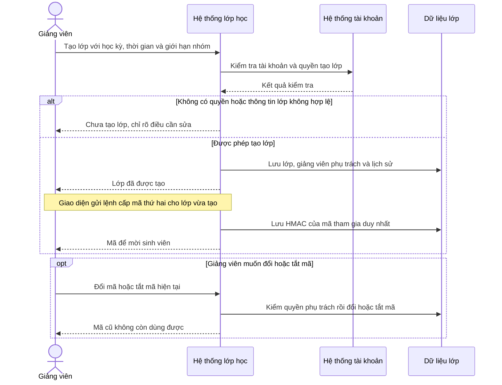
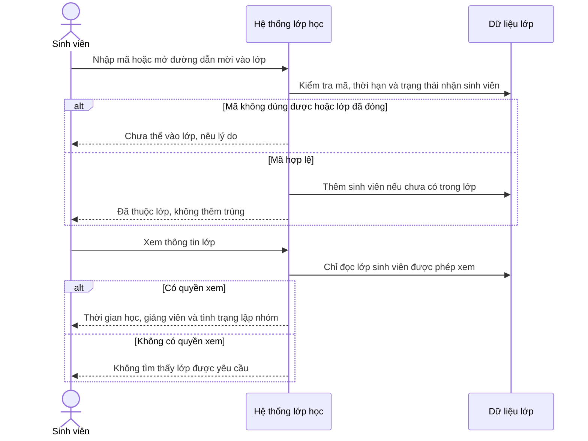
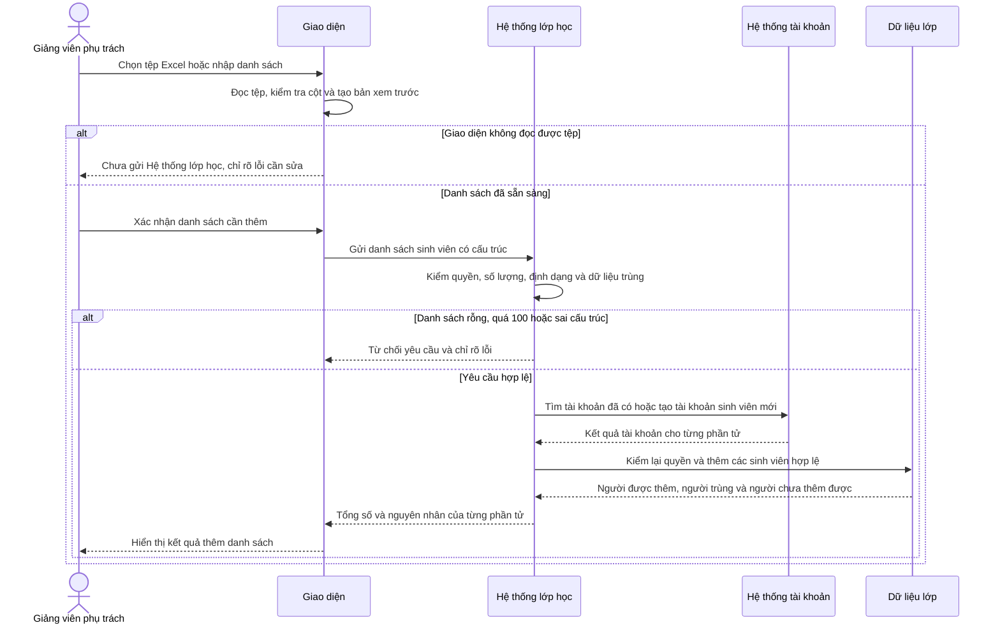
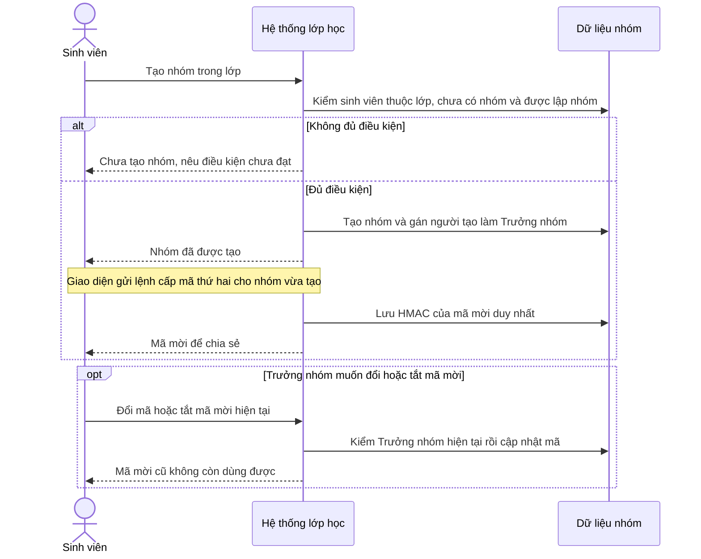
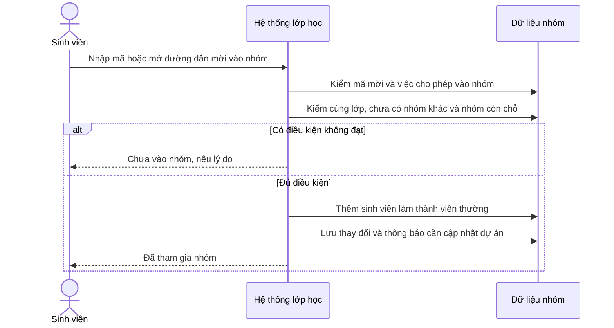
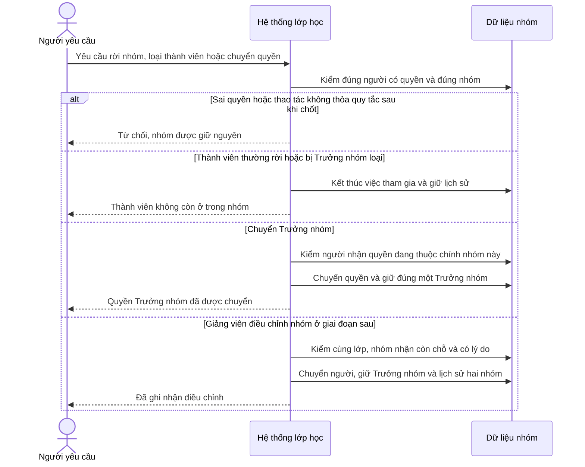
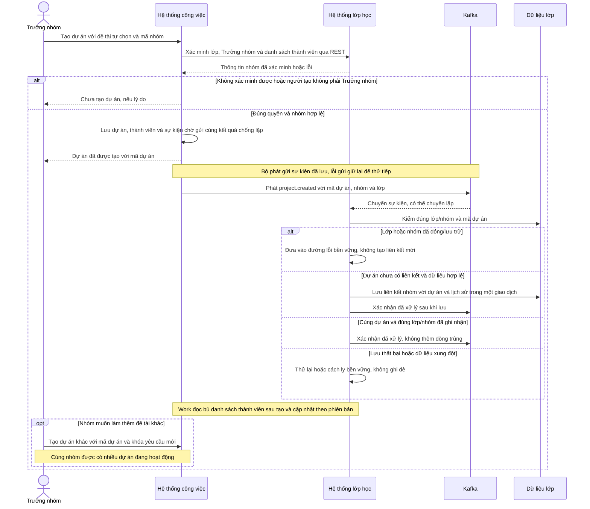
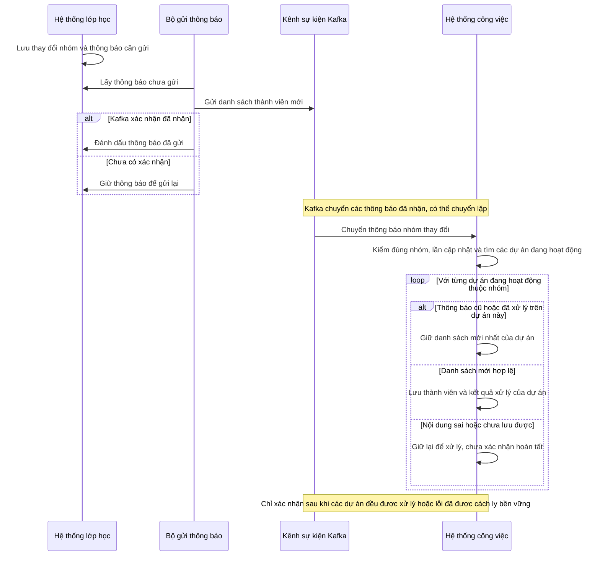
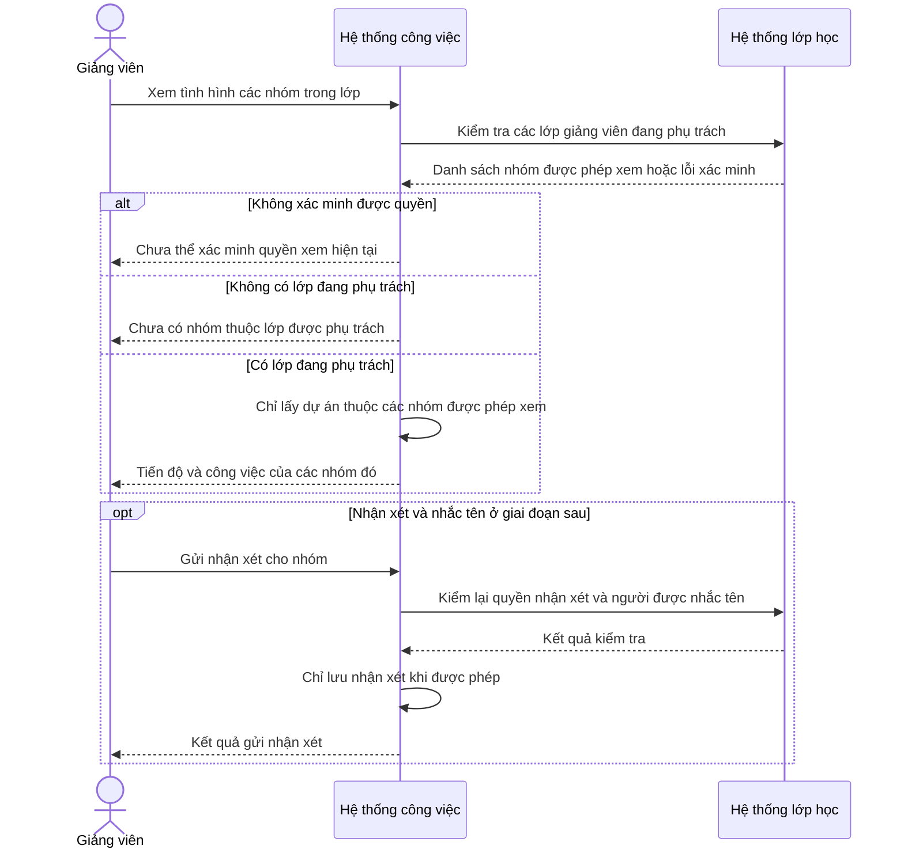

# Classroom Service — Một yêu cầu được xử lý như thế nào?

**Trạng thái: Thiết kế mục tiêu.** Các luồng dưới đây mô tả hệ thống cần xây,
chưa khẳng định các API đã được triển khai.

Đọc mỗi sơ đồ **từ trên xuống**. Mỗi cột là một người hoặc một phần của hệ
thống; mỗi mũi tên là một yêu cầu hoặc câu trả lời. Khung “Nếu…” cho biết hệ
thống làm gì khi đủ điều kiện và khi bị từ chối.

Tên gọi trong sơ đồ: **Hệ thống lớp học** là Classroom Service; **Hệ thống tài
khoản** là Identity Service; **Hệ thống công việc** là Work Service. “Dữ liệu
lớp” là nơi Classroom lưu lớp và nhóm. Chỉ Classroom đọc/ghi dữ liệu đó.

## 1. Chọn luồng cần đọc

| Mã | Câu hỏi được giải thích | Trường hợp sử dụng |
| --- | --- | --- |
| SQ-CL-01 | Giảng viên tạo lớp và nhận mã vào lớp ra sao? | UC-CL-01/02 |
| SQ-CL-02 | Sinh viên vào lớp và xem thông tin lớp thế nào? | UC-CL-03/15 |
| SQ-CL-03 | Thêm danh sách sinh viên, gặp phần tử sai thì sao? | UC-CL-04 |
| SQ-CL-04 | Ai trở thành Trưởng nhóm khi tạo nhóm? | UC-CL-05/07 |
| SQ-CL-05 | Muốn vào nhóm phải thỏa điều kiện gì? | UC-CL-06 |
| SQ-CL-06 | Rời nhóm, loại người và chuyển Trưởng nhóm khác nhau thế nào? | UC-CL-08–11 |
| SQ-CL-07 | Nhóm tự chọn đề tài và liên kết nhiều dự án ra sao? | UC-CL-12/14 |
| SQ-CL-08 | Nhóm đổi thành viên thì các dự án được cập nhật thế nào? | Kết quả sau thay đổi nhóm |
| SQ-CL-09 | Vì sao giảng viên chỉ thấy dự án của lớp mình? | UC-CL-13/16 |

## 2. Các sơ đồ trình tự

### SQ-CL-01 — Giảng viên tạo lớp và nhận mã vào lớp

> Giảng viên nhập thông tin lớp. Hệ thống kiểm quyền, lưu lớp và cấp mã để chia sẻ cho sinh viên.
> Nếu cấp mã gặp lỗi, lớp đã tạo vẫn được giữ lại; chỉ cần cấp lại mã.

**Kết quả:** Giảng viên có lớp và mã tham gia. Sinh viên chưa được tự động
thêm vào lớp chỉ vì lớp vừa được tạo.

Chi tiết triển khai và xử lý lỗi

Tạo lớp và cấp mã là hai lệnh do giao diện thực hiện nối tiếp. Mã ngẫu nhiên
chỉ trả một lần; cơ sở dữ liệu giữ HMAC-SHA-256 duy nhất khi khác rỗng và thời
hạn. Lỗi cấp mã thử lại trên mã lớp đã
tạo. Gửi lại lệnh tạo không tự tạo lớp khác hay đổi mã đang dùng. Bản ghi chống lặp không
lưu mã thô. Đổi/vô hiệu mã kiểm lại quyền Giảng viên trong giao dịch.

Kiểm môn học, ngày bắt đầu ≤ kết thúc và `0 < min <= max`. Sửa lớp kiểm phiên
bản mong đợi, không giảm mức tối đa xuống dưới số thành viên hiện có. Quản trị
viên hệ thống được tạo lớp nhưng phải chỉ định một tài khoản Giảng viên đang
hoạt động làm người phụ trách chính; Quản trị viên không tự có quyền dạy học
hoặc xem nội dung dự án.

### SQ-CL-02 — Sinh viên vào lớp và xem thông tin lớp

> Sinh viên nhập mã lớp. Mã phải đúng, còn hạn và lớp vẫn nhận sinh viên.
> Vào lớp thành công chỉ cho xem lớp và lập nhóm sau đó, chưa tự vào nhóm nào.

**Kết quả:** Sinh viên có thể xem thông tin lớp dù chưa có nhóm. Nhóm tự chọn
đề tài và tạo dự án sau đó, không chọn từ đề bài của giảng viên.

Chi tiết triển khai và xử lý lỗi

Xác thực phiên trước khi xử lý. Phía máy chủ tính HMAC-SHA-256 của mã đã chuẩn
hóa để tìm đúng một lớp; mã đang dùng có ràng buộc duy nhất. Khóa lớp và tra kết quả chống lặp theo người
gửi, phương thức, đường dẫn và khóa yêu cầu. Cùng nội dung đã hoàn tất và còn
quyền đọc thì trả kết quả cũ; khác nội dung trả 422. Ghi danh đang học không
tạo trùng. Trong P0, người đã rời hoặc bị loại bị từ chối khi dùng mã; khôi
phục ghi danh là lệnh
quản trị riêng ở giai đoạn sau, không tái kích hoạt ngầm.

Đọc là yêu cầu riêng, lọc theo ghi danh đang học hoặc phân công Giảng viên
hiện hành trước khi tìm lớp; không tồn tại và ngoài quyền cùng trả 404.
GET không ghi lịch sử hoặc sự kiện. Danh sách có phân trang; lịch sử quản trị
chỉ cho Giảng viên đúng lớp. Lấy hồ sơ tài khoản theo lô chỉ bổ sung tên/ảnh,
không cấp quyền; lỗi hồ sơ hiển thị không làm mất quyền đọc đã xác minh.

### SQ-CL-03 — Giảng viên thêm danh sách sinh viên

> Giao diện đọc Excel, phân tích và cho Giảng viên xem trước danh sách.
> Phía máy chủ chỉ nhận tối đa 100 sinh viên mỗi lần và trả nguyên nhân cho từng phần tử lỗi.

**Kết quả:** Phần tử sai không làm mất các phần tử đúng. Tạo tài khoản thành công
không đồng nghĩa đã thêm vào lớp thành công; hai kết quả phải được ghi rõ.

Chi tiết triển khai và xử lý lỗi

Đọc Excel, kiểm tra cột và dựng bản xem trước thuộc giao diện. Phía máy chủ Classroom
không nhận nội dung nhị phân hoặc thông tin mô tả của tệp. Danh sách rỗng, hơn 100 phần tử hoặc
sai cấu trúc bị từ chối cả yêu cầu; sai email/mã sinh viên của một phần tử được
trả riêng. Identity tìm theo email hoặc mã sinh viên; mã sinh viên chưa tồn tại
mà thiếu email không đủ tạo tài khoản.
Tài khoản Giảng viên/Quản trị viên, tài khoản bị khóa và xung đột danh tính không được
tự chuyển vai trò. Tài khoản mới chờ kích hoạt vẫn được ghi danh nhưng chưa
đăng nhập hoặc tham gia nhóm được. Identity lo hướng dẫn kích hoạt; không tuyên bố email
đã giao chỉ từ kết quả tạo tài khoản.

Trước khi gọi Identity, lưu bản ghi yêu cầu ở trạng thái đã chuẩn bị, mã băm
nội dung và `upstream_key` ổn định theo người gửi/lớp/khóa. Gọi Identity ngoài
giao dịch đang giữ khóa, có xác thực người dùng và dịch vụ. Khi trả về, khóa
lớp rồi bản ghi yêu cầu và kiểm lại quyền/trạng thái. Nếu yêu cầu đồng thời
đã hoàn tất thì trả kết quả đã lưu. Mỗi phần tử được ghi danh trong một điểm
khôi phục giao dịch riêng; đã học thì báo trùng, đã rời/bị loại không tự khôi
phục. Lỗi cơ sở dữ liệu hủy giao dịch cuối, không gán lỗi nghiệp vụ giả cho
một phần tử.

Ghi danh, lịch sử, sự kiện đã có hợp đồng và kết quả hoàn tất lưu cùng giao
dịch. Hết thời gian chờ thì giữ trạng thái đã chuẩn bị; gửi lại cùng khóa/nội
dung để tiếp tục. Không xóa bù tài khoản Identity. Sửa phần tử lỗi dùng khóa
mới. P0 không cần bảng nhập danh sách, công việc nền, trình đọc Excel phía máy
chủ hoặc nơi lưu tệp gốc. Thống nhất thời hạn lưu bản ghi yêu cầu trước vận hành.

### SQ-CL-04 — Sinh viên tạo nhóm và nhận mã mời

> Sinh viên đã vào lớp và chưa có nhóm được lập nhóm khi lớp đang cho phép.
> Người tạo làm Trưởng nhóm và nhận mã mời để chia sẻ với bạn cùng lớp.

**Kết quả:** Nhóm có đúng một Trưởng nhóm. Các bạn khác phải dùng mã mời để vào.

Chi tiết triển khai và xử lý lỗi

Khóa lớp, ghi danh và bản ghi yêu cầu. Chỉ tạo khi lớp mở lập nhóm, người tạo
đang học và chưa thuộc nhóm hoạt động khác trong lớp. Tạo nhóm, gán Trưởng
nhóm, đặt `source_version=1`, lưu lịch sử, sự kiện chứa đầy đủ danh sách thành
viên và kết quả chống lặp cùng giao dịch. Giao diện gửi lệnh cấp mã sau tạo;
nếu lỗi chỉ cấp lại trên nhóm đã tạo. HMAC/thời hạn ở nhóm; mã và đường dẫn mời dùng
chung giá trị, không có bảng lời mời riêng. Đổi/tắt mã kiểm Trưởng nhóm hiện hành.

Mã mời là chuỗi ngẫu nhiên; cơ sở dữ liệu chỉ giữ HMAC-SHA-256 duy nhất khi
khác rỗng. Nhóm mới được tạm dưới mức tối thiểu trong giai đoạn hình thành;
mức tối đa luôn được giữ. Giảng viên phụ trách chủ động chốt giai đoạn lập
nhóm; hệ thống không tự chốt theo thời gian.

### SQ-CL-05 — Sinh viên dùng mã mời để vào nhóm

> Muốn vào nhóm, sinh viên phải cùng lớp, chưa thuộc nhóm khác và nhóm còn chỗ.
> Mã mời phải còn hiệu lực; lớp vẫn phải cho phép tham gia nhóm.

**Kết quả:** Sinh viên trở thành Thành viên, không tự trở thành Trưởng nhóm.

Chi tiết triển khai và xử lý lỗi

Kiểm phiên, tính HMAC-SHA-256 của mã đã chuẩn hóa để tìm đúng một nhóm rồi
khóa lớp → nhóm → ghi danh → bản ghi yêu cầu. Sau chống lặp, kiểm
lớp cho lập nhóm, nhóm đang hoạt động, mã mời hiện hành còn hạn, người tham gia
đang học cùng lớp, chưa có nhóm khác và số người dưới mức tối đa. Đếm sau khóa
để hai yêu cầu tranh chỗ cuối không cùng vượt giới hạn.

Tạo một lần tham gia mới với vai trò Thành viên, không tái kích hoạt dòng
lịch sử. Tăng `source_version`, lưu lịch sử, sự kiện chờ gửi và kết quả yêu
cầu cùng giao dịch. HTTP xác nhận Classroom đã lưu; Work cập nhật sau qua SQ-CL-08.

### SQ-CL-06 — Rời nhóm, loại thành viên và chuyển Trưởng nhóm

> Thành viên chỉ rời nhóm của mình. Trưởng nhóm có thể loại thành viên thường hoặc chuyển quyền.
> Không thao tác nào được làm nhóm mất Trưởng nhóm; mọi thay đổi phải giữ lịch sử.

**Kết quả:** Trưởng nhóm muốn rời nhóm phải chuyển quyền trước. Giảng viên
đúng lớp được chuyển Trưởng nhóm; phân/chuyển người giữa nhóm là phần P1.

Chi tiết triển khai và xử lý lỗi

Xác thực, khóa lớp, các nhóm theo mã, ghi danh/thành viên và bản ghi yêu cầu.
Yêu cầu đã hoàn tất chỉ trả lại khi còn quyền đọc; không kiểm phiên bản như
một lệnh mới. Khóa cũ/nội dung mới trả 422. Lệnh mới kiểm quyền thực hiện,
phiên bản mong đợi và chính sách giai đoạn.

Rời chỉ tác động chính mình; chỉ Trưởng nhóm được loại thành viên thường.
Không kết thúc Trưởng nhóm cuối. Chuyển quyền yêu cầu người nhận đang ở cùng
nhóm; hạ người cũ trước khi nâng người mới trong cùng giao dịch. Người nhận
đã là Trưởng nhóm thì không đổi. Chuyển nhóm ở P1 cần lý do, giới hạn nhóm nhận
và người kế nhiệm nếu chuyển Trưởng nhóm đi. Kết thúc lần tham gia cũ rồi tạo
lần mới, giữ lịch sử. Kiểm đúng một Trưởng nhóm mỗi nhóm trước khi lưu; phiên
bản, lịch sử, danh sách đầy đủ từng nhóm và kết quả chống lặp cùng giao dịch.
Lỗi hủy toàn bộ thay đổi không trả thành công. Sau khi Giảng viên chốt nhóm,
Trưởng nhóm vẫn được loại thành viên thường của nhóm mình; Giảng viên phụ
trách được phân, chuyển hoặc loại sinh viên trong đúng lớp. Các thao tác này
không được làm nhóm mất Trưởng nhóm hoặc vượt giới hạn tối đa và phải có lý
do, lịch sử. Điều chỉnh của Giảng viên vẫn thuộc P1.

### SQ-CL-07 — Nhóm tự chọn đề tài và tạo dự án

> Nhóm tự chọn đề tài; Trưởng nhóm nhập thông tin và tạo dự án ở Work. Một nhóm có nhiều dự án hoạt động đồng thời.
> Work trả kết quả tạo dự án trước; sự kiện qua Kafka giúp Classroom ghi liên kết sau, nhận lặp không tạo trùng.

**Kết quả:** Dự án thuộc nhóm đã xác minh và lưu ở Work. Classroom ghi liên kết
qua sự kiện nên có thể chậm hơn; lỗi liên kết không phủ nhận việc Work đã tạo
dự án và không được làm tạo lại dự án đó.

Chi tiết triển khai và xử lý lỗi

API xác minh kiểm danh tính dịch vụ gọi và phiên người dùng. Classroom đọc
nhóm và thành viên nhất quán: đúng lớp/nhóm, mỗi mã tài khoản một trạng thái,
đúng một Trưởng nhóm đang hoạt động. Work kiểm lại người tạo trong danh sách
đó; lấy mã lớp từ kết quả xác minh. Gửi lại cùng khóa/nội dung trả kết quả đã
lưu; dự án khác được tạo với mã và khóa mới dù cùng nhóm.

`project.created` được lưu trong Outbox, tức bảng sự kiện chờ gửi, cùng giao
dịch tạo dự án. Work không gọi REST ngược để ghi liên kết. Classroom kiểm
nguồn và hợp đồng sự kiện trước khi ghi `GROUP_PROJECT_LINKS`; khóa duy nhất
`project_id` bảo vệ cả khi hai sự kiện đến đồng thời. Nhận cùng bộ lớp/nhóm/dự
án không ghi lịch sử trùng; cùng dự án nhưng lớp/nhóm khác phải cách ly, không
ghi đè. Chỉ xác nhận đã xử lý sau khi lưu hoặc cách ly bền vững. Lỗi lưu đang
chờ thử lại không được xác nhận đã hoàn tất.

Work cần đọc bù danh sách thành viên sau tạo, độc lập với bước Classroom ghi
liên kết, để khôi phục thay đổi nhóm có thể đã đến trước khi Project tồn tại.
Phiên bản ngăn dữ liệu cũ ghi đè mới. Không giữ khóa Classroom trong lúc Work
lưu. Nếu lớp hoặc nhóm đóng trong khoảng sau xác minh và trước khi sự kiện
được áp dụng, Classroom không ghi liên kết mới và đưa sự kiện vào đường lỗi
bền vững; không tự mở lại đối tượng. Không có giao dịch chung giữa hai dịch vụ.

**Đã triển khai backend:** nhận sự kiện Classroom, đọc bù sau tạo và nhiều dự
án hoạt động cùng nhóm. Chi tiết tại [ghi chú Work](../../work-service/classroom-project-linking.md).
Sơ đồ giữ vai trò thiết kế; kết quả chạy thật nằm tại
nghiệm thu backend (bản local `backend-validation.md`).

### SQ-CL-08 — Nhóm đổi thành viên, các dự án được cập nhật

> Hệ thống lớp học lưu thay đổi trước rồi gửi danh sách mới qua Kafka.
> Hệ thống công việc cập nhật tất cả dự án của nhóm; thông báo cũ hoặc bị gửi trùng không được làm sai danh sách.

**Kết quả:** Thay đổi đã lưu được gửi lại khi cần. Xác nhận đã gửi thông báo
khác với xác nhận tất cả dự án liên quan đã cập nhật thành công.

Chi tiết triển khai và xử lý lỗi

Đây là sự kiện nghiệp vụ qua Kafka. Thay đổi nhóm, `source_version`, lịch sử
và Outbox được lưu cùng giao dịch. Bộ phát gửi theo `class_sequence`, dùng mã
lớp làm khóa phân vùng và giữ `event_id` ổn định. Chỉ ghi `published_at` khi
Kafka xác nhận đã nhận; hết thời gian chờ không chứng minh sự kiện chưa đến.
Không gửi vượt sự kiện đầu cùng lớp đang chờ thử lại.

Work kiểm nguồn, lớp/nhóm và phiên bản; danh sách chứa một trạng thái hiện tại
cho mỗi tài khoản. Dữ liệu cũ không ghi đè dữ liệu mới; cùng mã hoặc cùng phiên
bản nhưng nội dung khác là xung đột. Work tìm dự án bằng mã nhóm tại dữ liệu
của mình, không chờ Classroom gửi lại danh sách mã dự án.

Mỗi dự án lưu thay đổi thành viên, lịch sử, sự kiện đầu ra và kết quả chống
lặp trong cùng giao dịch của dự án đó. Chống lặp/phiên bản được kiểm theo từng
dự án, không đánh dấu cả sự kiện đã xong sau khi chỉ cập nhật dự án đầu tiên.
Khi một dự án lỗi, lần nhận lại bỏ qua dự án đã xử lý rồi tiếp tục phần còn
thiếu. Chỉ xác nhận vị trí đọc Kafka sau khi tất cả dự án cần cập nhật đã lưu
hoặc lỗi đã được cách ly bền vững. Nơi cách ly, thời hạn lưu và cách xử lý lại
phải được chốt trong hợp đồng.

Giữ giờ khả dụng, phân công và lịch sử đóng góp ở Work. Không đồng bộ thành
viên vào dự án đã lưu trữ hoặc đã xóa và không tự mở lại dự án. Nhóm chưa có dự án
không làm tạo dự án tự động; SQ-CL-07 đọc bù thành viên sau mỗi lần tạo để
không mất thay đổi đến sớm. Work đã có consumer áp dụng từng dự án; kết quả
kiểm thử và giao nhận Kafka thật được ghi riêng tại trang nghiệm thu backend.

### SQ-CL-09 — Giảng viên xem dự án của lớp mình

> Giảng viên chỉ được xem dự án của các nhóm thuộc lớp mình đang phụ trách.
> Quyền nhận xét không cho phép giảng viên thay đổi công việc hoặc phân công của sinh viên.

**Kết quả:** Giảng viên không cần vào nhóm hay trở thành thành viên dự án để
xem/nhận xét dự án của lớp mình phụ trách.

Chi tiết triển khai và xử lý lỗi

Kiểm xác thực dịch vụ và phiên người dùng. Đọc phân công Giảng viên và nhóm
nhất quán; không có phân công trả rỗng, lỗi xác minh không được đổi thành có
quyền. Work vẫn đọc theo thành viên dự án khi phù hợp; lỗi Classroom không
xóa quyền đó. Vai trò Giảng viên toàn cục không cấp quyền đọc mọi lớp.

Danh sách nhóm được phép xem thuộc P0. Nhận xét/nhắc tên thuộc P1, cần xác
minh người thực hiện, dự án, nhóm, phiên bản, thời hạn và người được nhắc tên
qua bộ nối tin cậy. Work khóa dự án, kiểm dữ liệu trước khi lưu nhận xét, lịch
sử và Outbox cùng giao dịch. Không tin bằng chứng tự gửi từ trình duyệt hoặc
tạo dịch vụ ký mã riêng. Giảng viên không được đổi công việc, đóng Sprint hay
sửa phân công. Bảng theo dõi và chỉ số công việc do Work tính bằng quy tắc.

## 3. Quy tắc kỹ thuật chung dành cho người triển khai

- Mọi yêu cầu đều xác thực phiên; vai trò toàn cục đọc từ Identity qua API
  công bố, quyền lớp từ phân công Giảng viên hiện hành. Mã nguồn đối chiếu ở dưới.
- Thứ tự khóa: lớp → nhóm theo mã → ghi danh/thành viên → kết quả chống lặp.
  Tạo lớp chưa có dòng dữ liệu thì khóa yêu cầu trước khi tạo.
- Trả kết quả cũ chỉ khi còn quyền đọc; lệnh mới mới kiểm quyền ghi/phiên bản.
  Cùng khóa nhưng khác nội dung trả 422. Trưởng nhóm vừa chuyển quyền có thể đọc
  kết quả trong nhóm còn tham gia nhưng không được gửi lệnh quản lý mới.
- Hủy giao dịch do lỗi không trả thành công. Thay đổi nghiệp vụ, lịch sử, sự
  kiện đã có hợp đồng và kết quả chống lặp lưu cùng giao dịch. GET không có tác
  dụng phụ. Gọi HTTP/gửi Kafka ở ngoài giao dịch giữ khóa; sau HTTP kiểm lại quyền.
- OpenAPI nội bộ và schema sự kiện là sản phẩm của giai đoạn triển khai phần
  tích hợp: tạo từ serializer/URL và cấu trúc sự kiện thật, kiểm thử rồi khóa
  phiên bản. Không tạo hợp đồng giả trước khi có phần triển khai tương ứng.

Nguồn đối chiếu:
[Identity provisioning](../../../apps/identity-service/accounts/services/provisioning.py),
[GroupSnapshot](../../../apps/work-service/infrastructure/classroom.py),
[tạo dự án](../../../apps/work-service/apps/projects/services/projects.py),
[đồng bộ thành viên](../../../apps/work-service/apps/projects/services/membership.py),
[quyền đọc](../../../apps/work-service/apps/projects/queries/projects.py),
[quyền nhận xét](../../../apps/work-service/infrastructure/collaboration_scope.py).
Khi triển khai cần kiểm thử quyền, lỗi từng phần tử, chống lặp, tranh chỗ cuối,
chuyển Trưởng nhóm, mất liên kết và sự kiện đến trước khi có dự án. Hiển thị
đúng không chứng minh luồng nghiệp vụ đã chạy.
