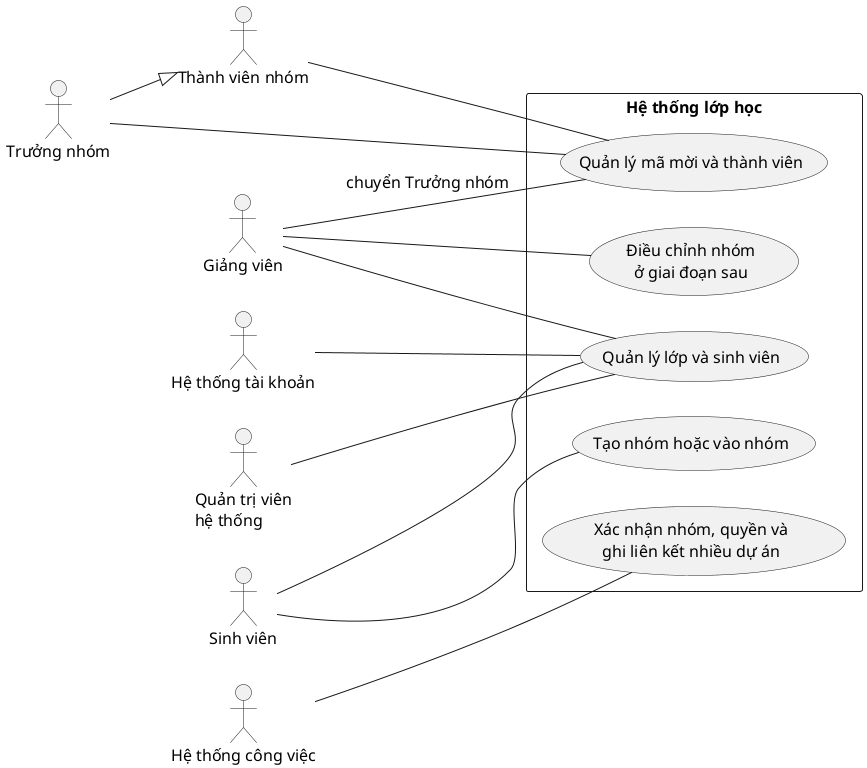
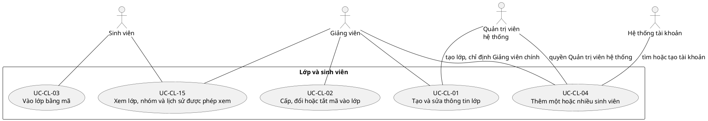
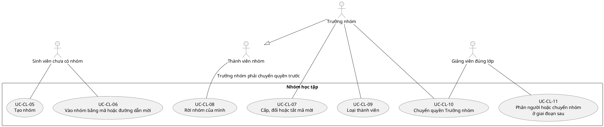
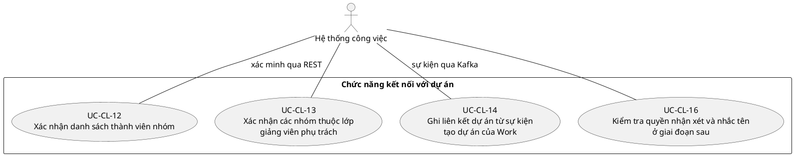

# Classroom Service — Tác nhân và trường hợp sử dụng

**Trạng thái: Thiết kế mục tiêu.** Nội dung theo phạm vi MVP đã rút gọn,
không xác nhận Classroom API đã chạy.

Nguồn: yêu cầu nghiệp vụ (đầu vào local `UTask - Phân tích thiết kế yêu cầu.md`)
mục 1–4, US-4.4/4.5 và mục 8; [BFD](bfd.md), [ERD 10 bảng](erd.md),
[ranh giới dữ liệu](../../system/data-ownership.md).

## 1. Tác nhân và điều kiện áp dụng

Ví dụ: An chưa có nhóm nên được tạo nhóm hoặc dùng mã mời để vào nhóm. Khi
An tạo Nhóm A, An trở thành Trưởng nhóm: được mời bạn, loại thành viên và
chuyển quyền trong Nhóm A. An không có quyền quản lý Nhóm B. Đường nối trong
sơ đồ cho biết ai được làm việc nào; mũi tên tam giác nghĩa là Trưởng nhóm
cũng là một thành viên.

Trong phần hình, “Hệ thống tài khoản” là Identity Service, “Hệ thống công
việc” là Work Service. Mã UC chỉ giúp tra cứu; không cần nhớ mã để hiểu chức năng.

| Tác nhân | Phạm vi |
| --- | --- |
| Sinh viên | Tham gia và xem lớp; khi có ghi danh hoạt động mới được tạo/tham gia nhóm |
| Thành viên nhóm | Sinh viên đang thuộc nhóm; có thể rời chính nhóm mình theo chính sách |
| Trưởng nhóm | Là Thành viên nhóm; thêm quyền quản lý mã mời, loại thành viên và chuyển quyền trong đúng nhóm |
| Giảng viên | Có quyền tạo lớp; chỉ quản lý/xem lớp đang được phân công và theo dõi dự án của các nhóm trong lớp |
| Quản trị viên hệ thống | Được tạo lớp và thêm sinh viên; không tự trở thành Giảng viên và không mặc định đọc nội dung dự án |
| Identity Service | Hỗ trợ xác minh tài khoản/phiên và tìm hoặc tạo tài khoản; không tạo ghi danh |
| Work Service | Gọi REST để xác minh nhóm/quyền; phát sự kiện tạo dự án để Classroom ghi liên kết |

Trong sơ đồ, đường liền thể hiện tham gia một trường hợp sử dụng, không biểu
diễn thứ tự xử lý. Kế thừa tác nhân chỉ dùng giữa Trưởng nhóm và Thành viên
nhóm: quyền tạo/tham gia nhóm vẫn có điều kiện **chưa có nhóm**, không được kế
thừa thành quyền tạo nhóm thứ hai. Không vẽ cơ sở dữ liệu, Kafka hoặc tiến
trình nội bộ thành người dùng. UC-CL-14 được kích hoạt bởi sự kiện từ Work,
không là nút để sinh viên tự khai mã dự án; thứ tự nằm ở SQ-CL-07/08.

## 2. Tổng quan mục tiêu

> Giảng viên quản lý lớp; sinh viên vào lớp rồi lập nhóm; Trưởng nhóm quản lý nhóm của mình.
> Hệ thống tài khoản và hệ thống công việc hỗ trợ các chức năng liên quan.

Các mục tiêu tổng quan được phân rã dưới đây. Mã UC chỉ có một nghĩa trong
toàn bộ tài liệu; bảng mục 4 nối chúng với chức năng và luồng xử lý.

## 3. Các trường hợp sử dụng chi tiết

### 3.1. Quản lý lớp và sinh viên

> Giảng viên tạo lớp và mã vào lớp. Sinh viên vào lớp rồi tự lập nhóm, chọn đề tài.
> Giảng viên cũng có thể thêm sinh viên từng người hoặc gửi một danh sách đã
> được giao diện đọc và chuẩn hóa từ tệp Excel.

### 3.2. Nhóm, thành viên và Trưởng nhóm

> Sinh viên chưa có nhóm được tạo nhóm hoặc dùng mã mời để vào nhóm.
> Chỉ Trưởng nhóm được quản lý mã mời và loại thành viên; muốn rời nhóm phải chuyển quyền trước.

### 3.3. Xác nhận nhóm và ghi liên kết dự án

> Nhóm tự chọn đề tài; hệ thống công việc xác minh Trưởng nhóm và thành viên trước khi tạo dự án.
> Sau khi tạo thành công, sự kiện qua Kafka giúp ghi liên kết; một nhóm có nhiều dự án.
> Giảng viên chỉ được xem hoặc nhận xét dự án thuộc lớp mình phụ trách.

## 4. Truy vết yêu cầu → chức năng → trường hợp sử dụng → luồng

| Căn cứ | Chức năng BFD | Trường hợp sử dụng | Sequence hoặc đặc tả áp dụng |
| --- | --- | --- | --- |
| Baseline 4.3, US-1.2 | 1.1–1.4 | UC-CL-01 | SQ-CL-01; sửa cấu hình dùng giao dịch chung tại mục 3 của Sequence |
| US-1.2 | 1.5 | UC-CL-02 | SQ-CL-01, nhánh cấp/đổi/vô hiệu mã |
| US-1.3 | 2.1 | UC-CL-03 | SQ-CL-02 |
| US-1.4 | 2.2–2.4 | UC-CL-04 | SQ-CL-03 |
| US-2.1 | 3.1 | UC-CL-05 | SQ-CL-04 |
| US-2.2 | 3.2 | UC-CL-06 | SQ-CL-05 |
| US-2.3 | 3.3 | UC-CL-07 | SQ-CL-04, nhánh mã mời |
| Vòng đời vai trò mục 1.2, US-2.3 | 3.4 | UC-CL-08, UC-CL-09 | SQ-CL-06, rời/loại thành viên |
| US-2.3 và mục 1.2 | 3.5 | UC-CL-10 | SQ-CL-06, chuyển Trưởng nhóm |
| US-2.5, ưu tiên mục 8.2 | 3.6 | UC-CL-11 | SQ-CL-06, nhánh điều chỉnh P1 |
| US-2.4 | 4.1, 4.3 | UC-CL-12, UC-CL-14 | SQ-CL-07 |
| US-2.3/2.4, baseline 10 | 4.4 | Hậu điều kiện UC-CL-05/06/08/09/10/11 | SQ-CL-08, không phải thao tác tay của người dùng |
| US-4.4 | 4.2 | UC-CL-13 | SQ-CL-09, dashboard |
| US-4.5, nhắc tên US-4.1 | 4.2 | UC-CL-16 | SQ-CL-09, phản hồi/nhắc tên P1; quyền dự án vẫn kiểm tại Work |
| US-1.3, US-2.5 và kiểm toán mục 2.3 | 5.1–5.3 | UC-CL-15 | SQ-CL-02, nhánh đọc; danh sách/lịch sử áp dụng cùng bộ lọc quyền |

## 5. Điều kiện và kết quả nghiệp vụ

### UC-CL-01/02 — Lớp và mã tham gia

Người tạo là Giảng viên hoặc Quản trị viên hệ thống. Lớp lưu
môn học, tên, học kỳ, ngày bắt đầu/kết thúc và giới hạn nhóm;
`starts_on <= ends_on` và `0 < group_min_size <= group_max_size`. Giảng viên
tạo lớp trở thành người phụ trách chính. Khi Quản trị viên tạo thay, yêu cầu
phải chỉ định một tài khoản Giảng viên đang hoạt động làm người phụ trách
chính; không gán Quản trị viên thành Giảng viên và không cấp quyền xem dự án.

Trải nghiệm tạo lớp tự cấp mã tham gia khi bước tạo mới thành công. Hai lệnh
tạo/cấp mã được tách để chỉ lưu mã băm; nếu cấp mã thất bại, báo lớp đã tạo và
cho cấp lại mã trên lớp đó. Đổi mã làm mã cũ mất hiệu lực; vô hiệu đặt mã băm
về rỗng. Mã thô không được lưu trong nhật ký hoặc bản ghi kết quả chống lặp.

Sửa lớp, phân công Giảng viên hoặc đóng/mở lập nhóm phải kiểm quyền trên chính
lớp đó. Giảng viên đang phụ trách là người chốt giai đoạn lập nhóm; hệ thống
không tự chốt theo thời gian. Không giảm số thành viên tối đa xuống dưới số
đang hoạt động trong nhóm và không tự loại sinh viên để đạt cấu hình mới.
Quản trị viên có thể quản trị lớp nhưng không nhờ vai trò đó mà có quyền dạy
học hoặc đọc nội dung dự án.

### UC-CL-03/15 — Tham gia và đọc dữ liệu

Sinh viên có phiên hợp lệ, lớp đang mở, mã hoặc liên kết hiện hành đúng và còn
hạn. Ghi danh đã hoạt động không tạo bản sao; `LEFT`/`REMOVED` không tự khôi
phục trong P0 khi chưa có chính sách tham gia lại. Tham gia lớp không cấp vai
trò nhóm hoặc dự án.

Đọc lớp cần ghi danh đang hoạt động hoặc phân công Giảng viên hiện hành,
không phụ thuộc có nhóm. Giảng viên xem danh sách sinh viên/nhóm và lịch sử
đúng lớp; Sinh viên không mặc định được xem lịch sử quản trị hoặc danh sách lớp khác.
Đọc/lọc/phân trang không tạo nhật ký hay sự kiện. Hồ sơ Identity chỉ bổ sung
tên/ảnh, không cấp quyền.

### UC-CL-04 — Thêm một hoặc nhiều sinh viên

Giảng viên phụ trách hoặc Quản trị viên hệ thống gửi một sinh viên hoặc
một danh sách JSON tối đa 100 phần tử. Giao diện chịu trách nhiệm đọc Excel,
kiểm tra cột và hiển thị bản xem trước; phía máy chủ Classroom không nhận tệp,
không lưu tệp và không có thư viện đọc Excel.

Phía máy chủ vẫn kiểm lại số lượng, trường bắt buộc, email, mã sinh viên và phần tử
trùng trong danh sách. Lỗi cấu trúc toàn bộ yêu cầu bị từ chối; lỗi của từng
phần tử được trả riêng để các phần tử hợp lệ khác vẫn được xử lý.

Identity tìm theo email hoặc mã sinh viên. Chỉ có mã sinh viên chưa tồn tại
thì không đủ tạo tài khoản mới; cần email. Xung đột danh tính, tài khoản bị
khóa hoặc có vai trò Giảng viên/Quản trị viên không được tự đổi vai trò. Tài
khoản mới chờ kích hoạt; Identity tạo hướng dẫn kích hoạt, Classroom tạo ghi
danh và không tự thêm vào nhóm. Chưa xác nhận email đã được gửi thành công
chỉ từ kết quả tạo tài khoản.

Kết quả tách **tài khoản mới**, **tài khoản cũ được thêm**, **ghi danh trùng**,
**phần tử cần kiểm tra/thất bại** và nguyên nhân từng phần tử. Có thể tài khoản đã
được tạo nhưng ghi danh thất bại; không gộp hai bước thành thành công toàn bộ.
Gửi lại cùng khóa/nội dung phục hồi kết quả cũ, không tự xử lý lại các phần tử lỗi;
sửa nội dung dùng khóa mới. Ghi danh `LEFT`/`REMOVED` cần xử lý riêng theo chính sách.

### UC-CL-05/06/07 — Tạo, tham gia và mã mời nhóm

Sinh viên phải đang ghi danh, lớp mở lập nhóm, nhóm đang hoạt động và chưa có
nhóm khác cùng lớp. Tạo nhóm gán người tạo làm Trưởng nhóm; trải nghiệm tạo tự
cấp mã mời, lỗi cấp mã chỉ thử lại trên nhóm đã tạo. Nhóm ban đầu được dưới
mức tối thiểu trong giai đoạn hình thành; mức tối đa luôn được kiểm khi tham gia.

Nhập mã và mở liên kết dùng chung một mã mời hiện hành trên nhóm. Tham gia
chỉ thành công khi mã đúng/còn hạn, cùng lớp và còn chỗ; vai trò được cấp là
Thành viên. Chỉ Trưởng nhóm hiện hành được đổi/vô hiệu mã. Không tạo bảng lời
mời riêng hoặc giới hạn lượt dùng mã ở P0.

### UC-CL-08/09/10 — Rời, loại và chuyển Trưởng nhóm

Thành viên thường được rời chính nhóm mình theo chính sách; Trưởng nhóm được
loại thành viên thường, không dùng thao tác loại để xóa Trưởng nhóm cuối cùng.
Trưởng nhóm muốn rời phải chuyển quyền trước. Chuyển quyền chỉ đến một thành
viên đang hoạt động của chính nhóm; gửi cho người không thuộc nhóm bị từ chối.

Mỗi thay đổi giữ lịch sử, tăng `source_version`, tạo ảnh chụp đầy đủ và giữ đúng
một Trưởng nhóm hoạt động. Work đồng bộ sau khi lưu thành công, không xóa các đóng góp
trước đó hay tự đặt lại giờ khả dụng. P0 có chuyển quyền bởi Giảng viên đúng
lớp theo yêu cầu mục 1.2. Sau khi Giảng viên chốt nhóm, Trưởng nhóm vẫn được
loại thành viên thường của nhóm mình; Giảng viên phụ trách được phân, chuyển
hoặc loại sinh viên trong đúng lớp, nhưng mọi thao tác phải giữ một Trưởng
nhóm, giới hạn tối đa, lý do và lịch sử. Các thao tác phân/chuyển nhóm ngoại
lệ vẫn được triển khai ở P1.

### UC-CL-11 — Điều chỉnh nhóm ngoại lệ, kể cả sau khi chốt — P1

Giảng viên đang phụ trách được phân Sinh viên chưa có nhóm hoặc chuyển nhóm
cùng lớp với lý do. Kiểm nhóm nhận còn chỗ, kết thúc lần tham gia cũ trước
khi tạo lần mới. Nếu chuyển Trưởng nhóm phải chọn người kế nhiệm hợp lệ cho
nhóm đi; không tự nâng người bất kỳ. Cảnh báo mức tối thiểu và giữ giới hạn
tối đa. Giảng viên được loại sinh viên sau khi chốt nhưng không được làm nhóm
mất Trưởng nhóm. Hai nhóm đổi phiên bản và có ảnh chụp riêng trong cùng giao
dịch Classroom, lịch sử không bị xóa.

### UC-CL-12/13/14/16 — Phối hợp Work

API nội bộ xác minh dịch vụ gọi và người dùng được chuyển tiếp. UC-CL-12 cho
Work ảnh chụp nhất quán gồm lớp/nhóm/phiên bản và một trạng thái mỗi `user_id`;
tạo dự án phải xác nhận đúng lớp/nhóm và người dùng là Trưởng nhóm hoạt động.
Nhóm tự nhập đề tài và có thể tạo nhiều dự án hoạt động đồng thời. Đọc phục hồi bằng
thông tin xác thực dịch vụ riêng phải giới hạn đúng nghiệp vụ, không giả danh người dùng.

Work sở hữu tạo Dự án/Thành viên dự án. UC-CL-14 nhận sự kiện `project.created`
từ Work qua Kafka rồi ghi `GROUP_PROJECT_LINKS`. Cùng mã dự án và đúng lớp/nhóm
không tạo thêm dòng; cùng dự án nhưng lớp/nhóm khác là xung đột cần kiểm tra.
Nhiều mã dự án khác nhau được gắn cùng nhóm. Không mở thêm API ghi liên kết
để Work gọi ngược. Lỗi ghi liên kết không làm tạo lại dự án ở Work. Nếu lớp
hoặc nhóm đã đóng/lưu trữ trước khi sự kiện được áp dụng thì Classroom không
tạo liên kết mới; sự kiện đi vào đường lỗi bền vững để kiểm tra, không tự mở
lại lớp/nhóm.

**Đã triển khai backend:** Work bỏ ràng buộc một dự án hoạt động mỗi nhóm;
Classroom có bảng liên kết và bộ nhận Kafka. Xem
[ghi chú Work](../../work-service/classroom-project-linking.md) và
nghiệm thu (bản local `backend-validation.md`). Không cần mã đề bài chung.

UC-CL-13 trả đúng nhóm của các phân công Giảng viên đang hoạt động; không có
phân công trả danh sách rỗng, lỗi xác minh không được diễn giải là đã có quyền.
UC-CL-16 xác minh người thực hiện/dự án/nhóm/phiên bản/thời hạn và người được
nhắc tên ở P1. Work lưu phản hồi, tính bảng theo dõi và kiểm quyền công việc;
không cấp Giảng viên quyền đổi công việc, Sprint hoặc phân công.

## 6. Phạm vi hoãn và bằng chứng

Điểm danh/điểm số vẫn thuộc Classroom ở P2; sơ đồ MVP không mở rộng sang LMS.
Hợp đồng OpenAPI và schema sự kiện được tạo, kiểm thử và khóa phiên bản trong
giai đoạn triển khai phần tích hợp; không tạo trước một hợp đồng giả chỉ để
hoàn thiện tài liệu thiết kế. Các quyết định đã chốt về quyền Quản trị viên,
chốt nhóm và phạm vi đồng bộ nằm tại [README](README.md#6-các-quyết-định-đã-chốt-cho-kế-hoạch).

Đã đối chiếu mã nguồn [cấp tài khoản Identity](../../../apps/identity-service/accounts/services/provisioning.py),
[giới hạn 100 phần tử](../../../apps/identity-service/accounts/serializers/provisioning.py),
[GroupSnapshot](../../../apps/work-service/infrastructure/classroom.py) và
[đồng bộ Work](../../../apps/work-service/apps/projects/services/membership.py).
Các mã nguồn này không chứng minh API Classroom hoặc bộ nhận Kafka mục tiêu đã chạy.
