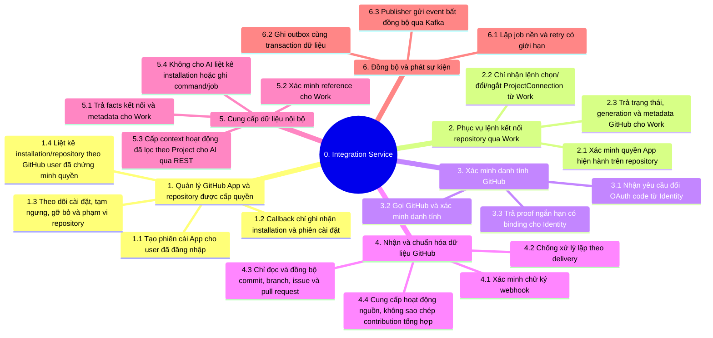

# Integration Service — BFD

**Trạng thái: Thiết kế mục tiêu.** BFD phân rã trách nhiệm nghiệp vụ cho tích
hợp GitHub; runtime Integration chưa được triển khai. Nguồn kiến trúc là
[tài liệu Integration](../../integration-service/README.md),
[luồng hệ thống](../../system/workflows.md#github) và
[giao tiếp](../../system/communication.md). Quyền từng caller theo
[phạm vi và quyền truy cập](../../integration-service/scope-access.md).

Identity sở hữu tài khoản UTask/OAuth liên kết; Integration đổi code với
GitHub và chỉ trả proof danh tính cho Identity. OAuth link không chứng minh
quyền quản trị repository. Work sở hữu Project, Task, quyền user/project và
`TaskGitHubLink`; chỉ lệnh Work sau khi kiểm tra leader `ACTIVE` mới được đổi
`ProjectConnection`. Callback cài App chỉ ghi nhận installation/phiên, không
kết nối Project. Cài App cũng không tự cấp quyền Project UTask. AI chỉ đọc
context GitHub đã lọc theo Project qua domain adapter, không liệt kê
installation, tạo command hoặc ghi job. Webhook có chữ ký xác thực nguồn gửi,
không cấp quyền cho user. Integration và worker chỉ thu thập dữ liệu GitHub
READ-ONLY; không tạo/sửa Issue, PR, comment hoặc repository contents. Job nền
dùng danh tính worker riêng và quyền App hiện hành, không impersonate user hay
dựa vào JWT user đã hết hạn. Notification nhận Kafka event khi có use case;
REST không phải đường mặc định để thông báo. Chỉ Integration gọi trực tiếp
GitHub API.
