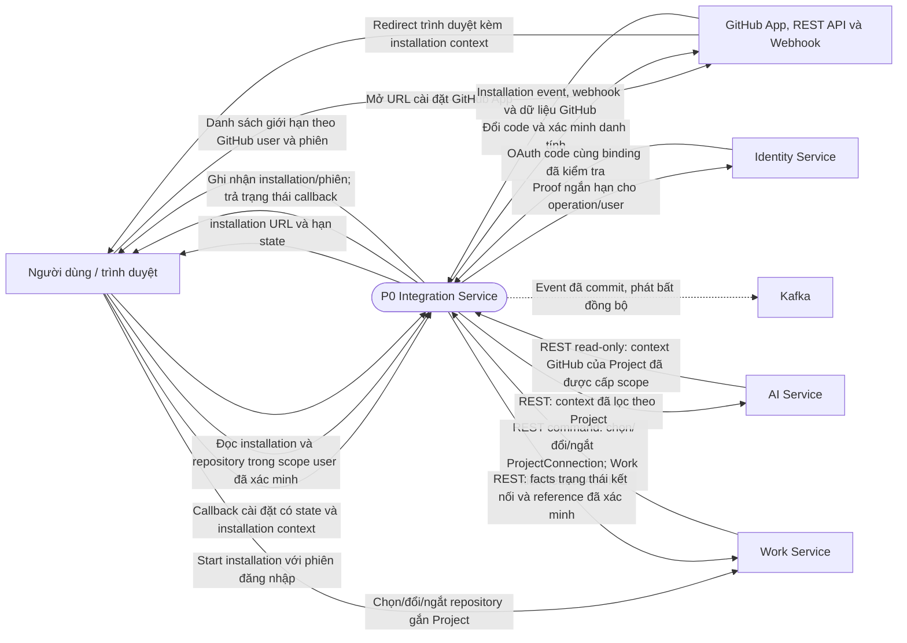
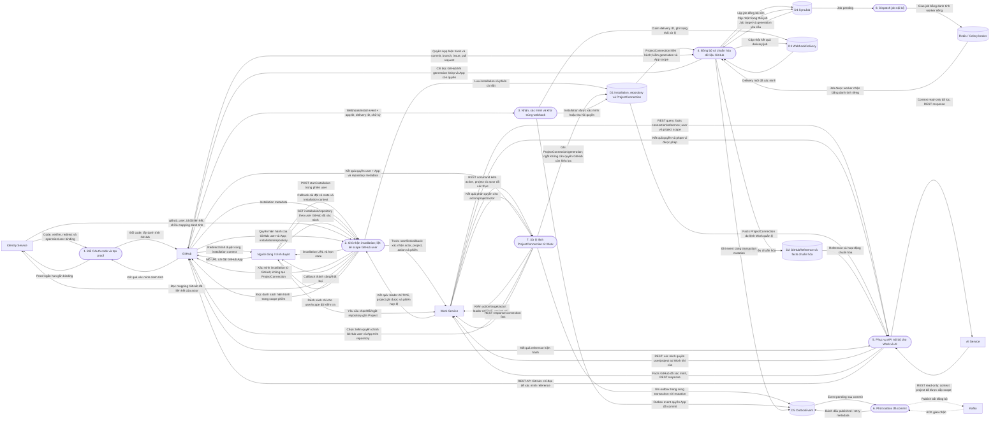

# Integration Service — DFD

**Trạng thái: Thiết kế mục tiêu.** Sơ đồ mô tả luồng dữ liệu dự kiến, không
xác nhận endpoint, database hoặc worker Integration đã chạy. Nguồn chuẩn:
[Integration Service](../../integration-service/README.md),
[API Integration](../../integration-service/api.md),
[giao tiếp](../../system/communication.md) và
[luồng GitHub](../../system/workflows.md#github). Quy tắc quyền chuẩn tại
[phạm vi và quyền truy cập](../../integration-service/scope-access.md).

## DFD context

Integration là một tiến trình trong sơ đồ context. REST trả kết quả đồng bộ;
Kafka chỉ nhận event bất đồng bộ đã commit. Identity nhận proof danh tính OAuth;
Work kiểm quyền user/project và là nơi duy nhất ra lệnh đổi liên kết repository
của Project. Trình duyệt chỉ dùng luồng cài App và đọc installation/repository
đã chứng minh quyền GitHub; callback không tự kết nối Project.

## DFD level 1

Callback cài App chỉ ghi nhận installation và phiên; việc user thấy App hoặc
repository không chứng minh quyền Project UTask. Danh sách công khai chỉ nằm
trong scope GitHub user đã liên kết/xác minh và phiên hiện hành; repository
được App cấp quyền không mặc nhiên hiển thị cho mọi user. Với start/list/callback,
P2 hỏi Work xác nhận actor, project, action, leader `ACTIVE`, project ghi được
và phiên; mapping Identity chỉ cho biết GitHub user đã liên kết, không chứng
minh quyền GitHub. Work kiểm tra action/project/actor cho mỗi mutation; chọn
repository cần quyền của chính GitHub user và App, còn ngắt kết nối vẫn được
phép khi quyền App đã bị thu hồi. Mutation ProjectConnection ghi outbox cùng
transaction. Webhook signature chỉ xác thực nguồn gửi, không cấp quyền user.
AI chỉ đọc context đã lọc theo project; không truy vấn installation hay ghi
command/job. Worker đọc generation hiện hành từ D1, dùng danh tính riêng và
kiểm quyền App; không impersonate user hay phụ thuộc JWT user hết hạn. Tác vụ
GitHub chỉ READ-ONLY. Webhook và
đồng bộ cần chống lặp riêng; consumer Kafka cần chống lặp theo `event_id`.
Outbox có thể phát sinh từ webhook, job hoặc command Work nên không tương ứng
một-một với delivery/job. Notification nhận event Kafka theo hợp đồng/use case;
không dùng Kafka làm request-response hoặc REST làm mặc định để thông báo.
