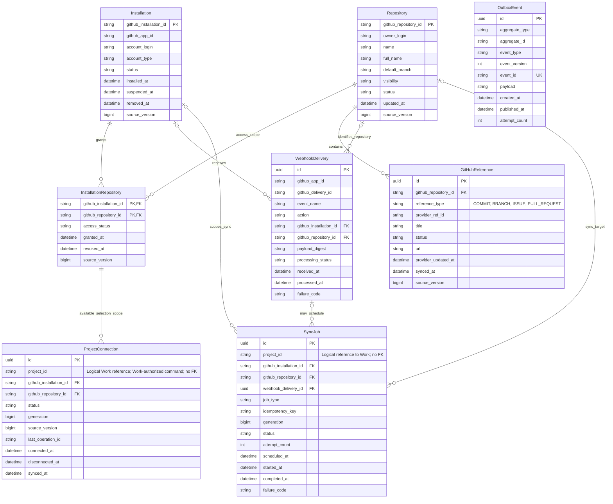

# Integration Service — ERD khái niệm

**Trạng thái: Thiết kế mục tiêu; đề xuất khái niệm, chưa phải schema đã chốt.**
Integration runtime, database schema và migration chưa được triển khai trong
repo. Xem [tài liệu service](../../integration-service/README.md),
[quyền sở hữu dữ liệu](../../system/data-ownership.md) và
[hợp đồng API](../../integration-service/api.md), cùng
[phạm vi và quyền truy cập](../../integration-service/scope-access.md).

ERD tập trung dữ liệu GitHub thuộc Integration. `project_id` là ID tham chiếu
logic tới Work, không có quan hệ FK. `TaskGitHubLink` thuộc Work nên được loại
khỏi ERD này. Không lưu contribution tổng hợp trùng nguồn; không lưu OAuth code,
access token hoặc refresh token như dữ liệu nghiệp vụ. Credential GitHub App
nếu cần phải được quản lý bằng cơ chế bí mật, ngoài ERD khái niệm này.

`ProjectConnection` biểu diễn installation/repository mà Integration đang dùng
cho một Project theo command đã được Work cho phép; đây là metadata liên kết
GitHub, không phải nguồn quyền user/project. Chỉ Work kiểm tra ProjectMember và
leader `ACTIVE`, rồi gửi command chọn/đổi/ngắt kết nối. Callback cài App ghi
nhận installation/phiên nhưng không tạo hoặc đổi `ProjectConnection`. Việc cài
App, liên kết OAuth hay thấy repository trong danh sách không tự chứng minh
quyền thao tác Project. `TaskGitHubLink` và quyền thành viên vẫn do Work sở hữu.
Webhook signature chỉ xác minh nguồn gửi; dữ liệu GitHub được thu thập READ-ONLY.

## Cardinality và quy tắc duy nhất đề xuất

- Installation và Repository có quan hệ nhiều-nhiều theo quyền cài App; bảng
  nối lưu trạng thái cấp quyền và phiên bản nguồn. Cặp
  `(github_installation_id, github_repository_id)` là duy nhất.
- Một repository có thể được nhiều Project tham chiếu. `ProjectConnection`
  giữ `project_id` logic; đề xuất tối đa một kết nối đang hoạt động cho mỗi
  project, còn lịch sử có thể giữ theo `generation`. Cần đối chiếu API và luồng
  đổi repository trước khi chốt constraint.
- GitHubReference dùng ID nội bộ riêng; định danh phía provider duy nhất theo
  repository, loại reference và ID provider ổn định. Số issue/PR và tên branch
  chỉ có ý nghĩa trong repository.
- Khóa delivery đề xuất là duy nhất theo cặp
  `(github_app_id, github_delivery_id)` để chống nhận lặp trong từng GitHub App.
  Delivery có thể không cần job hoặc kích hoạt nhiều job; đồng bộ/API cũng có
  thể tạo job không gắn delivery. Vì vậy quan hệ này tùy chọn và không 1:1.
- `idempotency_key` của SyncJob cần có phạm vi theo loại job và target; cách
  ghép khóa cần chốt cùng retry/replay policy. `project_id` là tham chiếu logic
  để giới hạn quyền đọc job; `generation` giúp nhận diện kết quả cũ khi kết nối
  repository thay đổi.
- OutboxEvent ghi thông báo từ mutation đã commit. Một delivery hoặc job có thể
  tạo không event, một event hoặc nhiều event; event cũng có thể do REST command
  tạo. Không áp đặt quan hệ 1:1 với WebhookDelivery/SyncJob. `aggregate_type`,
  `aggregate_id`, `event_id` là định danh/tham chiếu logic; publisher đánh dấu
  đã phát sau Kafka ACK.

Kiểu trường chỉ minh họa miền dữ liệu. Index, retention, payload schema,
constraint cuối cùng, quản lý secret và transaction boundary phải được chốt
trước migration. Đây không phải hợp đồng máy đọc được.
