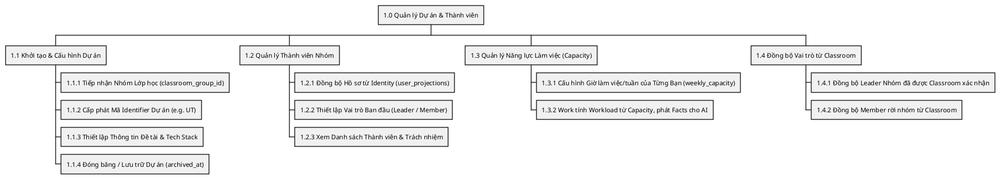
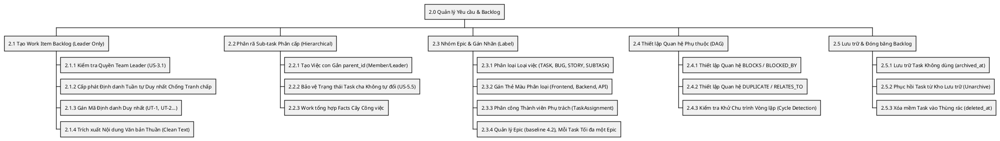
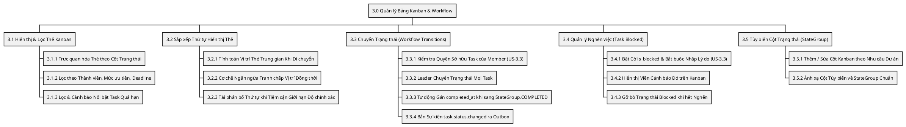
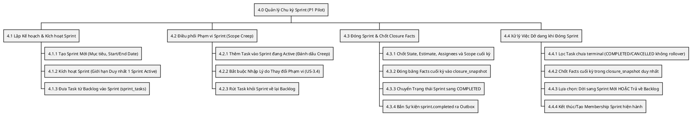
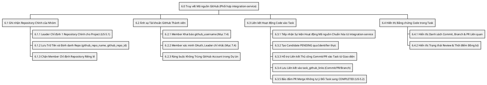

# UTask – Work Service Business Function Diagram (BFD)
## Sơ đồ Phân rã Chức năng Nghiệp vụ Chuyên sâu (Định dạng PlantUML)

**Phiên bản:** 4.0 (Đồng bộ 08/10/2026)  
**Trạng thái:** Thiết kế mục tiêu — chưa xác minh runtime  
**Service:** `apps/work-service`  
**Tài liệu tham chiếu:**
- [docs/architecture/UTask - Phân tích thiết kế yêu cầu.md](../../architecture/UTask%20-%20Phân%20tích%20thiết%20kế%20yêu%20cầu.md) (Source of Truth nghiệp vụ)
- [Kiến trúc hiện hành](../../system/architecture.md) (nguồn chuẩn)
- [erd.md](erd.md) (20 bảng mục tiêu, từ điển cột và SQL constraint minh họa; chưa có migration/trigger chạy thật)  
**Repository tham khảo thực tế:** [Plane](https://github.com/makeplane/plane) (`apps/api/plane/`)

---

## 1. Nghiên cứu & Cơ sở Thiết kế BFD

### 1.1. Khái niệm BFD (Business Function Diagram)
**Sơ đồ Phân rã Chức năng Nghiệp vụ (BFD)** là mô hình phân cấp dạng cây (Hierarchical Functional Decomposition) biểu diễn toàn bộ các chức năng và nhiệm vụ nghiệp vụ của hệ thống từ mức vĩ mô đến các thao tác chi tiết, không phụ thuộc vào giao diện hay công nghệ lưu trữ.

BFD đóng vai trò là **cầu nối trực tiếp** giữa:
1. **Yêu cầu người dùng (User Stories trong PRD)**: Xác định *hệ thống phải làm được những việc gì*.
2. **Sơ đồ Use Case**: Xác định *ai thực hiện chức năng nào và tương tác ra sao*.
3. **Sơ đồ Tuần tự (Sequence Diagrams)**: Xác định *trình tự xử lý dữ liệu và logic kỹ thuật của từng chức năng*.

---

### 1.2. Đối chiếu Chức năng Nghiệp vụ: Plane vs UTask `work-service`

| Nhóm Chức năng | Phân rã trong Mã nguồn Plane | Ánh xạ & Yêu cầu tương ứng trong UTask | Ranh giới Sở hữu Dịch vụ (Service Boundary) |
| :--- | :--- | :--- | :--- |
| **Dự án & Thành viên** | Models `Project`, `ProjectMember` và project create đã đọc | **Epic 2 (US-2.3 $\rightarrow$ US-2.5):** Cấu hình dự án, Identifier `UT`, phân vai Leader/Member, thiết lập `weekly_capacity` cho sinh viên. | **Work:** ProjectMember/capacity/quyền dự án; Classroom sở hữu GroupMember và Leader nhóm. |
| **Yêu cầu & Backlog** | Model `Issue`, sequence allocator và serializer validation đã đọc | **Epic 3 (US-3.1):** Tạo work item backlog (**Leader only**), phân loại (`TASK`, `BUG`, `STORY`), ước lượng story points, sub-tasks. | **Lõi work-service:** Sở hữu vòng đời task, cấu trúc phân cấp và quan hệ phụ thuộc DAG. |
| **Kanban & Trạng thái** | `StateViewSet`, `StateGroup`, `Issue.sort_order` | **Epic 3 (US-3.2, US-3.3):** Kéo thả thẻ, chuyển state (**Member chỉ task của mình**), đánh dấu task **Blocked** kèm lý do. | **Lõi work-service:** Sở hữu bảng Kanban, State Engine và quy tắc kiểm soát quyền chuyển trạng thái. |
| **Sprint & Chu kỳ** | `CycleViewSet`, `CycleIssueViewSet`, `transfer_cycle_issues` | **Epic 3 (US-3.4 - Should / Giai đoạn 2):** Lập kế hoạch Sprint, chốt closure facts, Work dựng Burndown theo rules, dời việc dở dang (Rollover), quản lý Scope Creep kèm lý do. *(Lưu ý: US-4.4 là Dashboard lớp của Giảng viên, không gán cho Sprint).* | **Lõi work-service:** Quản lý chu kỳ Scrum, bảng liên kết `sprint_tasks` và lưu closure facts; snapshot metric cùng facts ở Work. |
| **Trợ lý AI Hỗ trợ** | Không sao chép AI contract Plane; theo yêu cầu UTask | **Epic 5 (US-5.4 $\rightarrow$ US-5.7):** Phát facts qua Kafka (`description_stripped`, DAG, Capacity), đề xuất Backlog, phân rã task (**Human-in-the-loop: đề xuất $\rightarrow$ duyệt $\rightarrow$ lưu**). | **Phối hợp ai-service:** AI đọc context riêng qua Kafka; User gọi AI API; Work cấp facts và chỉ apply đã duyệt, rule công việc trong Work. |
| **Truy vết Mã nguồn** | Chỉ đối chiếu `IssueLink` metadata; không dùng làm bằng chứng Plane có GitHub contract giống UTask | **Epic 5 (US-5.1 $\rightarrow$ US-5.3):** Liên kết repo chính, ánh xạ GitHub Username của sinh viên (Mục 7.4), liên kết commit/PR vào task. | **Phối hợp integration-service:** `integration-service` quản lý GitHub App, OAuth & Webhook; `work-service` chỉ lưu projection/link, không gọi provider. |
| **Cộng tác & Kiểm toán** | `IssueCommentViewSet`, `IssueActivity` (Celery diff) | **Epic 4 (US-4.1, US-4.5):** Thảo luận trong task, Giảng viên phản hồi (Feedback) cấp Task & Project, ghi vết lịch sử biến động. | **Lõi work-service:** Sở hữu bình luận, phản hồi của giảng viên, nhật ký biến động và sự kiện miền outbox. |

---

### 1.3. Bảng Ánh xạ giữa Nhóm Chức năng BFD và Phân hệ Use Case

Để đảm bảo tính nhất quán tuyệt đối giữa phân rã chức năng nghiệp vụ (BFD) và kiến trúc trường hợp sử dụng (Use Case):

| Mã BFD | Tên Nhóm Chức năng BFD | Ánh xạ sang Phân hệ Use Case | Ghi chú Ranh giới Nghiệp vụ |
| :---: | :--- | :---: | :--- |
| **1.0** | Quản lý Dự án & Thành viên | **Phân hệ 1:** Quản lý Dự án & Thành viên | Khởi tạo đề tài, cấp Identifier `UT`, cấu hình capacity thành viên. |
| **2.0** | Quản lý Yêu cầu & Backlog | **Phân hệ 2:** Backlog & Task Management | Leader tạo task, thành viên phân rã sub-task, thiết lập đồ thị DAG. |
| **3.0** | Quản lý Bảng Kanban & Workflow | **Phân hệ 3:** Bảng Kanban & State Engine | Trực quan hóa tiến độ, phân quyền chuyển trạng thái và quản lý task blocked. |
| **4.0** | Quản lý Chu kỳ Sprint | **Phân hệ 4:** Sprint Lifecycle & Rollover | Lập kế hoạch, theo dõi Burndown, đóng Sprint và xử lý việc tồn đọng (Should). |
| **5.0** | Hỗ trợ Trợ lý AI Thông minh | **Phân hệ 5:** Tương tác Trợ lý AI | Nguyên tắc Human-in-the-loop: AI đề xuất, Người duyệt (US-5.4 $\rightarrow$ US-5.7). |
| **6.0** | Truy vết Mã nguồn GitHub | **Phân hệ 6:** Truy vết GitHub & Kiểm toán | Gộp cùng BFD 7.0 vào Phân hệ 6 để quản lý toàn diện tính minh chứng và kiểm toán. |
| **7.0** | Cộng tác, Phản hồi & Kiểm toán | **Phân hệ 6:** Truy vết GitHub & Kiểm toán | Thảo luận task, Feedback giảng viên, tệp đính kèm và xuất bản sự kiện outbox. |

**Ranh giới các Yêu cầu ngoài phạm vi trực tiếp của `work-service`:**
- **US-4.2 (Nhận thông báo khi được giao việc, mention hoặc gần deadline):** Thuộc quyền sở hữu của `notification-service`. `work-service` chỉ phát sinh domain events qua Kafka topic `utask.work.events`.
- **US-4.4 (Dashboard lớp học tổng quan cho Giảng viên):** Web ghép scope Classroom, tài nguyên/chỉ số Work; AI không phải nguồn chỉ số.

---

## 2. Cây Phân rã Chức năng Nghiệp vụ BFD (Mức 0 $\rightarrow$ Mức 2)

```plantuml
@startwbs
skinparam monochrome true
skinparam shadowing false
skinparam defaultFontName Arial, sans-serif
skinparam defaultFontSize 12
skinparam roundcorner 6

* 0.0 HỆ THỐNG QUẢN LÝ CÔNG VIỆC & ĐỒ ÁN (WORK SERVICE)
** 1.0 Quản lý Dự án & Thành viên
*** 1.1 Khởi tạo & Cấu hình Dự án
*** 1.2 Quản lý Thành viên Nhóm
*** 1.3 Quản lý Năng lực Làm việc (Capacity)
*** 1.4 Đồng bộ Vai trò từ Classroom
** 2.0 Quản lý Yêu cầu & Backlog
*** 2.1 Tạo Work Item Backlog (Leader Only)
*** 2.2 Phân rã Sub-task Phân cấp
*** 2.3 Nhóm Epic & Gán Nhãn (Label)
*** 2.4 Thiết lập Quan hệ Phụ thuộc (DAG)
*** 2.5 Lưu trữ & Đóng băng Backlog
** 3.0 Quản lý Bảng Kanban & Workflow
*** 3.1 Hiển thị & Lọc Thẻ Kanban
*** 3.2 Sắp xếp Thứ tự Hiển thị Thẻ
*** 3.3 Chuyển Trạng thái (Phân quyền Member/Leader)
*** 3.4 Quản lý Nghẽn việc (Blocked)
*** 3.5 Tùy biến Cột Workflow (StateGroup)
** 4.0 Quản lý Chu kỳ Sprint (P1 Pilot)
*** 4.1 Lập Kế hoạch & Kích hoạt Sprint
*** 4.2 Điều phối Phạm vi Sprint (Scope Creep)
*** 4.3 Đóng Sprint & Chốt Closure Facts
*** 4.4 Dời việc Dở dang hoặc Trả về Backlog
** 5.0 Hỗ trợ Trợ lý AI Thông minh (Phối hợp ai-service)
*** 5.1 Đồng bộ Dữ kiện AI qua Kafka
*** 5.2 Tiếp nhận Bản nháp Đề xuất Backlog (US-5.4)
*** 5.3 Tiếp nhận Bản nháp Phân rã Task (US-5.5)
*** 5.4 Phê duyệt Áp dụng Đề xuất AI (Human-in-the-loop)
*** 5.5 Work tính Tín hiệu cơ bản, AI phân tích Rủi ro (US-5.6)
*** 5.6 Hiển thị Cảnh báo Rủi ro cho Giảng viên (US-5.7)
** 6.0 Truy vết Mã nguồn GitHub (Phối hợp integration-service)
*** 6.1 Ghi nhận Repository Chính của Nhóm
*** 6.2 Ánh xạ Định danh GitHub Thành viên
*** 6.3 Liên kết Commit/PR/Branch vào Task (Tự động/Thủ công)
*** 6.4 Hiển thị Bằng chứng Phát triển Code trong Task
** 7.0 Cộng tác, Phản hồi & Kiểm toán Nghiệp vụ
*** 7.1 Thảo luận & Mention trong Task
*** 7.2 Giảng viên Phản hồi Hướng dẫn Đồ án
*** 7.3 Quản lý Tệp Đính kèm Task/Project
*** 7.4 Nhật ký Biến động Công việc (Audit Trail)
*** 7.5 Xuất bản Sự kiện Miền Đảm bảo Nhất quán
@endwbs
```

---

## 3. Đặc tả Chi tiết Phân rã Chức năng Nghiệp vụ (Mức 2 & Mức 3)

### 3.1. Phân hệ 1.0: Quản lý Dự án & Thành viên Đồ án

Chịu trách nhiệm thiết lập không gian đồ án cho nhóm sinh viên, gắn mã tiền tố nhận diện task và quản lý cam kết thời gian làm việc.

---

### 3.2. Phân hệ 2.0: Quản lý Yêu cầu & Backlog (Core Work Item Lifecycle)

Chịu trách nhiệm quản lý danh mục công việc cần làm của đồ án, phân cấp nhiệm vụ và thiết lập đồ thị phụ thuộc DAG.

---

### 3.3. Phân hệ 3.0: Quản lý Bảng Kanban & Workflow State Engine

Chịu trách nhiệm trực quan hóa tiến độ công việc, hỗ trợ kéo thả thẻ với vị trí tùy biến và siết chặt quyền hạn cập nhật trạng thái theo US-3.3.

---

### 3.4. Phân hệ 4.0: Quản lý Chu kỳ Phát triển & Sprint (P1 Pilot - Should)

Chịu trách nhiệm quản lý Sprint theo chuẩn Scrum, giữ facts cuối kỳ và lịch sử membership; Work kiểm soát thay đổi phạm vi; Work dựng chuỗi Burndown từ history/facts.

---

### 3.5. Phân hệ 5.0: Hỗ trợ Trợ lý AI Thông minh (Phối hợp ai-service)

Chịu trách nhiệm tích hợp trợ lý AI theo nguyên tắc an toàn dữ liệu: AI chỉ đọc context nội bộ đồng bộ Kafka và đề xuất bản nháp, con người duyệt thì mới commit mutation.

```plantuml
@startwbs
skinparam monochrome true
skinparam shadowing false

* 5.0 Hỗ trợ Trợ lý AI Thông minh (Phối hợp ai-service)
** 5.1 Đồng bộ Dữ kiện AI qua Kafka
*** 5.1.1 Trích xuất Mô tả Sạch Không chứa Định dạng Web
*** 5.1.2 Phát Facts Dependency qua Kafka
*** 5.1.3 Phát Facts Capacity qua Kafka
** 5.2 Tiếp nhận Bản nháp Đề xuất Backlog
*** 5.2.1 Nhóm AI nhận Ý định từ User qua AI API
*** 5.2.2 Nhóm AI Suy luận và Lưu Đề xuất (ngoài Work)
*** 5.2.3 Nhóm AI hiển thị Bản nháp (ngoài Work)
** 5.3 Tiếp nhận Bản nháp Phân rã Task
*** 5.3.1 Nhóm AI nhận Yêu cầu Phân rã (ngoài Work)
*** 5.3.2 Nhóm AI tạo/lưu đề xuất Subtask (ngoài Work)
*** 5.3.3 Nhóm AI hiển thị Draft theo Contract
** 5.4 Phê duyệt Đề xuất AI (Human-in-the-loop)
*** 5.4.1 Người dùng Chỉnh sửa, Loại bỏ Đề xuất Không phù hợp
*** 5.4.2 Leader Bấm Duyệt Backlog -> Tạo Hàng loạt Task
*** 5.4.3 Member Bấm Duyệt Sub-tasks -> Tạo Việc con
*** 5.4.4 Đánh dấu Nguồn gốc source = AI_BACKLOG / AI_DECOMPOSED
** 5.5 Work tính Tín hiệu cơ bản, AI phân tích Rủi ro (US-5.6)
*** 5.5.1 Work tính Tín hiệu Task/Capacity và phát Facts
*** 5.5.2 Work tính tín hiệu, nhóm AI phân tích và lưu kết quả
** 5.6 Hiển thị Cảnh báo Rủi ro cho Giảng viên (US-5.7)
*** 5.6.1 Hiển thị Mức Rủi ro Kèm Nguyên nhân và Đường dẫn Dữ liệu Nguồn
*** 5.6.2 Đánh dấu Rõ Trạng thái Dữ liệu (Mất kết nối, Chưa đồng bộ, Chưa map tài khoản)
@endwbs
```

---

### 3.6. Phân hệ 6.0: Truy vết Mã nguồn GitHub (Phối hợp integration-service)

Chịu trách nhiệm ghi nhận thông tin 1 repository chính của nhóm và liên kết hoạt động phát triển với các task để minh chứng tiến độ thực tế (tích hợp qua integration-service).

---

### 3.7. Phân hệ 7.0: Cộng tác, Phản hồi, Tệp đính kèm & Kiểm toán Nghiệp vụ

Chịu trách nhiệm hỗ trợ thảo luận nhóm, ghi nhận phản hồi của Giảng viên, đính kèm tệp minh chứng và bảo đảm tính kiện toàn sự kiện phân tán.

```plantuml
@startwbs
skinparam monochrome true
skinparam shadowing false

* 7.0 Cộng tác, Phản hồi & Kiểm toán
** 7.1 Thảo luận & Mention trong Task
*** 7.1.1 Gửi Bình luận Trao đổi trong Task (content_html)
*** 7.1.2 Mention Thành viên Nhóm (Ủy thác notification-service gửi cảnh báo)
*** 7.1.3 Xóa mềm Bình luận Giữ Dấu vết (deleted_at)
** 7.2 Giảng viên Phản hồi Hướng dẫn Đồ án
*** 7.2.1 Kiểm tra Quyền Teacher đối với Lớp Phụ trách
*** 7.2.2 Gửi Phản hồi Cấp Project Dashboard (task_id NULL)
*** 7.2.3 Gửi Phản hồi Cấp Task Chi tiết (US-4.5)
*** 7.2.4 Bảo vệ Tuyệt đối Không Đổi State hay Phân công Task
** 7.3 Quản lý Tệp Đính kèm Task/Project
*** 7.3.1 Tải lên Ảnh chụp Lỗi & Tài liệu Minh chứng Đồ án
*** 7.3.2 Lưu Storage Key & Metadata vào attachments, Một Subject Task hoặc Project
*** 7.3.3 Xóa Tệp Đính kèm
** 7.4 Nhật ký Biến động (Activity)
*** 7.4.1 Tự động Ghi vết Mọi Thay đổi Thuộc tính (Audit Trail)
*** 7.4.2 Hiển thị Dòng Thời gian Biến động Task cho Giảng viên
** 7.5 Xuất bản Sự kiện Miền Đảm bảo Nhất quán
*** 7.5.1 Ghi Sự kiện Miền Đồng thời trong Cùng Giao dịch Nghiệp vụ
*** 7.5.2 Tiến trình Nền Quét Sự kiện Chưa phát hành
*** 7.5.3 Phát tán Sự kiện với Cơ chế Thử lại (Exponential Backoff)
@endwbs
```

---

## 4. Ma trận vai trò phối hợp

| Mã BFD | Tên Chức năng Nghiệp vụ | Team Leader | Team Member | Teacher | AI Agent | Outbox Worker |
| :---: | :--- | :---: | :---: | :---: | :---: | :---: |
| **1.1** | Khởi tạo & Cấu hình Dự án | **A/R** | I | I | - | - |
| **1.2** | Quản lý Thành viên Nhóm | **A/R** | I | C | - | - |
| **1.3** | Cấu hình Weekly Capacity | **A/R** | C | I | I | - |
| **1.4** | Đồng bộ ProjectMember từ Classroom | I | I | I | - | - |
| **2.1** | Tạo Work Item Backlog | **A/R** | - | I | - | - |
| **2.2** | Phân rã Sub-task | **A/R** | **R (task mình)** | I | C | - |
| **2.3** | Nhóm Epic & Gán Nhãn | **A/R** | R | I | - | - |
| **2.4** | Thiết lập Quan hệ Phụ thuộc DAG | **A/R** | R | I | I | - |
| **2.5** | Lưu trữ & Đóng băng Backlog | **A/R** | - | I | - | - |
| **3.1** | Xem & Lọc Bảng Kanban | R | R | R | - | - |
| **3.2** | Kéo thả Sắp xếp Thẻ Kanban | R | R | - | - | - |
| **3.3** | Chuyển Trạng thái Task | **A/R (tất cả)**| **R (task được giao)**| - | - | - |
| **3.4** | Đánh dấu Task Bị chặn (Blocked)| **A/R** | **R (task được giao)**| I | I | - |
| **3.5** | Tùy biến Cột Trạng thái | **A/R** | - | - | - | - |
| **4.1** | Lập Kế hoạch Sprint | **A/R** | I | I | - | - |
| **4.2** | Điều phối Phạm vi Sprint (Creep)| **A/R** | - | I | - | - |
| **4.3** | Đóng Sprint & Chốt Closure Facts | **A/R** | I | I | - | - |
| **4.4** | Dời việc Dở dang hoặc Về Backlog | **A/R** | I | I | - | - |
| **5.1** | Đồng bộ Dữ kiện AI qua Kafka | - | - | - | **R (consume)** | **R (publish)** |
| **5.2** | AI Đề xuất Backlog Dự án | **A/R (duyệt)** | - | I | **R (đề xuất)**| - |
| **5.3** | AI Phân rã Task Phức tạp | **A/R (duyệt)** | **A/R (duyệt)** | I | **R (đề xuất)**| - |
| **5.4** | Phê duyệt Đề xuất AI | **A/R** | R | I | - | - |
| **5.5** | Work cấp facts/tín hiệu, nhóm AI phân tích và lưu report | I | I | I | **R (phân tích)** | **R (phát facts)** |
| **5.6** | Hiển thị Cảnh báo Rủi ro Tiến độ | I | I | **R (xem)** | I | - |
| **6.1** | Liên kết Repository Chính | **A/R** | - | I | - | - |
| **6.2** | Ánh xạ Tài khoản GitHub | **A** | **R** | I | - | - |
| **6.3** | Candidate GitHub và xác nhận | R (confirm) | R (confirm) | I | - | - |
| **6.4** | Hiển thị Bằng chứng Code | R | R | R | I | - |
| **7.1** | Thảo luận trong Task | R | R | R | - | - |
| **7.2** | Giảng viên Phản hồi Hướng dẫn | I | I | **A/R** | - | - |
| **7.3** | Tệp Đính kèm Task/Project (R2) | R | R | I (xem/download) | - | - |
| **7.4** | Nhật ký Biến động (Audit Trail)| I | I | R | I | - |
| **7.5** | Xuất bản Sự kiện Outbox Kafka | - | - | - | - | **A/R** |

*Ghi chú:*
- **A (Accountable):** Người chịu trách nhiệm phê duyệt cao nhất.
- **R (Responsible):** Người trực tiếp thực thi thao tác.
- **C (Consulted):** Người được tham vấn ý kiến trước khi thực hiện.
- **I (Informed):** Người được nhận thông báo kết quả sau khi thực hiện.

---

## 5. Phạm vi và kiểm chứng
BFD là thiết kế mục tiêu. Ma trận dùng ký hiệu R/A/C/I để đọc vai trò người dùng và đối tác; không là RACI đầy đủ của đội phát triển và không thay permission action/field trong API. Work command/query/consumer thực hiện phần nghiệp vụ trong boundary, publisher chỉ phát dữ liệu đã commit. Classroom quyết định GroupMember, Work đồng bộ ProjectMember; consumer không phải outbox publisher. Work tính số liệu/rule công việc; nhóm AI lưu và trình bày phân tích riêng.

Plane commit 7466675e471efe1c96b122615f7a0d30c9b2eb05 là nguồn tham khảo scope/query/grouped offset/cycle snapshot. Project counter, quyền lớp, graph isolation và candidate-confirm là rule UTask. Không dùng nhãn 100%/Approved để kết luận code đã có. P0 cần cả GitHub/AI/dashboard; Sprint thuộc P1 theo PRD.

---

Work consumer chịu trách nhiệm đồng bộ 1.2/1.4 và candidate GitHub 6.3; Work query/job chịu số liệu/rule công việc, nhóm AI chịu báo cáo phân tích; publisher không làm analytics.

Các node “Nhóm AI” trong BFD 5 chỉ là điểm phối hợp ngoài Work, không nhiệm vụ triển khai schema/job AI. [Hợp đồng ranh giới](../../project-service/ai-boundary-contract.md).
