# Work Service — ERD có kiểm kê và căn cứ dữ liệu

**Phiên bản 6.0 — 08/10/2026. Trạng thái: Thiết kế mục tiêu, đã rà soát tĩnh; Work hiện có model/migration và kiểm thử nội bộ với PostgreSQL riêng.** Hiện trạng tại [Work backend](../../project-service/work-backend.md), chưa suy ra runtime liên service đã nghiệm thu. Nội bộ AI Service/AIDB thuộc nhóm khác. Số bảng được đếm từ entity khai báo và mọi đầu quan hệ, không lấy con số cũ làm yêu cầu cố định.

Nguồn: [baseline mục 4.2/4.6/4.7/10/12](../../architecture/UTask_Architecture_Technology_Baseline%20%281%29.md), [PRD](../../architecture/UTask%20-%20Phân%20tích%20thiết%20kế%20yêu%20cầu.md), [Work API](../../architecture/Work_Service_API_Specification.md), [Work–AI](../../project-service/ai-boundary-contract.md), [Sequence](sequence.md), [BFD](bfd.md), [Use Case](usecase.md). [Quyết định từng bảng và bằng chứng Plane](../../project-service/erd-audit-20261008.md).

## 1. Kiểm kê thật và ERD

20 entity trong bản này: 11 bảng nghiệp vụ, 5 bảng quan hệ và 4 bảng projection/hạ tầng. Đường FK tham chiếu bảng nào thì bảng đó phải có khai báo; không tạo FK sang Identity/Classroom/Integration/AI DB. Bảng không có FK (projection, inbox, receipt) vẫn tính trong kiểm kê. Đây không phải số bảng live database.

| Nhóm | Bảng |
| --- | --- |
| Nghiệp vụ (11) | Project, ProjectMember, State, Sprint, Epic, Label, Task, Attachment, TaskGitHubLink, Comment, Activity |
| Quan hệ (5) | SprintTask, TaskLabel, TaskAssignment, TaskRelation, CommentMention |
| Projection/hạ tầng (4) | UserProjection, OutboxEvent, ConsumedEvent, IdempotencyRecord |

```mermaid
erDiagram
    Project ||--o{ ProjectMember : "project_id"
    Project ||--o{ State : "project_id"
    Project ||--o{ Sprint : "project_id"
    Sprint ||--o{ SprintTask : "sprint_id"
    Task ||--o{ SprintTask : "task_id"
    Project ||--o{ Epic : "project_id"
    Project ||--o{ Label : "project_id"
    Task ||--o{ TaskLabel : "task_id"
    Label ||--o{ TaskLabel : "label_id"
    Project ||--o{ Task : "project_id"
    Epic o|--o{ Task : "epic_id"
    State ||--o{ Task : "state_id"
    Task o|--o{ Task : "parent_id"
    Project o|--o{ Attachment : "project_id"
    Task o|--o{ Attachment : "task_id"
    Task ||--o{ TaskGitHubLink : "task_id"
    Task ||--o{ TaskAssignment : "task_id"
    Task ||--o{ TaskRelation : "task_id"
    Task ||--o{ TaskRelation : "related_task_id"
    Project o|--o{ Comment : "project_id"
    Task o|--o{ Comment : "task_id"
    Project o|--o{ Activity : "project_id"
    ProjectMember o|--o{ Activity : "project_member_id"
    State o|--o{ Activity : "state_id"
    Sprint o|--o{ Activity : "sprint_id"
    Task o|--o{ Activity : "task_id"
    Epic o|--o{ Activity : "epic_id"
    Label o|--o{ Activity : "label_id"
    Comment o|--o{ Activity : "comment_id"
    Project ||--o{ OutboxEvent : "project_id"
    Comment ||--o{ CommentMention : "comment_id"

    Project {
        uuid id PK
        varchar identifier "Unique short key e.g. UT"
        varchar name
        text description
        text target_goals "Mục tiêu đề tài đồ án"
        jsonb tech_stack "Ngăn xếp công nghệ dự kiến"
        date start_date "Thời gian bắt đầu dự kiến"
        date end_date "Thời gian hoàn thành dự kiến"
        varchar classroom_group_id "Logical ref to Classroom Group"
        varchar class_id "Logical ref to Classroom Class"
        bigint group_source_version
        bigint version
        bigint board_revision
        bigint event_sequence
        bigint current_task_sequence "Nonnegative project counter"
        varchar github_repo_owner "NULL"
        varchar github_default_branch "NULL"
        bigint github_connection_version "NULL"
        varchar github_operation_id "NULL"
        bigint github_connection_generation "NULL"
        varchar github_connection_status "NULL"
        timestamptz github_synced_at "NULL"
        varchar github_repo_name "Primary repository e.g. owner/repo"
        varchar github_repo_id "GitHub Repo ID"
        timestamptz created_at
        timestamptz updated_at
        timestamptz archived_at "Nullable"
        timestamptz deleted_at "Nullable"
    }

    ProjectMember {
        uuid id PK
        uuid project_id FK
        uuid user_id "Logical UUID to Identity, no cross-service FK"
        varchar role "LEADER | MEMBER"
        varchar status "ACTIVE | LEFT | REMOVED"
        integer weekly_capacity "Hours per week, not story points"
        bigint group_source_version
        varchar github_username "GitHub account mapping"
        varchar github_user_id "GitHub User ID"
        boolean is_github_verified "Verification status"
        timestamptz joined_at
        timestamptz left_at "Nullable"
        bigint github_source_version "Requires upstream ordered account contract"
        timestamptz updated_at "Last membership or capacity change"
    }

    UserProjection {
        uuid user_id PK "Logical UUID to Identity, no cross-service FK"
        varchar display_name
        varchar avatar_url "NULL"
        timestamptz updated_at
        varchar source_event_id "Dedup reference, not an ordering guarantee"
        timestamptz source_occurred_at "Source time, not received time"
    }

    State {
        uuid id PK
        uuid project_id FK
        varchar name
        varchar slug
        varchar color "Hex code"
        float sequence "Kanban column order"
        varchar group "BACKLOG | UNSTARTED | STARTED | REVIEW | COMPLETED | CANCELLED"
        boolean is_default
        timestamptz created_at
        timestamptz deleted_at "Soft delete, preserve referenced history"
    }

    Sprint {
        uuid id PK
        uuid project_id FK
        varchar name
        text goal
        varchar status "DRAFT | ACTIVE | COMPLETED"
        date start_date "NULL until planned, required to start"
        date end_date "NULL until planned, required to start"
        float sort_order
        jsonb closure_snapshot "Versioned Work closure snapshot"
        bigint version
        timestamptz started_at "NULL"
        timestamptz closed_at "NULL"
        timestamptz created_at
        timestamptz updated_at
        timestamptz archived_at "Nullable"
    }

    SprintTask {
        uuid id PK
        uuid sprint_id FK
        uuid task_id FK
        timestamptz added_at
        text scope_change_reason "Mandatory if mid-sprint change"
        timestamptz ended_at "End current membership, retain history"
        varchar end_reason "REMOVED | CLOSED | ROLLED_OVER"
        timestamptz deleted_at "Tombstone only"
        text removal_reason "Reason for ending scope, not overwritten add reason"
    }

    Epic {
        uuid id PK
        uuid project_id FK
        varchar name
        text description
        uuid lead_user_id "Logical UUID to Identity, no cross-service FK"
        varchar status "PLANNED | IN_PROGRESS | COMPLETED | CANCELLED"
        date start_date "NULL"
        date target_date "NULL"
        timestamptz created_at
        timestamptz updated_at
        timestamptz deleted_at "Soft delete, preserve referenced history"
    }

    Label {
        uuid id PK
        uuid project_id FK
        varchar name
        varchar color "Hex code"
        text description "NULL"
        timestamptz created_at
        timestamptz deleted_at "Soft delete, preserve referenced history"
    }

    TaskLabel {
        uuid id PK
        uuid task_id FK
        uuid label_id FK
        timestamptz created_at
    }

    Task {
        uuid id PK
        uuid project_id FK
        bigint sequence_id "UT-1, UT-2..."
        uuid epic_id FK "Nullable"
        uuid state_id FK
        uuid parent_id FK "Self-referencing for sub-issues"
        varchar type "TASK | BUG | STORY | SUBTASK"
        varchar source "MANUAL | AI_BACKLOG | AI_DECOMPOSED"
        varchar ai_proposal_id "NULL"
        varchar ai_local_id "NULL"
        text acceptance_criteria
        bigint version
        uuid deletion_batch_id "NULL"
        varchar title
        text description_html
        text description_stripped "AI clean context"
        varchar priority "LOW | MEDIUM | HIGH | URGENT"
        integer story_points "NULL"
        date due_date "NULL"
        boolean is_blocked "Manual flag, not dependency computed state"
        text blocked_reason "Reason why task is blocked"
        float sort_order "Kanban card position"
        uuid created_by_user_id "Logical UUID to Identity, no cross-service FK"
        timestamptz completed_at "NULL"
        timestamptz created_at
        timestamptz updated_at
        timestamptz archived_at "Nullable"
        timestamptz deleted_at "Nullable"
        varchar ai_revision "Opaque reviewed revision, no AI report"
        varchar ai_payload_hash "Immutable approved item hash, not current Task content"
    }

    Attachment {
        uuid id PK
        uuid project_id FK "Project subject only, nullable"
        uuid task_id FK "Task subject only, nullable"
        varchar file_name
        integer file_size
        varchar storage_key
        varchar content_type
        varchar status "PENDING | CONFIRMED | EXPIRED"
        timestamptz expires_at
        timestamptz confirmed_at "NULL"
        timestamptz deleted_at "NULL"
        uuid uploaded_by_user_id "Logical UUID to Identity, no cross-service FK"
        timestamptz created_at
    }

    TaskGitHubLink {
        uuid id PK
        uuid task_id FK
        varchar github_repo_id
        bigint connection_generation
        bigint source_version
        varchar confirmation_status "PENDING | CONFIRMED"
        uuid confirmed_by_user_id "Logical UUID to Identity, no cross-service FK"
        timestamptz confirmed_at "NULL"
        timestamptz deleted_at "NULL"
        varchar link_type "BRANCH | COMMIT | PULL_REQUEST"
        varchar github_ref_id "Commit hash, PR number or branch name"
        varchar github_title "Commit message or PR title"
        varchar github_status "OPEN | MERGED | CLOSED"
        varchar github_url "Direct URL to commit or PR"
        boolean is_verified "Verified against primary repo"
        uuid created_by_user_id "Logical UUID to Identity, no cross-service FK"
        timestamptz synced_at
    }

    TaskAssignment {
        uuid id PK
        uuid task_id FK
        uuid user_id "Logical UUID to Identity, no cross-service FK"
        timestamptz assigned_at
    }

    TaskRelation {
        uuid id PK
        uuid task_id FK "Source task"
        uuid related_task_id FK "Target task"
        varchar relation_type "BLOCKS | DUPLICATE | RELATES_TO"
        timestamptz deleted_at "Nullable; null means active relation"
        timestamptz created_at
    }

    Comment {
        uuid id PK
        uuid project_id FK "Project subject only, nullable"
        uuid task_id FK "Task subject only, nullable"
        uuid user_id "Logical UUID to Identity, no cross-service FK"
        text content_html
        text content_stripped
        boolean is_teacher_feedback "US-4.5"
        timestamptz created_at
        timestamptz updated_at
        timestamptz deleted_at "Nullable"
    }

    Activity {
        uuid id PK
        uuid project_id FK "Nullable subject, not copied scope"
        uuid project_member_id FK "Nullable subject"
        uuid state_id FK "Nullable subject"
        uuid sprint_id FK "Nullable subject"
        uuid task_id FK "Nullable subject"
        uuid epic_id FK "Nullable subject"
        uuid label_id FK "Nullable subject"
        uuid comment_id FK "Nullable subject"
        uuid actor_user_id "Logical UUID to Identity, no cross-service FK"
        varchar verb
        varchar field "NULL"
        text old_value "NULL"
        text new_value "NULL"
        timestamptz created_at
    }

    OutboxEvent {
        uuid id PK
        varchar aggregate_type "task | sprint | project"
        varchar aggregate_id
        varchar event_type "task.status.changed | task.created..."
        integer event_version
        integer retry_count "Retry attempt counter"
        text last_error "Error message if Kafka fails"
        jsonb data "Whole envelope, business fields at event.data"
        uuid project_id FK
        bigint project_sequence
        timestamptz next_attempt_at "NULL"
        timestamptz created_at
        timestamptz published_at "NULL until sent to Kafka"
    }

    ConsumedEvent {
        varchar event_id PK
        varchar consumer_group PK
        varchar event_type
        varchar payload_hash
        timestamptz processed_at
    }

    IdempotencyRecord {
        uuid id PK
        varchar idempotency_key "Unique within actor method route"
        varchar ai_proposal_id "Opaque proposal namespace, optional AI operation"
        varchar ai_item_id "Opaque action item, optional AI operation"
        uuid operation_id "Unique NOT NULL committed operation"
        varchar http_method
        timestamptz expires_at "NULL"
        uuid user_id "Logical UUID to Identity, no cross-service FK"
        varchar endpoint_path
        varchar payload_hash
        integer response_status
        jsonb response_body
        timestamptz created_at
    }

    CommentMention {
        uuid id PK
        uuid comment_id FK
        uuid user_id "Logical UUID to Identity, no cross-service FK"
        timestamptz created_at
    }
```



## 2. Từ điển đủ trường và quy tắc từng bảng

Một hàng từ điển cho **mỗi cột trong ERD**. N là NOT NULL, Y là nullable. UUID người dùng là logical reference theo [Identity model](../../../apps/identity-service/accounts/models.py), không FK hoặc bản User mới. Classroom/provider/proposal IDs giữ opaque VARCHAR theo contract, không tự giả kiểu UUID. Column FK áp RESTRICT/PROTECT khi hard-delete; dùng tombstone/workflow thay xóa lịch sử. Tên/key API có thể là field suy ra, không đồng nghĩa có cột lưu trùng.

[Ma trận bằng chứng từng cột](../../project-service/erd-field-evidence.md) truy đủ 234 cột tới PRD/baseline/ownership, trường Plane/Identity tương ứng nếu có và lý do điều chỉnh Work. Từ điển dưới vẫn là nguồn schema; ma trận không coi mọi kiểu/giới hạn/vocabulary của Work là yêu cầu literal hoặc code đã triển khai.

### 2.1. `projects` — Project

| Cột | PostgreSQL | Null | Khóa/tham chiếu | Ý nghĩa/nguồn |
| --- | --- | --- | --- | --- |
| `id` | UUID | N | PK | Định danh bản ghi, bất biến |
| `identifier` | VARCHAR(10) | N | — | Mã ổn định, regex ^[A-Z0-9]{2,10}$; không tái dùng khi archive/delete |
| `name` | VARCHAR(200) | N | — | Tên đề tài/dự án; không dùng làm định danh và không bắt buộc unique như identifier |
| `description` | TEXT | N | — | Mô tả tổng quan đề tài do Leader nhập; không lưu báo cáo hoặc prompt AI |
| `target_goals` | TEXT | N | — | Mục tiêu đề tài đồ án |
| `tech_stack` | JSONB | N | — | Document cấu hình project, không repeating membership |
| `start_date` | DATE | Y | — | Ngày bắt đầu dự kiến do Leader cấu hình, theo timezone nghiệp vụ |
| `end_date` | DATE | Y | — | Ngày kết thúc dự kiến do Leader cấu hình; không trước start_date khi cả hai có giá trị |
| `classroom_group_id` | VARCHAR(100) | N | — | Logical Group bắt buộc cho MVP, opaque Classroom ID, không FK |
| `class_id` | VARCHAR(100) | Y | — | Projection scope Class từ Classroom, không nguồn quyền độc lập |
| `group_source_version` | BIGINT | N | — | Phiên bản membership/group từ Classroom, cần upstream ordered contract |
| `version` | BIGINT | N | — | Version command Project; không giả mọi Task mutation tự tăng trường này |
| `board_revision` | BIGINT | N | — | Invalidates board cursor khi mutation ảnh hưởng dữ liệu board |
| `event_sequence` | BIGINT | N | — | Bộ đếm event trong project, khác counter mã Task |
| `current_task_sequence` | BIGINT | N | — | Bộ đếm mã Task dưới Project write barrier, không giảm/tái dùng |
| `github_repo_owner` | VARCHAR(100) | Y | — | Owner/org do Integration xác minh, projection có version, không tin body client |
| `github_default_branch` | VARCHAR(100) | Y | — | Tên nhánh mặc định từ Integration, không tự gọi GitHub |
| `github_connection_version` | BIGINT | Y | — | Version source connection do Integration cấp; không tự tăng thay upstream |
| `github_operation_id` | VARCHAR(100) | Y | — | Correlation của thao tác kết nối repo để retry/reconcile, do contract Integration cấp |
| `github_connection_generation` | BIGINT | Y | — | Thế hệ connection hiện hành; thay/ngắt repo làm generation cũ không ghi đè mới |
| `github_connection_status` | VARCHAR(100) | Y | — | Trạng thái kết nối source như pending/connected/disconnected theo contract Integration |
| `github_synced_at` | TIMESTAMPTZ | Y | — | Mốc nguồn Integration đồng bộ gần nhất; dữ liệu stale/disconnected phải hiển thị riêng |
| `github_repo_name` | VARCHAR(255) | Y | — | Primary repository e.g. owner/repo |
| `github_repo_id` | VARCHAR(100) | Y | — | ID repository chính do Integration xác nhận, không suy từ owner/name có thể đổi |
| `created_at` | TIMESTAMPTZ | N | — | Thời điểm server tạo bản ghi; bất biến, không dùng thời điểm client |
| `updated_at` | TIMESTAMPTZ | N | — | Thời điểm cập nhật thành công gần nhất trong Work, cùng transaction thay đổi |
| `archived_at` | TIMESTAMPTZ | Y | — | Null đang hoạt động; có giá trị là lưu trữ/read-only theo command, khác thùng rác |
| `deleted_at` | TIMESTAMPTZ | Y | — | Null còn hiện hành; có giá trị là tombstone, giữ FK và lịch sử, không xóa vật lý |

**Khóa/ràng buộc/lifecycle:** uq_projects_identifier UNIQUE(identifier) toàn vòng đời; uq_one_primary_project_per_group UNIQUE(classroom_group_id) WHERE archived_at/deleted_at IS NULL; counter/version/revision/sequence không âm; ngày start<=end khi đủ. Group ID không null cho MVP; project độc lập ngoài phạm vi.

### 2.2. `project_members` — ProjectMember

| Cột | PostgreSQL | Null | Khóa/tham chiếu | Ý nghĩa/nguồn |
| --- | --- | --- | --- | --- |
| `id` | UUID | N | PK | Định danh bản ghi, bất biến |
| `project_id` | UUID | N | FK→Project.id | Quan hệ local Work, kiểm scope khi ghi |
| `user_id` | UUID | N | Logical Identity UUID | UUID user trong project slot; không FK Identity, không lấy từ token người giao để thay assignee |
| `role` | VARCHAR(100) | N | — | LEADER/MEMBER do Classroom xác nhận theo MVP |
| `status` | VARCHAR(100) | N | — | ACTIVE/LEFT/REMOVED; một row bền cho project/user |
| `weekly_capacity` | INTEGER | N | — | Số giờ khả dụng mỗi tuần do Leader cấu hình, không phải story point hoặc giờ thực tế |
| `group_source_version` | BIGINT | N | — | Phiên bản membership/group từ Classroom, cần upstream ordered contract |
| `github_username` | VARCHAR(100) | Y | — | Login hiển thị từ Integration, có thể đổi; không thay stable github_user_id |
| `github_user_id` | VARCHAR(100) | Y | — | ID tài khoản GitHub ổn định được Integration xác minh |
| `is_github_verified` | BOOLEAN | N | — | Cờ Integration đã xác minh mapping user–GitHub; không quyền do Leader tự cấp |
| `joined_at` | TIMESTAMPTZ | N | — | Lần gia nhập/khôi phục hiện hành; các lần trước giữ Activity |
| `left_at` | TIMESTAMPTZ | Y | — | Null khi ACTIVE; thời điểm rời/bị loại phiên hiện hành, lịch sử trước ở Activity |
| `github_source_version` | BIGINT | Y | — | Dùng chỉ khi Integration cam kết thứ tự; không coi received_at là version |
| `updated_at` | TIMESTAMPTZ | N | — | Mốc Work thay role/status/capacity/GitHub mapping thành công; dùng response PATCH capacity |

**Khóa/ràng buộc/lifecycle:** uq_project_member UNIQUE(project_id,user_id) không chỉ ACTIVE; uq_one_leader_per_project UNIQUE(project_id) WHERE role=LEADER AND status=ACTIVE; command giữ ít nhất một Leader. ACTIVE iff left_at null. Capacity >=0, không tự chọn trần giờ từ giả định. uq_project_member_github_id unique stable ID ACTIVE/project nếu verified; uq_project_member_github_username lower(username) unique ACTIVE/project. ID/verified cập nhật theo source.

### 2.3. `user_projections` — UserProjection

| Cột | PostgreSQL | Null | Khóa/tham chiếu | Ý nghĩa/nguồn |
| --- | --- | --- | --- | --- |
| `user_id` | UUID | N | PK; Logical Identity UUID | UUID Identity là PK projection; có thể thiếu projection mà không làm mất logical author/membership |
| `display_name` | VARCHAR(200) | N | — | Bản sao tên hiển thị từ Identity.profile; không nguồn xác định quyền |
| `avatar_url` | VARCHAR(500) | Y | — | URL/avatar reference từ Identity projection, không do Work quản lý credential |
| `updated_at` | TIMESTAMPTZ | N | — | Mốc Work nhận/cập nhật projection, khác source_occurred_at; không dùng để xác định source mới nhất |
| `source_event_id` | VARCHAR(100) | N | — | Tham chiếu event nguồn đã tạo phiên bản profile đang lưu; dùng truy vết/dedup, không bảo đảm thứ tự |
| `source_occurred_at` | TIMESTAMPTZ | N | — | Mốc source của snapshot profile; timestamp không chứng minh tổng thứ tự |

**Khóa/ràng buộc/lifecycle:** PK user_id; không FK Identity; profile projection không nguồn permission. Identity envelope hiện không có source entity sequence, cần reconciliation/ordering contract, không hứa last-received-wins là mới nhất. Projection chưa có dữ liệu thì giữ display placeholder, không block logical author/membership.

### 2.4. `states` — State

| Cột | PostgreSQL | Null | Khóa/tham chiếu | Ý nghĩa/nguồn |
| --- | --- | --- | --- | --- |
| `id` | UUID | N | PK | Định danh bản ghi, bất biến |
| `project_id` | UUID | N | FK→Project.id | Quan hệ local Work, kiểm scope khi ghi |
| `name` | VARCHAR(50) | N | — | Tên cột Kanban do Leader cấu hình, unique trong các State chưa xóa của Project |
| `slug` | VARCHAR(60) | N | — | Identifier URL metadata, phải unique active theo project |
| `color` | VARCHAR(7) | N | — | Màu hiển thị dạng #RRGGBB; không mã trạng thái nghiệp vụ |
| `sequence` | DOUBLE PRECISION | N | — | Thứ tự hữu hạn của cột trong Project; không sequence mã Task |
| `group` | VARCHAR(100) | N | — | BACKLOG/UNSTARTED/STARTED/REVIEW/COMPLETED/CANCELLED |
| `is_default` | BOOLEAN | N | — | Đúng một default active theo command, DB chỉ bảo vệ tối đa một |
| `created_at` | TIMESTAMPTZ | N | — | Thời điểm server tạo bản ghi; bất biến, không dùng thời điểm client |
| `deleted_at` | TIMESTAMPTZ | Y | — | Null còn hiện hành; có giá trị là tombstone, giữ FK và lịch sử, không xóa vật lý |

**Khóa/ràng buộc/lifecycle:** uq_state_name_per_project và uq_state_slug_per_project unique active (deleted_at null); uq_one_default_state_per_project unique project active WHERE is_default. Project/group bất biến khi có Task; delete dùng tombstone sau migration target, default không xóa.

### 2.5. `sprints` — Sprint

| Cột | PostgreSQL | Null | Khóa/tham chiếu | Ý nghĩa/nguồn |
| --- | --- | --- | --- | --- |
| `id` | UUID | N | PK | Định danh bản ghi, bất biến |
| `project_id` | UUID | N | FK→Project.id | Quan hệ local Work, kiểm scope khi ghi |
| `name` | VARCHAR(200) | N | — | Tên đợt làm việc trong Project, không dùng thay Sprint UUID |
| `goal` | TEXT | N | — | Mục tiêu Sprint được Leader cấu hình và ghi lịch sử khi sửa |
| `status` | VARCHAR(100) | N | — | DRAFT/ACTIVE/COMPLETED, không reopen closed trong MVP |
| `start_date` | DATE | Y | — | Ngày kế hoạch bắt đầu; DRAFT có thể trống, bắt buộc khi start, khác started_at thực tế |
| `end_date` | DATE | Y | — | Ngày kế hoạch kết thúc; DRAFT có thể trống, bắt buộc khi start và không trước start_date |
| `sort_order` | DOUBLE PRECISION | N | — | Rank hiển thị hữu hạn theo phạm vi bảng/cột; server tính, rebalance dưới lock khi cần |
| `closure_snapshot` | JSONB | Y | — | Nguồn DUY NHẤT facts/points/assignees cuối kỳ và metric có snapshot_version/formula_version |
| `version` | BIGINT | N | — | Version kiểm command hiện hành |
| `started_at` | TIMESTAMPTZ | Y | — | Mốc server chuyển DRAFT sang ACTIVE, bất biến sau start; không ngày dự kiến |
| `closed_at` | TIMESTAMPTZ | Y | — | Mốc server close thành công cùng closure_snapshot và status COMPLETED |
| `created_at` | TIMESTAMPTZ | N | — | Thời điểm server tạo bản ghi; bất biến, không dùng thời điểm client |
| `updated_at` | TIMESTAMPTZ | N | — | Thời điểm cập nhật thành công gần nhất trong Work, cùng transaction thay đổi |
| `archived_at` | TIMESTAMPTZ | Y | — | Null đang hoạt động; có giá trị là lưu trữ/read-only theo command, khác thùng rác |

**Khóa/ràng buộc/lifecycle:** uq_one_active_sprint_per_project partial UNIQUE project/status=ACTIVE; start<=end; timestamps đúng DRAFT/ACTIVE/COMPLETED; closed cần closure_snapshot. Snapshot và closed_at immutable, không null bằng reopen; không ghi facts đóng ở SprintTask nữa.

### 2.6. `sprint_tasks` — SprintTask

| Cột | PostgreSQL | Null | Khóa/tham chiếu | Ý nghĩa/nguồn |
| --- | --- | --- | --- | --- |
| `id` | UUID | N | PK | Định danh bản ghi, bất biến |
| `sprint_id` | UUID | N | FK→Sprint.id | Quan hệ local Work, kiểm scope khi ghi |
| `task_id` | UUID | N | FK→Task.id | Quan hệ local Work, kiểm scope khi ghi |
| `added_at` | TIMESTAMPTZ | N | — | Mốc Task được thêm vào Sprint trong phiên membership này; ADD lại tạo phiên mới sau kết thúc phiên cũ |
| `scope_change_reason` | TEXT | Y | — | Lý do ADD vào Sprint ACTIVE; giữ nguyên sau ADD |
| `ended_at` | TIMESTAMPTZ | Y | — | Null là membership hiện hành nếu chưa tombstone; đóng cả terminal tasks |
| `end_reason` | VARCHAR(100) | Y | — | REMOVED/CLOSED/ROLLED_OVER; đi cùng ended_at |
| `deleted_at` | TIMESTAMPTZ | Y | — | Tombstone dữ liệu exceptional; rút/close/rollover dùng ended_at/end_reason, không thay bằng deleted_at |
| `removal_reason` | TEXT | Y | — | Lý do REMOVE đang ACTIVE; không ghi đè lý do ADD |

**Khóa/ràng buộc/lifecycle:** uq_sprint_task_active UNIQUE(sprint_id,task_id) WHERE ended_at/deleted_at null và uq_one_current_sprint_per_task UNIQUE(task_id) cùng predicate. ended_at/end_reason null cùng nhau, ended_at>=added_at. ADD/REMOVE lý do riêng khi ACTIVE; is_scope_creep suy từ added_at/started_at, không cột. Same-project Sprint/Task dưới lock. Ngày khởi đầu Sprint DRAFT có thể null; start command bắt buộc đủ start/end trước ACTIVE.

### 2.7. `epics` — Epic

| Cột | PostgreSQL | Null | Khóa/tham chiếu | Ý nghĩa/nguồn |
| --- | --- | --- | --- | --- |
| `id` | UUID | N | PK | Định danh bản ghi, bất biến |
| `project_id` | UUID | N | FK→Project.id | Quan hệ local Work, kiểm scope khi ghi |
| `name` | VARCHAR(200) | N | — | Tên nhóm tính năng lớn, unique giữa các Epic chưa xóa trong Project |
| `description` | TEXT | N | — | Mô tả phạm vi nhóm tính năng, không sao chép danh sách Task vào đây |
| `lead_user_id` | UUID | Y | Logical Identity UUID | UUID người phụ trách Epic ACTIVE cùng project lúc được giao; không cấp quyền Task toàn project |
| `status` | VARCHAR(100) | N | — | PLANNED / IN_PROGRESS / COMPLETED / CANCELLED |
| `start_date` | DATE | Y | — | Ngày bắt đầu dự kiến do Leader cấu hình, theo timezone nghiệp vụ |
| `target_date` | DATE | Y | — | Ngày dự kiến hoàn tất Epic, không trước start_date khi đủ hai ngày |
| `created_at` | TIMESTAMPTZ | N | — | Thời điểm server tạo bản ghi; bất biến, không dùng thời điểm client |
| `updated_at` | TIMESTAMPTZ | N | — | Thời điểm cập nhật thành công gần nhất trong Work, cùng transaction thay đổi |
| `deleted_at` | TIMESTAMPTZ | Y | — | Null còn hiện hành; có giá trị là tombstone, giữ FK và lịch sử, không xóa vật lý |

**Khóa/ràng buộc/lifecycle:** baseline mục 4.2 có Epic riêng; uq_epic_name_per_project unique active; lead phải ACTIVE cùng project lúc gán; start<=target khi đủ; delete tombstone, giữ Task.epic_id để đọc lịch sử nhưng không cho gán mới. Mỗi Task tối đa một Epic; Story là Task.type=STORY, không một bảng Story hoặc EpicTask khác.

### 2.8. `labels` — Label

| Cột | PostgreSQL | Null | Khóa/tham chiếu | Ý nghĩa/nguồn |
| --- | --- | --- | --- | --- |
| `id` | UUID | N | PK | Định danh bản ghi, bất biến |
| `project_id` | UUID | N | FK→Project.id | Quan hệ local Work, kiểm scope khi ghi |
| `name` | VARCHAR(50) | N | — | Tên nhãn phân loại, unique giữa các Label chưa xóa trong Project |
| `color` | VARCHAR(7) | N | — | Màu hiển thị dạng #RRGGBB, không điều khiển workflow |
| `description` | TEXT | Y | — | Giải thích cách dùng nhãn; có thể trống, không lưu danh sách Task |
| `created_at` | TIMESTAMPTZ | N | — | Thời điểm server tạo bản ghi; bất biến, không dùng thời điểm client |
| `deleted_at` | TIMESTAMPTZ | Y | — | Null còn hiện hành; có giá trị là tombstone, giữ FK và lịch sử, không xóa vật lý |

**Khóa/ràng buộc/lifecycle:** uq_label_name_per_project unique active; TaskLabel không xuyên project. DELETE tombstone, detach active links bằng command có audit nếu cần; không xóa FK lịch sử.

### 2.9. `task_labels` — TaskLabel

| Cột | PostgreSQL | Null | Khóa/tham chiếu | Ý nghĩa/nguồn |
| --- | --- | --- | --- | --- |
| `id` | UUID | N | PK | Định danh bản ghi, bất biến |
| `task_id` | UUID | N | FK→Task.id | Quan hệ local Work, kiểm scope khi ghi |
| `label_id` | UUID | N | FK→Label.id | Quan hệ local Work, kiểm scope khi ghi |
| `created_at` | TIMESTAMPTZ | N | — | Mốc gán nhãn hiện hành; lịch sử bỏ/gán nhãn qua Activity Task |

**Khóa/ràng buộc/lifecycle:** unique_task_label UNIQUE(task_id,label_id); bỏ/gán lại có thể delete/create junction hiện hành, Activity giữ lịch sử. Same-project kiểm dưới lock.

### 2.10. `tasks` — Task

| Cột | PostgreSQL | Null | Khóa/tham chiếu | Ý nghĩa/nguồn |
| --- | --- | --- | --- | --- |
| `id` | UUID | N | PK | Định danh bản ghi, bất biến |
| `project_id` | UUID | N | FK→Project.id | Quan hệ local Work, kiểm scope khi ghi |
| `sequence_id` | BIGINT | N | — | BIGINT cùng kiểu với Project counter; code suy từ identifier + sequence |
| `epic_id` | UUID | Y | FK→Epic.id | Quan hệ local Work, kiểm scope khi ghi |
| `state_id` | UUID | N | FK→State.id | Quan hệ local Work, kiểm scope khi ghi |
| `parent_id` | UUID | Y | FK→Task.id | Quan hệ local Work, kiểm scope khi ghi |
| `type` | VARCHAR(100) | N | — | TASK/BUG/STORY/SUBTASK; SUBTASK cần parent |
| `source` | VARCHAR(100) | N | — | MANUAL/AI_BACKLOG/AI_DECOMPOSED |
| `ai_proposal_id` | VARCHAR(100) | Y | — | Opaque proposal reference nhóm AI, chỉ nguồn gốc Task |
| `ai_local_id` | VARCHAR(100) | Y | — | Item ID trong proposal, unique theo project/proposal/item |
| `acceptance_criteria` | TEXT | N | — | Điều kiện nghiệm thu Task đã được user chấp nhận; không bỏ mất khi AI bulk apply |
| `version` | BIGINT | N | — | Version kiểm command hiện hành |
| `deletion_batch_id` | UUID | Y | — | Nhóm thao tác soft-delete subtree; restore chỉ các Task bị cùng thao tác, không Task xóa độc lập |
| `title` | VARCHAR(300) | N | — | Tiêu đề Work item; do actor hợp lệ nhập/duyệt, không dùng làm định danh |
| `description_html` | TEXT | N | — | Nội dung Task đã sanitize để hiển thị; thay đổi đồng thời sinh description_stripped |
| `description_stripped` | TEXT | N | — | Derived plain text từ sanitized HTML; không phải nguồn nội dung thứ hai |
| `priority` | VARCHAR(100) | N | — | LOW / MEDIUM / HIGH / URGENT |
| `story_points` | INTEGER | Y | — | Ước lượng nguyên không âm, null chưa ước lượng; không số giờ, không metric năng lực sinh viên |
| `due_date` | DATE | Y | — | Ngày hạn chót Task; rule quá hạn dùng timezone đã chốt và trạng thái terminal |
| `is_blocked` | BOOLEAN | N | — | Chỉ manual blocked flag; dependency signal được query/rule riêng |
| `blocked_reason` | TEXT | Y | — | Lý do người dùng đánh dấu bị chặn; bắt buộc khi is_blocked=true, null khi bỏ chặn |
| `sort_order` | DOUBLE PRECISION | N | — | Rank hiển thị hữu hạn theo phạm vi bảng/cột; server tính, rebalance dưới lock khi cần |
| `created_by_user_id` | UUID | N | Logical Identity UUID | UUID người thực sự tạo/duyệt Task, không lấy model AI làm actor người dùng |
| `completed_at` | TIMESTAMPTZ | Y | — | Vào COMPLETED mới gán, cùng group giữ mốc, reopen clear |
| `created_at` | TIMESTAMPTZ | N | — | Thời điểm server tạo bản ghi; bất biến, không dùng thời điểm client |
| `updated_at` | TIMESTAMPTZ | N | — | Thời điểm cập nhật thành công gần nhất trong Work, cùng transaction thay đổi |
| `archived_at` | TIMESTAMPTZ | Y | — | Null đang hoạt động; có giá trị là lưu trữ/read-only theo command, khác thùng rác |
| `deleted_at` | TIMESTAMPTZ | Y | — | Null còn hiện hành; có giá trị là tombstone, giữ FK và lịch sử, không xóa vật lý |
| `ai_revision` | VARCHAR(100) | Y | — | Opaque revision bản đề xuất user đã duyệt; không prompt, report hoặc context AI |
| `ai_payload_hash` | VARCHAR(64) | Y | — | SHA-256 của item đã duyệt sau chuẩn hóa, bất biến từ lúc tạo; dùng so retry từng item qua batch/key khác, không hash nội dung Task đang được sửa |

**Khóa/ràng buộc/lifecycle:** uq_task_project_sequence UNIQUE(project_id,sequence_id), sequence>0, story_points>=0 nullable; unique AI project/proposal/local WHERE proposal not null, bộ proposal/local/revision/payload_hash null cùng nhau và source tương ứng. ai_payload_hash là hex SHA-256 server tính từ item đã duyệt, không đổi khi Task được sửa thủ công sau tạo. Manual không giả AI nguồn. parent/epic/state cùng project; parent cycle cấm; state active lúc transition; project_id không đổi. Blocked có reason, unblock reason null. Duy trì completed_at theo state qua command/trigger, không CHECK join bảng khác.

### 2.11. `attachments` — Attachment

| Cột | PostgreSQL | Null | Khóa/tham chiếu | Ý nghĩa/nguồn |
| --- | --- | --- | --- | --- |
| `id` | UUID | N | PK | Định danh bản ghi, bất biến |
| `project_id` | UUID | Y | FK→Project.id | Chỉ điền cho tệp cấp Project; không copy project từ Task |
| `task_id` | UUID | Y | FK→Task.id | Chỉ điền cho tệp cấp Task; đúng một trong project_id/task_id |
| `file_name` | VARCHAR(255) | N | — | Tên tệp đã kiểm/sanitize lúc cấp upload; không quyết định object key hoặc permission |
| `file_size` | INTEGER | N | — | Metadata đã cấp; confirm đòi actual khớp, không copy expected/actual trùng |
| `storage_key` | VARCHAR(1000) | N | — | Server cấp, unique, bất biến; signed URL không lưu DB |
| `content_type` | VARCHAR(100) | N | — | MIME đã cấp phải khớp object/content policy lúc confirm; metadata MIME không tự chứng minh bytes |
| `status` | VARCHAR(100) | N | — | PENDING/CONFIRMED/EXPIRED trên cùng hàng |
| `expires_at` | TIMESTAMPTZ | N | — | Hạn upload/confirm, không là thời hạn tồn tại tệp confirmed |
| `confirmed_at` | TIMESTAMPTZ | Y | — | Mốc server xác nhận tài nguyên/liên kết, chỉ có khi status hoặc confirmation_status CONFIRMED |
| `deleted_at` | TIMESTAMPTZ | Y | — | Null còn hiện hành; có giá trị là tombstone, giữ FK và lịch sử, không xóa vật lý |
| `uploaded_by_user_id` | UUID | N | Logical Identity UUID | UUID chủ upload từ auth lúc presign, bất biến qua confirm, không người bất kỳ cùng prefix |
| `created_at` | TIMESTAMPTZ | N | — | Thời điểm server tạo bản ghi; bất biến, không dùng thời điểm client |

**Khóa/ràng buộc/lifecycle:** chk_attachment_subject num_nonnulls(project_id,task_id)=1; subject/owner/storage_key bất biến. Tệp Project dùng Project scope, tệp Task suy scope qua Task; audit subject tương ứng Project hoặc Task. storage_key UNIQUE, file_size trong (0,26214400], MIME allowlist API; CONFIRMED iff confirmed_at nonnull, PENDING/EXPIRED confirmed_at null; expiry>created_at. Chỉ confirmed chưa deleted list/count/download. Owner/subject/key/metadata bất biến; replay không INSERT hàng thứ hai. Storage immutability/content check còn phải nghiệm thu R2.

### 2.12. `task_github_links` — TaskGitHubLink

| Cột | PostgreSQL | Null | Khóa/tham chiếu | Ý nghĩa/nguồn |
| --- | --- | --- | --- | --- |
| `id` | UUID | N | PK | Định danh bản ghi, bất biến |
| `task_id` | UUID | N | FK→Task.id | Quan hệ local Work, kiểm scope khi ghi |
| `github_repo_id` | VARCHAR(100) | N | — | Repo source bất biến của link, giữ để PR cùng số ở repo khác không bị UPSERT chung |
| `connection_generation` | BIGINT | N | — | Nguồn kết nối lúc đồng bộ, ngăn event generation cũ apply hiện hành |
| `source_version` | BIGINT | N | — | Version từ Integration, schema/ordering cần contract |
| `confirmation_status` | VARCHAR(100) | N | — | PENDING/CONFIRMED; regex chỉ gợi ý |
| `confirmed_by_user_id` | UUID | Y | Logical Identity UUID | UUID user ACTIVE đã xác nhận link, bắt buộc khi CONFIRMED, không Leader giả verified danh tính |
| `confirmed_at` | TIMESTAMPTZ | Y | — | Mốc server xác nhận tài nguyên/liên kết, chỉ có khi status hoặc confirmation_status CONFIRMED |
| `deleted_at` | TIMESTAMPTZ | Y | — | Mốc hủy link/candidate tại Work; không xóa commit/PR trên GitHub hoặc dữ liệu lịch sử |
| `link_type` | VARCHAR(100) | N | — | BRANCH / COMMIT / PULL_REQUEST |
| `github_ref_id` | VARCHAR(300) | N | — | Canonical ref: PR number không dấu #; commit/branch theo Integration |
| `github_title` | VARCHAR(300) | Y | — | Tiêu đề PR/thông điệp commit từ Integration; có thể thiếu theo loại ref |
| `github_status` | VARCHAR(100) | Y | — | Nullable theo loại ref; OPEN/MERGED/CLOSED chỉ áp PR, không ép COMMIT |
| `github_url` | VARCHAR(1000) | Y | — | URL provider từ Integration đã kiểm, không URL tùy ý để cấp quyền truy cập |
| `is_verified` | BOOLEAN | N | — | Provider ref đã được Integration kiểm; KHÁC human confirmation |
| `created_by_user_id` | UUID | Y | Logical Identity UUID | UUID người tạo thủ công, null với candidate do system; không tự coi là confirmer |
| `synced_at` | TIMESTAMPTZ | N | — | Mốc metadata source được đồng bộ thành công, không thay source_version để chống reorder |

**Khóa/ràng buộc/lifecycle:** uq_task_github_link_ref UNIQUE(task_id,github_repo_id,link_type,github_ref_id) WHERE deleted_at null. CONFIRMED iff confirmer/time nonnull; confirmation cần is_verified=true. Source version/generation không âm; PR status giới hạn theo loại; metadata old source không overwrite new. Repo change giữ lịch sử, không tự confirm từ regex.

### 2.13. `task_assignments` — TaskAssignment

| Cột | PostgreSQL | Null | Khóa/tham chiếu | Ý nghĩa/nguồn |
| --- | --- | --- | --- | --- |
| `id` | UUID | N | PK | Định danh bản ghi, bất biến |
| `task_id` | UUID | N | FK→Task.id | Quan hệ local Work, kiểm scope khi ghi |
| `user_id` | UUID | N | Logical Identity UUID | UUID assignee được Leader/command giao việc; phải là member ACTIVE cùng project lúc giao |
| `assigned_at` | TIMESTAMPTZ | N | — | Mốc phân công hiện hành; mọi bỏ/gán lại được ghi Activity để giữ lịch sử |

**Khóa/ràng buộc/lifecycle:** unique_task_assignment UNIQUE(task_id,user_id); user ACTIVE cùng project ở thời điểm giao. Removal không xóa attribution lịch sử; quyền thao tác còn phụ thuộc membership ACTIVE. Reassign/bỏ ghi Activity trong transaction.

### 2.14. `task_relations` — TaskRelation

| Cột | PostgreSQL | Null | Khóa/tham chiếu | Ý nghĩa/nguồn |
| --- | --- | --- | --- | --- |
| `id` | UUID | N | PK | Định danh bản ghi, bất biến |
| `task_id` | UUID | N | FK→Task.id | Canonical source; scope suy từ Task, không lưu project_id thêm |
| `related_task_id` | UUID | N | FK→Task.id | Quan hệ local Work, kiểm scope khi ghi |
| `relation_type` | VARCHAR(100) | N | — | BLOCKS có hướng; DUPLICATE/RELATES_TO dùng thứ tự UUID để canonical cặp vô hướng |
| `deleted_at` | TIMESTAMPTZ | Y | — | Null là cạnh hiện hành; có giá trị là tombstone, restore phải kiểm scope/DAG mới |
| `created_at` | TIMESTAMPTZ | N | — | Thời điểm server tạo bản ghi; bất biến, không dùng thời điểm client |

**Khóa/ràng buộc/lifecycle:** chk_prevent_self_relation; uq_task_relation_pair UNIQUE(task_id,related_task_id,relation_type) WHERE deleted_at null. BLOCKED_BY normalize đảo chiều thành BLOCKS; loại vô hướng chỉ lưu task_id<related_task_id. Mọi loại same-project; graph traversal chỉ BLOCKS active/Task active dưới Project barrier; update loại cạnh cũ. Không NEW.project_id của relation.

### 2.15. `comments` — Comment

| Cột | PostgreSQL | Null | Khóa/tham chiếu | Ý nghĩa/nguồn |
| --- | --- | --- | --- | --- |
| `id` | UUID | N | PK | Định danh bản ghi, bất biến |
| `project_id` | UUID | Y | FK→Project.id | Chỉ điền khi comment cấp Project, không copy từ task |
| `task_id` | UUID | Y | FK→Task.id | Chỉ điền khi comment Task; đúng một trong project_id/task_id |
| `user_id` | UUID | N | Logical Identity UUID | UUID tác giả lấy từ actor đã xác thực tại thời điểm viết, không tin user_id client |
| `content_html` | TEXT | N | — | Nội dung Comment sanitize; author/feedback flag do server xác minh, không nhận quyền từ HTML |
| `content_stripped` | TEXT | N | — | Văn bản thuần dẫn xuất từ content_html trong cùng command; không nguồn nội dung độc lập |
| `is_teacher_feedback` | BOOLEAN | N | — | Vai trò ở thời điểm viết, do server xác minh, không suy từ global role hiện tại |
| `created_at` | TIMESTAMPTZ | N | — | Thời điểm server tạo bản ghi; bất biến, không dùng thời điểm client |
| `updated_at` | TIMESTAMPTZ | N | — | Thời điểm cập nhật thành công gần nhất trong Work, cùng transaction thay đổi |
| `deleted_at` | TIMESTAMPTZ | Y | — | Null còn hiện hành; có giá trị là tombstone, giữ FK và lịch sử, không xóa vật lý |

**Khóa/ràng buộc/lifecycle:** chk_comment_subject num_nonnulls(project_id,task_id)=1; scope Project suy từ Task nếu Task comment. POST body một subject, response project_id là field suy ra khi cần. User/Teacher quyền hiện hành; content sanitized/stripped cùng command; edit/delete giữ Activity subject Comment và tombstone.

### 2.16. `activities` — Activity

| Cột | PostgreSQL | Null | Khóa/tham chiếu | Ý nghĩa/nguồn |
| --- | --- | --- | --- | --- |
| `id` | UUID | N | PK | Định danh bản ghi, bất biến |
| `project_id` | UUID | Y | FK→Project.id | Subject Project thực sự, không copied scope |
| `project_member_id` | UUID | Y | FK→ProjectMember.id | Subject |
| `state_id` | UUID | Y | FK→State.id | Subject |
| `sprint_id` | UUID | Y | FK→Sprint.id | Subject |
| `task_id` | UUID | Y | FK→Task.id | Subject |
| `epic_id` | UUID | Y | FK→Epic.id | Subject |
| `label_id` | UUID | Y | FK→Label.id | Subject |
| `comment_id` | UUID | Y | FK→Comment.id | Subject |
| `actor_user_id` | UUID | Y | Logical Identity UUID | UUID actor người dùng, null cho system job/consumer; không lưu profile/role hiện hành trùng lặp |
| `verb` | VARCHAR(100) | N | — | Tên hành động audit như created/updated/assigned/removed/restored, vocabulary cố định trong code |
| `field` | VARCHAR(100) | Y | — | Một field change hoặc null cho action, không JSON changes lưu trùng |
| `old_value` | TEXT | Y | — | Giá trị trước của field tại thời điểm thay đổi, null khi tạo hoặc không có giá trị trước |
| `new_value` | TEXT | Y | — | Giá trị sau của field tại thời điểm thay đổi, null khi xóa/unset; snapshot lịch sử không đổi theo entity |
| `created_at` | TIMESTAMPTZ | N | — | Thời điểm server tạo bản ghi; bất biến, không dùng thời điểm client |

**Khóa/ràng buộc/lifecycle:** chk_activity_subject num_nonnulls(8 subject FKs)=1; không entity_type/entity_id copied, không JSON changes trùng old/new. Append-only, subject immutable, FK RESTRICT/PROTECT hard delete; soft-delete entity vẫn xem audit. Attachment dùng subject Project hoặc Task theo owner; link/relation dùng Task; field/old/new tham chiếu item.

### 2.17. `outbox_events` — OutboxEvent

| Cột | PostgreSQL | Null | Khóa/tham chiếu | Ý nghĩa/nguồn |
| --- | --- | --- | --- | --- |
| `id` | UUID | N | PK | Định danh bản ghi, bất biến |
| `aggregate_type` | VARCHAR(100) | N | — | task / sprint / project |
| `aggregate_id` | VARCHAR(100) | N | — | Logical entity nguồn event; không FK đa hình hay quyền đọc |
| `event_type` | VARCHAR(100) | N | — | Tên event theo contract source; không suy ra event mới từ wildcard |
| `event_version` | INTEGER | N | — | Version schema event được producer/consumer thống nhất; khớp trường trong envelope data |
| `retry_count` | INTEGER | N | — | Số lần publish cần thử lại, số nguyên không âm, không làm đổi event ID |
| `last_error` | TEXT | Y | — | Lỗi publish đã làm sạch để chẩn đoán; không chứa token/credential hoặc toàn payload nhạy cảm |
| `data` | JSONB | N | — | Toàn envelope bất biến; business ở data.data; typed metadata phục vụ query phải khớp envelope |
| `project_id` | UUID | N | FK→Project.id | Quan hệ local Work, kiểm scope khi ghi |
| `project_sequence` | BIGINT | N | — | Unique trong project, cấp từng event dưới Project barrier |
| `next_attempt_at` | TIMESTAMPTZ | Y | — | Lần sớm nhất publisher được retry event; null nếu chưa lên lịch backoff |
| `created_at` | TIMESTAMPTZ | N | — | Thời điểm server tạo bản ghi; bất biến, không dùng thời điểm client |
| `published_at` | TIMESTAMPTZ | Y | — | Chỉ sau delivery ACK, resend vẫn giữ event ID |

**Khóa/ràng buộc/lifecycle:** PK id=event_id envelope; uq_outbox_project_sequence UNIQUE(project_id,project_sequence); sequence>0,retry>=0. Envelope/type/version/aggregate/id/key/time và typed columns khớp, build một lần immutable. published_at sau ACK, index pending(project_id,project_sequence) và next_attempt_at. Không coi unique key là FIFO nhiều publisher.

### 2.18. `consumed_events` — ConsumedEvent

| Cột | PostgreSQL | Null | Khóa/tham chiếu | Ý nghĩa/nguồn |
| --- | --- | --- | --- | --- |
| `event_id` | VARCHAR(100) | N | PK | Opaque event ref theo contract source, cùng consumer_group là PK |
| `consumer_group` | VARCHAR(100) | N | PK | Namespace consumer xử lý event; cùng event có receipt riêng cho mỗi consumer group |
| `event_type` | VARCHAR(100) | N | — | Tên event theo contract source; không suy ra event mới từ wildcard |
| `payload_hash` | VARCHAR(64) | N | — | Hash canonical message; cùng ID hash khác là violation |
| `processed_at` | TIMESTAMPTZ | N | — | Mốc effect và receipt commit thành công; không ghi khi rollback hoặc poison/DLQ |

**Khóa/ràng buộc/lifecycle:** PRIMARY KEY(event_id,consumer_group), hash đủ256-bit; chỉ PROCESSED sau effect cùng transaction. status luôn PROCESSED là dư nên bỏ; rollback không receipt, poison/DLQ không success receipt. Retention không làm replay side effect lại khi upstream còn replay.

### 2.19. `idempotency_records` — IdempotencyRecord

| Cột | PostgreSQL | Null | Khóa/tham chiếu | Ý nghĩa/nguồn |
| --- | --- | --- | --- | --- |
| `id` | UUID | N | PK | Định danh bản ghi, bất biến |
| `idempotency_key` | VARCHAR(100) | N | — | Khóa retry do client cấp, unique trong scope actor/method/route, không mặc định global |
| `ai_proposal_id` | VARCHAR(100) | Y | — | Null cho HTTP command thường; cùng ai_item_id là logical operation identity AI |
| `ai_item_id` | VARCHAR(100) | Y | — | Action item duy nhất, không mảng ID hay cả batch nhiều action independent |
| `operation_id` | UUID | N | — | UUID UNIQUE NOT NULL cho command đã commit, dùng lookup/reconcile |
| `http_method` | VARCHAR(100) | N | — | Method command HTTP chuẩn hóa; thuộc unique replay scope cùng user/path/key |
| `expires_at` | TIMESTAMPTZ | Y | — | Hạn HTTP replay/cache; AI operation tombstone không xóa khi item còn apply được |
| `user_id` | UUID | N | Logical Identity UUID | UUID actor của command gốc; current actor vẫn phải có scope trước đọc/replay operation |
| `endpoint_path` | VARCHAR(300) | N | — | Đường dẫn command chuẩn hóa gồm resource ID; không query string tùy tiện hay URL host |
| `payload_hash` | VARCHAR(64) | N | — | Hash semantic command/target/revision/body, loại client key và actor khỏi hash; actor đã là scope riêng |
| `response_status` | INTEGER | N | — | HTTP status thành công đã commit và được phép replay; không ghi success trước mutation commit |
| `response_body` | JSONB | N | — | Approved outcome/IDs/versions/project binding, không report/prompt AI |
| `created_at` | TIMESTAMPTZ | N | — | Thời điểm server tạo bản ghi; bất biến, không dùng thời điểm client |

**Khóa/ràng buộc/lifecycle:** uq_idempotency_scope UNIQUE(user_id,http_method,endpoint_path,idempotency_key); operation_id UNIQUE NOT NULL; chk_ai_operation_pair cả proposal/item null hoặc đủ; uq_ai_operation_item UNIQUE(ai_proposal_id,ai_item_id) WHERE proposal not null. Lookup canonical AI operation sau current auth/scope TRƯỚC expected_version mutation; actor/key mới cùng payload trả cùng operation, payload khác conflict. Một row authoritative/operation, không tạo row thứ hai cho retry/key mới. Proposal/item phải được namespace ổn định đủ phân biệt theo contract; không tự giả hai ID cục bộ là global nếu nhóm AI chưa xác nhận.

### 2.20. `comment_mentions` — CommentMention

| Cột | PostgreSQL | Null | Khóa/tham chiếu | Ý nghĩa/nguồn |
| --- | --- | --- | --- | --- |
| `id` | UUID | N | PK | Định danh bản ghi, bất biến |
| `comment_id` | UUID | N | FK→Comment.id | Quan hệ local Work, kiểm scope khi ghi |
| `user_id` | UUID | N | Logical Identity UUID | UUID logical recipient, không copy project/task/profile/role |
| `created_at` | TIMESTAMPTZ | N | — | Mốc user trở thành recipient của phiên bản Comment hiện hành, edit diff gửi chỉ recipients mới |

**Khóa/ràng buộc/lifecycle:** UNIQUE(comment_id,user_id); current recipients quan hệ M:N. Edit diff/update quan hệ và outbox recipients mới; Activity giữ lịch sử, Notification giữ send dedup. Không JSON list IDs stored trong Comment.

## 3. Quy tắc ghi và kiểm chứng constraint

### 3.1. Same-project, DAG và lock

Task.state/epic/parent, SprintTask.sprint/task, TaskLabel.task/label và TaskRelation hai task phải cùng Project. TaskRelation scope suy từ canonical source Task, không lưu thêm project_id. Comment và Attachment có đúng một subject Project hoặc Task; khi subject Task thì suy scope qua Task, không lưu copied project_id. Activity suy từ đúng một subject.

PostgreSQL CHECK chỉ đọc row hiện hành, **không CHECK subquery join bảng khác**. Thiết kế chọn FK thường cho tồn tại local và trigger migration cho same-project/immutable ownership, vì junction không lưu thêm project_id để lập composite FK. Trigger scope-check không tự chứng minh graph an toàn: mọi write path vẫn theo Project barrier rồi State/Sprint/Task theo ID để recheck. Không coi riêng transaction.atomic/khóa hai đầu cạnh là proof chống mọi cycle đồng thời. Với READ COMMITTED, acquire Project lock ở statement trước, rồi traversal query mới thấy state đã commit; graph update loại cạnh cũ/soft-deleted và dùng visited/UNION dedup. Trigger/lock hiện là mục tiêu cần implementation và test DB, chưa được cài từ tài liệu này.

Project ownership bất biến; Task parent thay đổi phải qua command, không generic PATCH. Entity project_id bất biến. Active Leader tối đa một do unique; ít nhất một do command. Permissions Actor ACTIVE và Teacher scope kiểm theo nguồn, không từ UserProjection.

### 3.2. Constraint SQL minh họa (chưa phải migration)

```sql
ALTER TABLE attachments ADD CONSTRAINT chk_attachment_subject
CHECK (num_nonnulls(project_id, task_id) = 1);

ALTER TABLE comments ADD CONSTRAINT chk_comment_subject
CHECK (num_nonnulls(project_id, task_id) = 1);

ALTER TABLE activities ADD CONSTRAINT chk_activity_subject
CHECK (num_nonnulls(project_id, project_member_id, state_id, sprint_id,
                  task_id, epic_id, label_id, comment_id) = 1);

CREATE UNIQUE INDEX uq_one_current_sprint_per_task ON sprint_tasks(task_id)
WHERE ended_at IS NULL AND deleted_at IS NULL;

CREATE UNIQUE INDEX uq_sprint_task_active ON sprint_tasks(sprint_id, task_id)
WHERE ended_at IS NULL AND deleted_at IS NULL;

CREATE UNIQUE INDEX uq_task_relation_pair
ON task_relations(task_id, related_task_id, relation_type)
WHERE deleted_at IS NULL;

ALTER TABLE idempotency_records ADD CONSTRAINT chk_ai_operation_pair
CHECK (num_nonnulls(ai_proposal_id, ai_item_id) IN (0, 2));

CREATE UNIQUE INDEX uq_ai_operation_item
ON idempotency_records(ai_proposal_id, ai_item_id)
WHERE ai_proposal_id IS NOT NULL;

ALTER TABLE project_members ADD CONSTRAINT uq_project_member
UNIQUE (project_id, user_id);
```

Các tên mapping domain lỗi mục tiêu: `chk_task_assignment_membership` → MEMBER_NOT_ACTIVE; `chk_task_relation_dag` → DAG_CYCLE_DETECTED; `chk_same_project` → INVALID_OPERATION. Nếu triển khai bằng trigger cần ERRCODE 23514 và CONSTRAINT name này; không gọi đây là CHECK subquery hoặc trigger đã cài.

Mọi CHECK dùng enum/string phải kết hợp nullability N/Y ở từ điển, không dựa vào CHECK UNKNOWN để cấm null. Unique conditional thực thi qua partial index; constraint name dùng chung Error Registry API. Trigger nếu có dùng SQLSTATE/constraint name ổn định, không map lỗi bằng câu tiếng Việt. Tham khảo [PostgreSQL constraints](https://www.postgresql.org/docs/16/ddl-constraints.html), [partial indexes](https://www.postgresql.org/docs/16/indexes-partial.html).

### 3.3. Xóa và lịch sử

- State/Epic/Label xóa mềm. State default không xóa; State có Task phải chỉ định target cùng Project và bulk-transition/completion/audit/version trước tombstone. Activity FK giữ nguyên, không bị CASCADE mất lịch sử.
- Task archive khác delete. Delete subtree cùng deletion_batch_id, kết thúc current Sprint membership và tombstone relation, không sửa snapshot Sprint đã đóng. Restore chỉ batch đó, kiểm graph và state hiện hành dưới lock, không tự phục hồi membership Sprint cũ.
- ProjectMember dùng một slot/project/user, rời/rejoin/transfer giữ Activity, không tạo nhiều LEFT rows làm endpoint user_id mơ hồ. Assignment cũ có thể còn attribution nhưng không cấp quyền cho user REMOVED.
- Attachment PENDING là tài nguyên chưa hoàn tất, cùng ID khi confirm. TaskGitHubLink CONFIRMED là human decision, không suy ra từ is_verified/provider PR MERGED. Connection đổi giữ lịch sử repo ID.
- Physical purge/retention cần policy riêng. Audit/snapshot/AI operation identity không xóa theo TTL cache HTTP làm mất proof hoặc cho apply lại. Không tự PURGE DB từ sửa tài liệu.

### 3.4. Chỉ mục theo query, không nhân bản dữ liệu

Task(project_id,created_at DESC,id DESC) cho list, Task(project_id,state_id,sort_order,id) WHERE deleted/archived null cho board; assignment(user_id,task_id); SprintTask(task_id) active unique và (sprint_id,added_at,id) history; Comment từng subject/time/id; Attachment từng subject/created_at/id WHERE status=CONFIRMED AND deleted_at IS NULL; Mention(user_id,comment_id); Activity từng subject/time/id; Outbox(project_id,project_sequence) pending/next_attempt; receipt HTTP unique và AI unique. FK không tự tạo index phía referencing trong PostgreSQL; index theo workload/EXPLAIN, không hứa index-only scan hoặc benchmark từ Plane.

## 4. Chuẩn hóa và ngoại lệ có căn cứ

3NF xét khóa và phụ thuộc hàm, không xét “20 bảng”. Không cố thêm/tách bảng hoặc nhét repeating IDs vào JSONB để đạt một con số. Bản này loại bỏ:

- project_id suy ra ở TaskRelation; comment project/task hai đường scope (đổi thành XOR subject).
- ai_metadata trùng proposal/local/revision: Work chỉ giữ scalar provenance, không AIDB report/prompt/context.
- state/points/assignee cuối kỳ trên từng SprintTask bị lặp trong closure_snapshot: chốt **một document Sprint**, membership chỉ timeline/reason.
- current_sprint_id/cache, is_completed/is_scope_creep flags suy ra từ membership/state/time; ConsumedEvent.status hằng PROCESSED.
- bảng riêng một-row counter Project, hai bảng Activity cùng shape, receipt upload riêng đã gộp trước đó. Giữ junction Assignment/Label/Relation/Mention vì M:N hoặc có hướng là nhu cầu thật.

**Ngoại lệ có chủ ý, không gọi strict 3NF toàn hệ thống:** tech_stack document; closure_snapshot lịch sử immutable; User/GitHub/Classroom projections; description_stripped derived text; Outbox envelope/typed routing columns và response receipt. Mỗi ngoại lệ có owner/nguồn/lifecycle/validation tại từ điển, không là lý do tự thêm bảng “chuẩn hóa” AIDB của nhóm khác. Counter/revision là metadata Project cho concurrency, không entity nghiệp vụ riêng.

## 5. Quyết định Work đã chọn và hợp đồng liên nhóm

| Phần | Đã chọn trong bản thiết kế Work | Chưa được runtime/hợp đồng upstream xác minh |
| --- | --- | --- |
| AI boundary | User gọi nhóm AI; Work context Kafka và human apply; không lưu report/context AI | Namespace proposal/item/revision, verifier/source versions/apply-result schema cần nhóm AI đồng ý; trường opaque trong Work là đề xuất contract |
| Group | MVP gắn nhóm; một active project/group, stable ProjectMember slot | Freeze/rejoin/Leader exceptions, Classroom source versions/Teacher scope chưa có code; archive tạo project mới/unarchive conflict đúng rule active |
| Identity projection | Logical user UUID từ source Identity, không FK | Envelope source hiện có event_id/occurred_at nhưng chưa entity sequence; cần ordered producer/reconcile, không giả source version đã có |
| GitHub | Repo-scoped refs, human confirm/provider verify độc lập | Integration generation/source ordering chưa có source; R2/provider identity acceptance chưa chạy |
| Sprint history | Membership timeline + một closure snapshot; Work tự tính rules. Lưu timestamp UTC, ngày nghiệp vụ theo Asia/Ho_Chi_Minh; null points là chưa ước lượng, CANCELLED không tính hoàn thành | Test implementation lịch sử/concurrency trước chart P1; không suy chuỗi ngày trước thời điểm đã ghi lịch sử |
| Integrity | Khóa/unique/CHECK/nullability và tombstone policy ở trên; Work hiện có models/migrations và test PostgreSQL nội bộ | Các nhánh được kiểm ghi tại [kiểm thử Work](../../project-service/work-api-testing.md); recovery runtime và tích hợp provider cần nghiệm thu riêng |

Quyết định thiết kế nội bộ Work trong bản này đã chọn để triển khai: giữ 20 bảng theo vai trò ở phần 1, không treo schema vì chưa có runtime. Hợp đồng liên nhóm xác nhận cách giao tiếp/proof/order, không chuyển trách nhiệm thiết kế Work sang người dùng. Nghiệm thu runtime là bước kiểm implementation, không là lý do để chưa chọn mô hình dữ liệu. Thay đổi yêu cầu mới sau này dùng quyết định/version mới.

## 6. Kiểm tra đồng bộ

Chạy `python scripts/check_work_design.py` để đối chiếu entity/FK/cardinality/type/nullability với từ điển từng cột, Sequence message lifelines/fragments, JSON syntax, link nội bộ và bản HTML với source. Chạy `python scripts/sync_work_diagrams.py --check` cho viewer parity. Script kiểm tài liệu, không thay kiểm chứng semantics API/DB/Kafka/provider/concurrency. Ma trận source Plane và kết quả các check tại [biên bản](../../project-service/erd-audit-20261008.md).
