# UTask — Work Service: sơ đồ tuần tự

**Phiên bản:** 7.0 — rà soát theo source Plane và thiết kế gọn ngày 08/10/2026.
**Trạng thái: Thiết kế mục tiêu**, chưa có Work runtime để nghiệm thu.

Nguồn chuẩn: [system](../../system/README.md), [Work API](../../architecture/Work_Service_API_Specification.md), [PRD](../../architecture/UTask%20-%20Phân%20tích%20thiết%20kế%20yêu%20cầu.md), [ERD 20 bảng](erd.md), [BFD](bfd.md), [Use Case](usecase.md).

## 1. Quy ước đọc và kiểm chuẩn

- Mỗi sơ đồ là `sequenceDiagram`: actor, lifeline, message, response, nhánh alt/else hoặc opt và thứ tự xử lý. Flowchart không được gắn nhãn Sequence.
- Request người dùng luôn qua API: kiểm JWT/session-status và resource scope trước command. Các bước auth chung được ghi trong message/ghi chú; không giả định gateway đã cấp quyền. Permission hiện hành còn được kiểm trong transaction.
- REST/LLM/storage validation ngoài transaction; protocol khóa Project → State/Sprint/Task theo ID áp dụng mọi Work writer. Nhánh lỗi sau BEGIN phải ROLLBACK và không đi tiếp đường ghi thành công.
- Receipt request và event dedup là hạ tầng trong thiết kế mục tiêu; attachment dùng một Attachment PENDING/CONFIRMED/EXPIRED. Project.current_task_sequence là counter, Activity chung có đúng một subject FK, CommentMention là quan hệ M:N.
- DB chỉ lưu Outbox; process publisher mới phát Kafka và nhận ACK. `-)` biểu diễn message bất đồng bộ, `-->>` biểu diễn response. Publisher/consumer chạy độc lập, có thể xử lý trước hoặc sau HTTP response sau DB commit; diagram chỉ minh họa một lịch thực thi. Event tự đến độc lập với request; không dùng Kafka để hỏi-đáp đồng bộ.
- Các diagram rút gọn body/query và response envelope; API là nguồn whitelist/route/schema chi tiết. Mã Task hiển thị không thay UUID path. Có lỗi DB thì toàn transaction rollback; không gọi test/render thành bằng chứng runtime đã chạy.
- Với mọi command có receipt: kiểm quyền hiện hành trước đọc kết quả; key/item đã có nhưng hash khác thì conflict và rollback. Chỉ command mới kiểm expected_version rồi ghi; replay đã commit không chạy lại mutation hoặc kiểm điều kiện chuyển trạng thái của lần đầu.

## 2. Danh mục luồng

| Số | Luồng | Trọng tâm đã kiểm |
| --- | --- | --- |
| 1 | Tạo Task backlog | Leader, FK/assignment validation, Project counter, atomic audit/outbox/receipt |
| 2 | Transition/reorder | Assignee/Leader, version, completion/reopen, rank và rollback |
| 3 | Block/unblock | Lý do, membership, terminal policy, không đổi workflow |
| 4 | Close Sprint/rollover | Snapshot facts trước di chuyển, membership history, publisher tách DB |
| 5 | Dependency | Sequence thật, permission trước normalize, project graph lock và cycle rollback |
| 6 | AI backlog | User gọi nhóm AI, Work human apply/provenance/receipt |
| 7 | AI subtask/context Work | Context Kafka job bất đồng bộ, Work apply đúng Task được giao |
| 8 | GitHub activity/confirm | Integration DB/outbox, consumer dedup, pending candidate và user confirm |
| 9 | Teacher feedback | Classroom scope ngoài TX, mention diff/audit, Notification sau event |
| 10 | Project setup | Group Leader, snapshot membership, default states, counter và uniqueness |
| 11 | Chọn repository | Integration source authority, operation replay, projection lag/reconcile |
| 12 | Attachment | Một hàng từ presign tới confirm/download, owner/key/expiry và retry |

### 2.1. Sequence 1 — Tạo Task backlog

Tham khảo validation → save → response của Plane; Work bổ sung Leader-only, Project counter và audit/outbox/receipt chung transaction. Tạo subtask/AI apply có policy riêng ở 7/6.

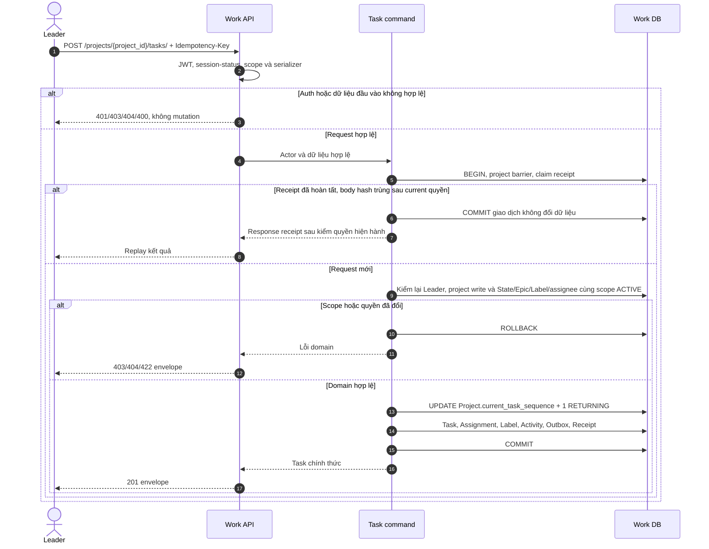

### 2.2. Sequence 2 — Transition và reorder Kanban

Plane đồng bộ completed_at khi state đổi; UTask phân biệt vào COMPLETED, chuyển giữa các cột COMPLETED và reopen. Neighbor ID/rank/revision là policy UTask, không coi paginator offset Plane là cursor board này.

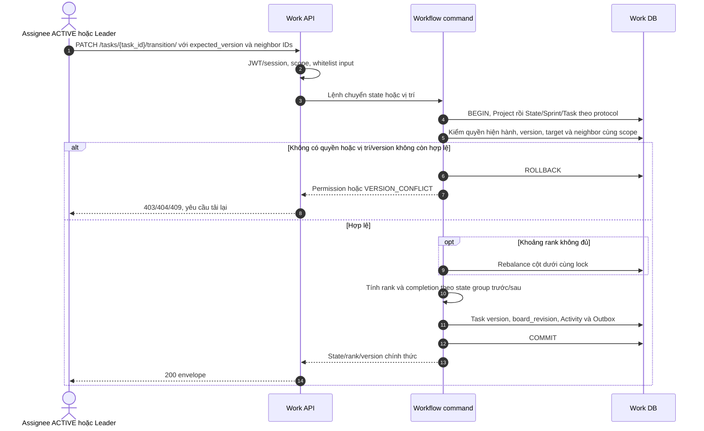

### 2.3. Sequence 3 — Block hoặc unblock

Blocked là cờ do người dùng ghi, không tự đổi state; tín hiệu dependency/overdue do Work rules tính riêng. Bật blocked trên terminal Task bị từ chối; unblock không sửa state.

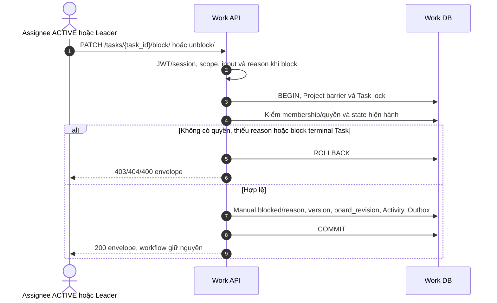

### 2.4. Sequence 4 — Close Sprint và rollover (P1)

Học thứ tự snapshot-before-transfer của Plane. UTask giữ hàng membership lịch sử thay vì đổi cycle_id trên hàng cũ. Source phải ACTIVE; với một ACTIVE/project, target kế tiếp hợp lệ trong MVP là DRAFT hoặc backlog, không một ACTIVE thứ hai.

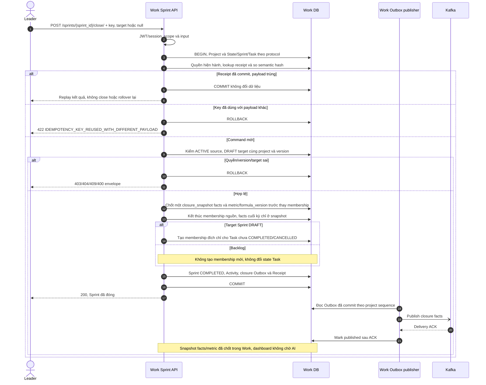

Receipt replay dùng protocol chung mục 1.5 của Work API, không close lại hoặc tạo membership lần hai. Lỗi publisher chỉ để Outbox pending/retry, không rollback Sprint đã commit; dashboard phân biệt báo cáo chưa cập nhật.

### 2.5. Sequence 5 — Dependency canonical và kiểm cycle

Plane đảo chiều relation khi nhận tên nghịch đảo, nhưng cho relation xuyên project trong workspace ở đường đã đọc. UTask giữ same-project/DAG. Permission kiểm trên Task trong URL trước khi chuẩn hóa BLOCKED_BY, không vô tình buộc Member phải được giao cả task target.

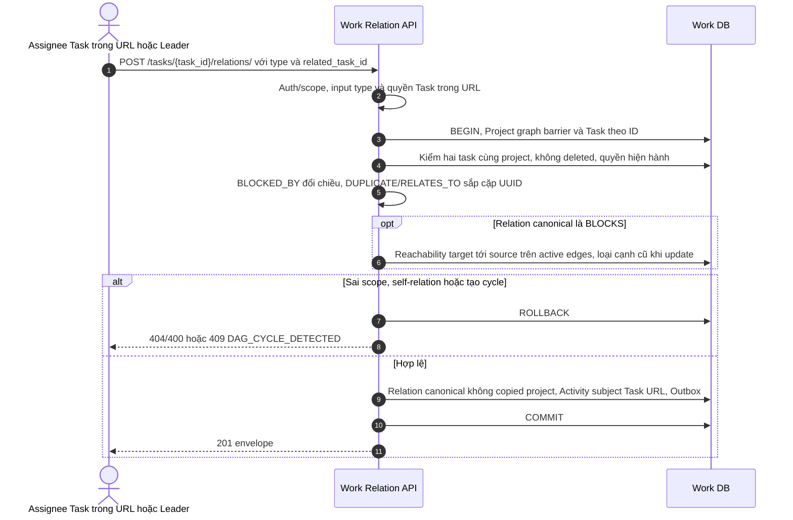

RELATES_TO/DUPLICATE kiểm scope nhưng không đi vào DAG. Delete/update/restore/AI batch cùng barrier; relation lookup chấp nhận Task URL là một trong hai đầu cạnh, không bỏ sót BLOCKED_BY vì lưu chiều canonical.

### 2.6. Sequence 6 — User gọi nhóm AI, Work áp dụng backlog đã duyệt

AI Service/AIDB do nhóm khác phụ trách, được vẽ như một hệ thống ngoài ranh giới Work. Không áp đặt schema AI, job nội bộ hoặc quyền truy cập từ một sơ đồ Work. Work chỉ chịu context export và mutation đã được user duyệt. API AI là hợp đồng cần nhóm AI cung cấp, chưa có source trong repo.

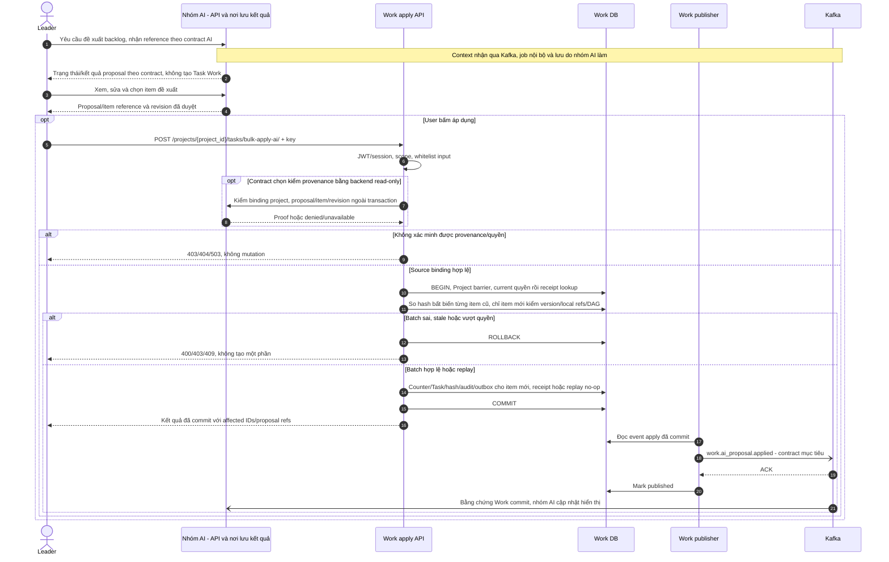

Mất response/event sau commit: dùng receipt/provenance lookup/replay, không tạo mutation mới. User chỉ xem/sửa draft không làm Work ghi report. AI không tự báo APPLIED vì user bấm nút. Schema proof/event/reconcile phải được hai nhóm thống nhất; sơ đồ không chứng minh AI đã triển khai.

### 2.7. Sequence 7 — Subtask đã duyệt và context Work bất đồng bộ

User gọi AI theo contract nhóm AI. Work nhận request context qua Kafka nếu contract chọn snapshot bổ sung; worker chỉ export dữ liệu Work và không chờ agent chạy LLM. Khi apply, Member chỉ làm trên task cha được giao, không dùng AI để đổi assignee/estimate/deadline hoặc state parent.

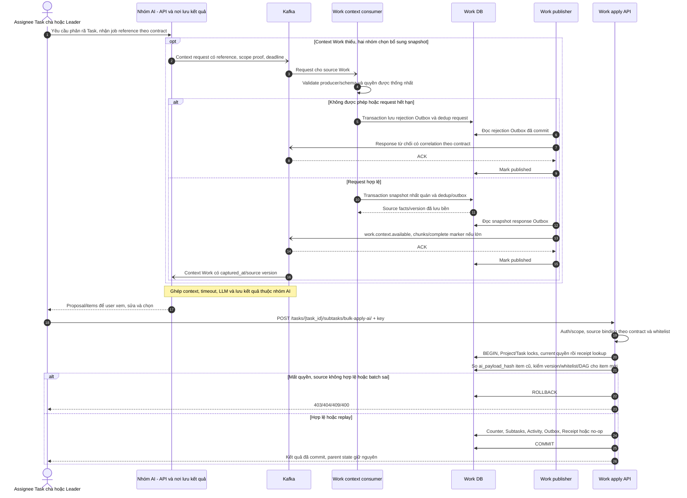

Snapshot export không đọc DB Classroom/Integration. Request event không tự cấp quyền, dedup/offset sau effect commit hoặc response rejection lưu bền/ACK. Context timeout thuộc nhóm AI, không Work HTTP query chờ Kafka. Result apply được trả/phát theo Sequence 6. Agent không gọi Work REST/DB lấy context.

### 2.8. Sequence 8 — GitHub event, candidate và user confirm

Integration là owner provider. Tách Integration DB/publisher, Work consumer và Work API; DB không gửi Kafka, consumer không nhận command người dùng. Cùng event_id/hash dedup, source version/generation bảo vệ stale updates.

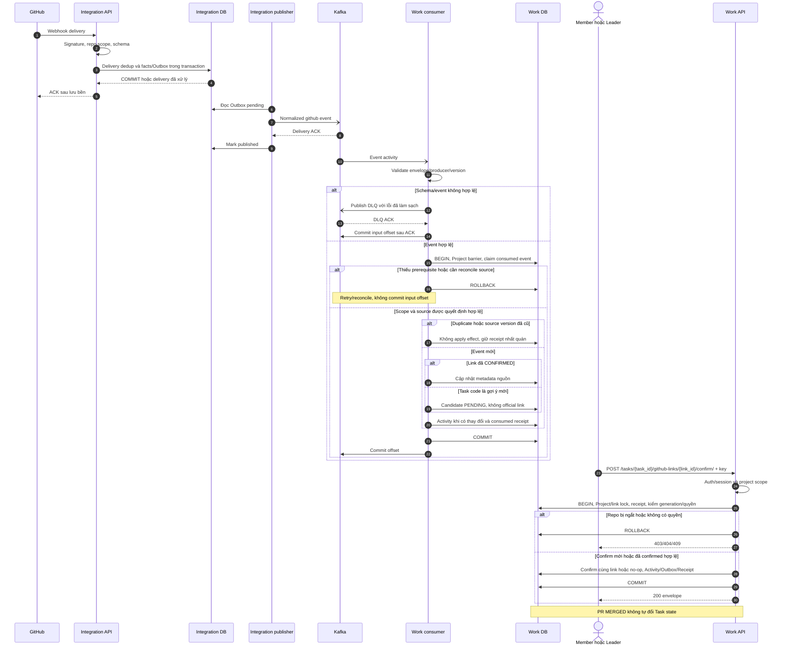

Duplicate delivery không tạo Outbox mới ở Integration. Event thiếu prerequisite/project/source snapshot phải retry/reconcile dưới rollback, không coi là nhánh “repo hợp lệ”. DB lỗi không commit offset. Consumer duplicate khác hash hoặc unsupported version không ghi PROCESSED. Hủy/link thủ công vẫn qua Work API theo scope.

### 2.9. Sequence 9 — Teacher feedback và mention

Plane comment: permission → serializer → save → background activity. Work bổ sung Teacher đúng lớp, CommentMention và Activity/Outbox atomic; feedback không đổi kế hoạch Task.

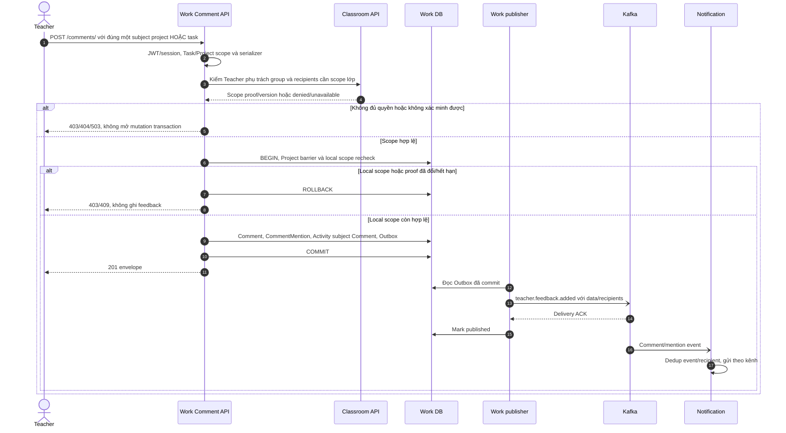

Nếu local scope/proof đã đổi hoặc DB constraint fail dưới lock thì rollback, không trả 201. Edit giữ diff người được nhắc và chỉ phát recipients mới; cùng audit history. Scope proof có expiry/version, REST không tạo strong consistency xuyên DB.

### 2.10. Sequence 10 — Tạo project từ group

Plane tạo Project → creator member → default states. UTask khác quyền: Group Leader đã được Classroom xác nhận và kế thừa toàn bộ membership/role nguồn, không tự nâng một Member.

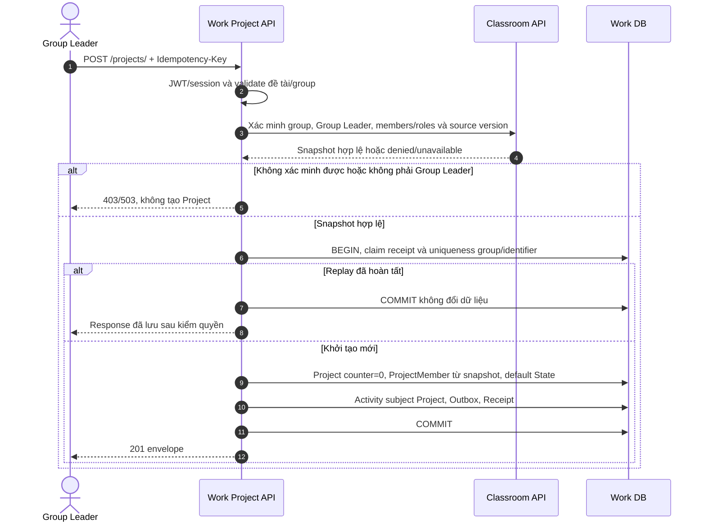

Unique conflict/DB lỗi rollback toàn bộ, không có project thiếu State/Member. Group thay đổi sau verify được xử lý bằng source version/reconcile; không có FK hoặc transaction xuyên Classroom DB. Membership consumer cập nhật Work bằng source version dưới Project barrier, cùng activity/outbox/dedup.

### 2.11. Sequence 11 — Chọn repository qua Integration

Luồng GitHub App/OAuth của UTask, không sao chép lời gọi provider trong monolith Plane vào Work. Integration là source connection; operation_id cho retry, expected generation cho concurrent change.

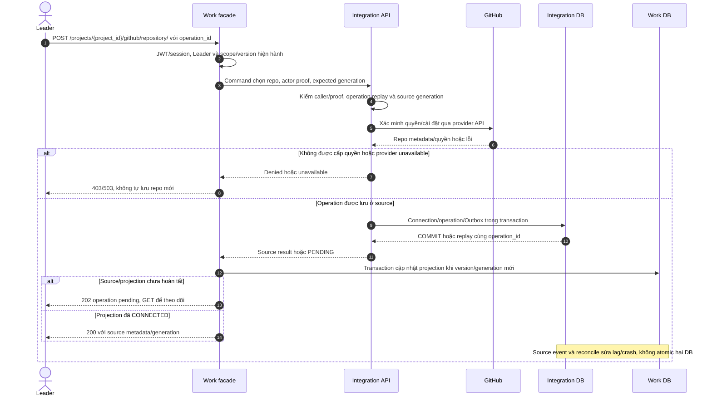

Không giữ Work transaction trong lúc gọi Integration/GitHub. Receipt replay có thể trả source result cũ sau kiểm quyền mà không gọi provider; Response/Event cũ không ghi đè source mới; repo cũ/link cũ giữ lịch sử. Work DB lỗi sau Integration commit cần reconcile theo operation_id, không tuyên bố provider connection đã rollback. Group/Leader permission đã mất lúc cập nhật phải xử lý theo source proof và policy ownership, không cấp quyền từ metadata client.

### 2.12. Sequence 12 — Tệp Task/Project: upload, confirm và download

resource_path là `/tasks/{task_id}` hoặc `/projects/{project_id}`; server resolve đúng một subject, không nhận hai owner từ body.

Plane FileAsset được tạo trước presign và cập nhật is_uploaded sau đó; UTask học vòng đời một hàng, nhưng thêm owner/subject/expiry/content validation và CONFIRMED-only scope.

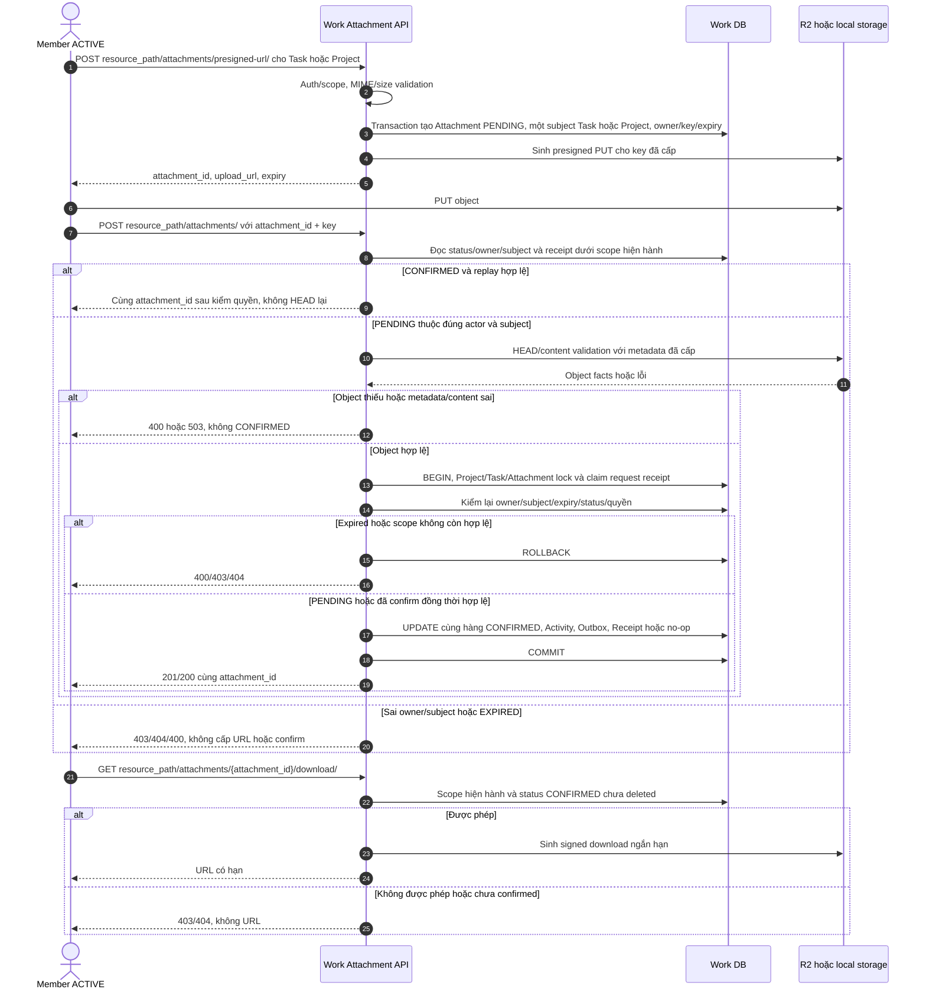

`key` trong lệnh confirm là Idempotency-Key header, không là storage_key client chọn. Retry CONFIRMED kiểm quyền/receipt trước khi yêu cầu HEAD lại; không INSERT attachment thứ hai. Presign lỗi để PENDING cleanup, không giả đã upload. Chỉ CONFIRMED được list/count/download; signed PUT có thể còn hạn sau confirm nên storage immutability/checksum/version policy phải được chốt khi tích hợp R2, không coi HEAD metadata là toàn bộ bảo vệ nội dung.

## 3. Đối chiếu mã Plane và giới hạn kế thừa

Source đã đọc: nhánh preview, commit **7466675e471efe1c96b122615f7a0d30c9b2eb05**. Không chạy Plane runtime; đây là bằng chứng source tại một snapshot.

| Luồng | Source Plane | Điều được kế thừa / khác biệt UTask |
| --- | --- | --- |
| Task create | [Issue create](https://github.com/makeplane/plane/blob/7466675e471efe1c96b122615f7a0d30c9b2eb05/apps/api/plane/app/views/issue/base.py#L405), [serializer validation](https://github.com/makeplane/plane/blob/7466675e471efe1c96b122615f7a0d30c9b2eb05/apps/api/plane/api/serializers/issue.py#L110) | Permission/validation trước save. Plane cho member tạo; UTask backlog Leader-only. |
| Sequence allocator | [Issue.save](https://github.com/makeplane/plane/blob/7466675e471efe1c96b122615f7a0d30c9b2eb05/apps/api/plane/db/models/issue.py#L180) | Plane advisory lock + Max ledger; UTask Project counter dưới barrier đã có, không thêm bảng một-hàng/project. |
| Completion/board | [completion hook](https://github.com/makeplane/plane/blob/7466675e471efe1c96b122615f7a0d30c9b2eb05/apps/api/plane/db/models/issue.py#L240), [grouped offset](https://github.com/makeplane/plane/blob/7466675e471efe1c96b122615f7a0d30c9b2eb05/apps/api/plane/utils/paginator.py#L195) | Hook xử lý completion/reopen; UTask giữ mốc khi đổi cột cùng COMPLETED và có board revision riêng. |
| Sprint rollover | [transfer snapshot/links](https://github.com/makeplane/plane/blob/7466675e471efe1c96b122615f7a0d30c9b2eb05/apps/api/plane/utils/cycle_transfer_issues.py#L410) | Snapshot trước transfer. Plane update cycle_id trên link; UTask kết thúc membership cũ/tạo mới, giữ history, Work tính metric nội bộ. |
| Dependency | [relation create](https://github.com/makeplane/plane/blob/7466675e471efe1c96b122615f7a0d30c9b2eb05/apps/api/plane/app/views/issue/relation.py#L209) | Có chuẩn hóa chiều, workspace scope; UTask same-project/DAG lock, không chứng minh cycle detector UTask từ Plane. |
| Comment/activity | [comment create](https://github.com/makeplane/plane/blob/7466675e471efe1c96b122615f7a0d30c9b2eb05/apps/api/plane/app/views/issue/comment.py#L64) | Scope/serializer/save trước background task. UTask audit/Outbox cùng mutation TX; không sao chép delay call rồi hứa durability. |
| Project setup | [Project create](https://github.com/makeplane/plane/blob/7466675e471efe1c96b122615f7a0d30c9b2eb05/apps/api/plane/app/views/project/base.py#L257) | Creator membership/default State; UTask xác minh Classroom Group Leader và kế thừa membership, không Admin creator bất kỳ. |
| Attachment | [FileAsset create/presign](https://github.com/makeplane/plane/blob/7466675e471efe1c96b122615f7a0d30c9b2eb05/apps/api/plane/app/views/asset/v2.py#L116), [confirm và project access](https://github.com/makeplane/plane/blob/7466675e471efe1c96b122615f7a0d30c9b2eb05/apps/api/plane/app/views/asset/v2.py#L418) | Học vòng đời asset một hàng trước/sau upload; không suy ra Plane có đúng receipt/expiry/content validation của UTask. |
| AI/GitHub integrations | Không có bằng chứng ở các đường source trên cho ownership/context/event như UTask | Tuân theo docs/system và PRD UTask, không gắn nhãn “kế thừa Plane” cho thiết kế chưa được source chứng minh. |

## 4. Kết quả rà soát và điều kiện triển khai

Phạm vi Work: nội bộ AI/AIDB do nhóm khác. Đã sửa ở tầng thiết kế: Sequence 5 flowchart → sequence, nhánh rollback, tách publisher khỏi DB, api/consumer khác lifeline, Project counter/Activity/Attachment mới, COMPLETED/CANCELLED policy, context-not-ready, human apply, source authority và thêm 3 luồng còn thiếu.

[Mermaid Sequence syntax](https://mermaid.js.org/syntax/sequenceDiagram.html) hỗ trợ actor/lifeline, message/response, alt/else, opt và message async được dùng ở đây. Render pass chỉ xác nhận cú pháp; review source/API/ERD mới kiểm ý nghĩa. Không gọi tài liệu đạt 100% nghiệp vụ hoặc xác nhận implementation.

Khi có code: test auth/IDOR, same-project, rollback/crash/replay, closure concurrent writer, graph cycle concurrent, Kafka ACK/DLQ/source versions, attachment Task/Project expiry/overwrite và provider thật. Quyết định Work về bảng/cardinality/quyền/snapshot đã ghi ở API/ERD và audit mục 6; hợp đồng proof/order/reconcile liên nhóm cần phối hợp, còn runtime phải chứng minh thực thi đúng các lựa chọn đó.

## 5. Ranh giới đã thống nhất trong lần sửa này

Không có service tiến độ riêng; Work query/job tính số liệu trên Work DB. User gọi AI API do nhóm AI phụ trách, Work không tạo job/lưu report. Schema/provenance/context-request/result-event cần contract hai nhóm trước implementation. [Work–AI boundary](../../project-service/ai-boundary-contract.md).

## 6. Quy tắc schema được audit trước implementation

- Comment và Attachment ghi đúng một FK subject; project response của Task comment là field suy ra. Activity giữ đúng một subject, nguồn history không bị hard-delete State/Epic/Label.
- Close Sprint chốt facts vào một closure_snapshot, SprintTask chỉ timeline/lý do ADD và REMOVE riêng; không is_scope_creep persisted hay bản snapshot thứ hai trên junction.
- TaskRelation scope suy từ Task, loại vô hướng canonical theo UUID, permission trước normalize. Work provenance scalar, không JSON chứa dữ liệu AI.
- Receipt/replay sau current permission **trước** expected version cho mutation mới; replay đã có không fail vì chính lần apply đầu đã tăng version. AI cùng item/actor/key khác lookup cùng operation, không hai row authoritative.
- AI/Integration/Identity ordered-source contracts chưa có code phải được xác nhận; source event_id hoặc lúc nhận không tự là entity version.

Các nhánh/schema này được đối chiếu tại [ERD audit](../../project-service/erd-audit-20261008.md); render không thay test concurrency.
