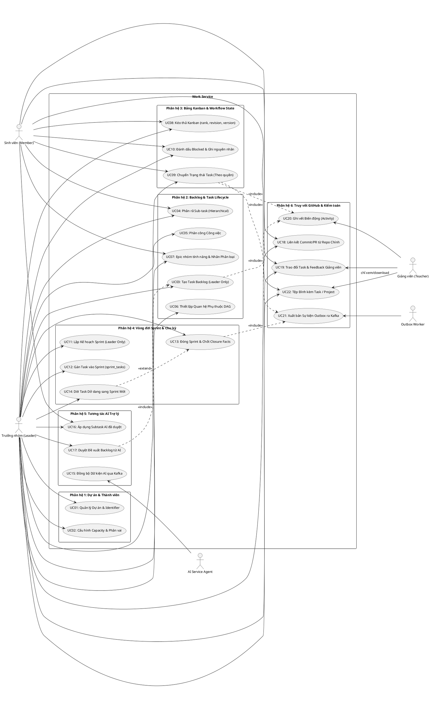
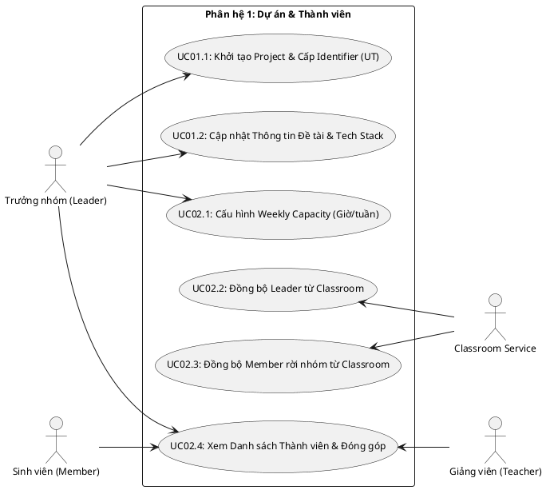
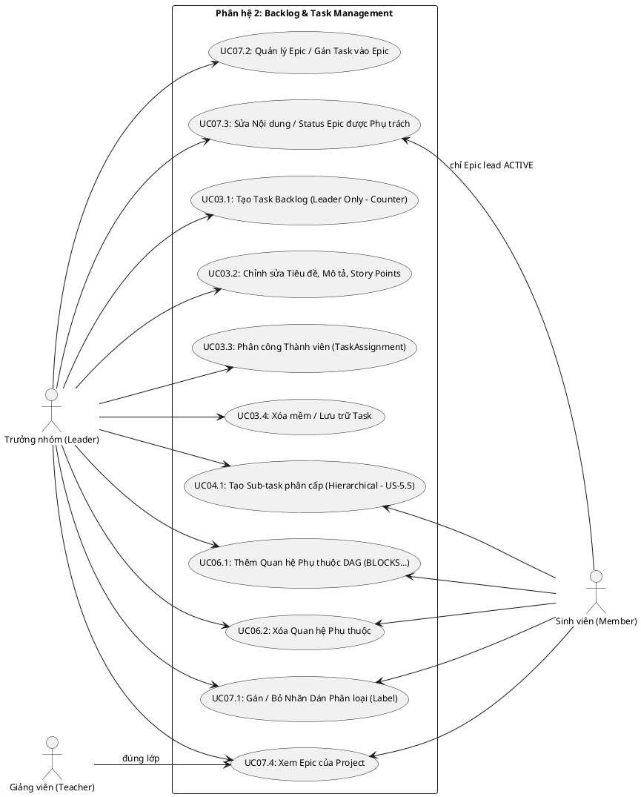
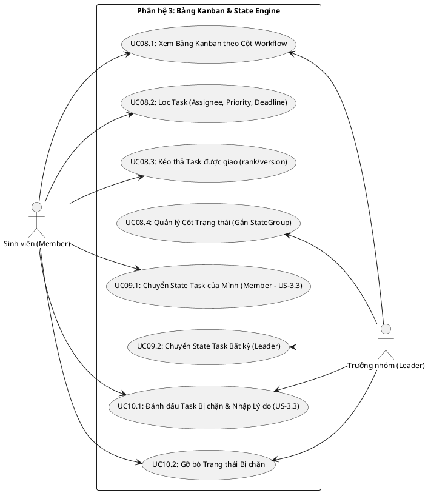
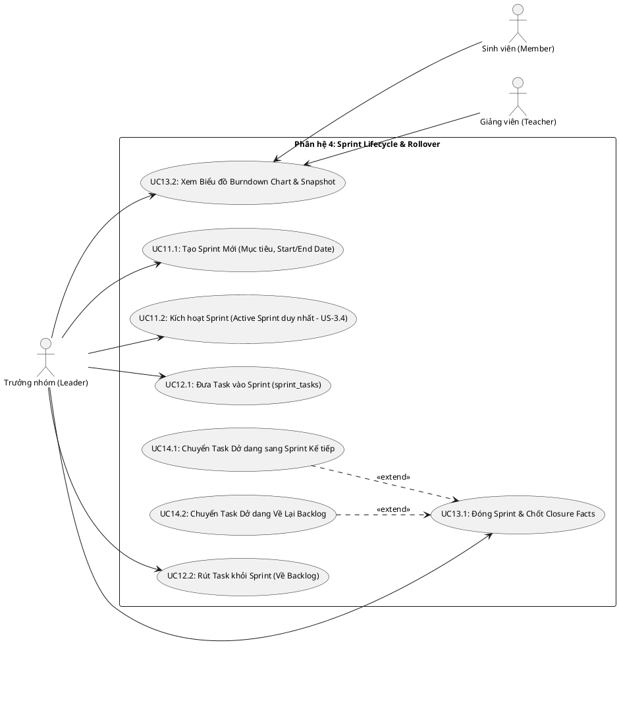
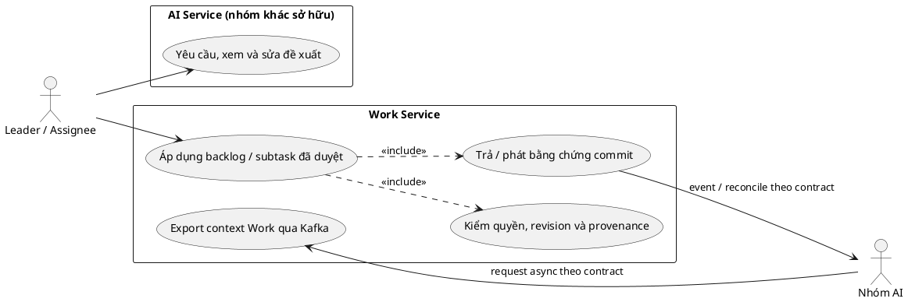
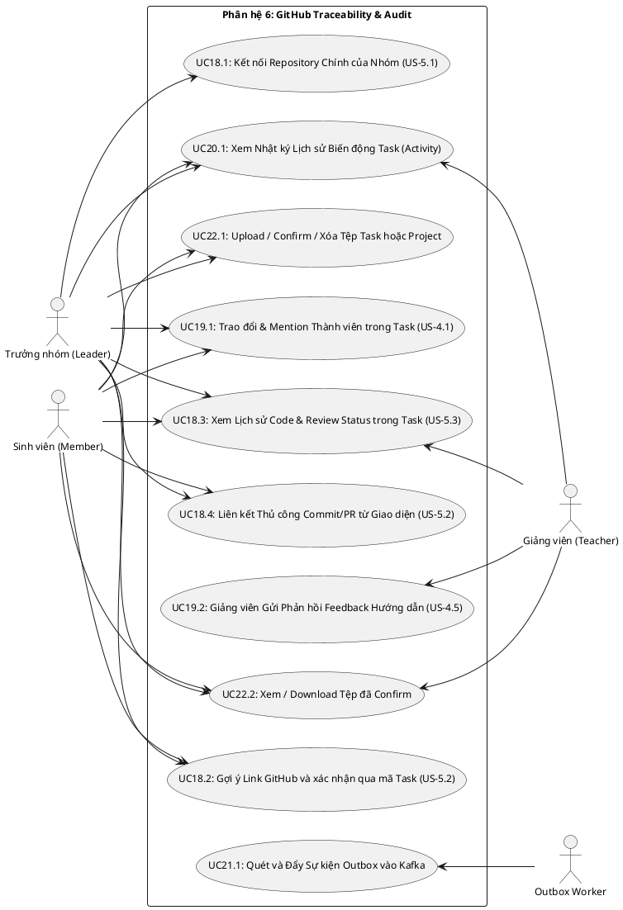

# UTask – Work Service Use Case Diagrams & Detailed Specifications
## Hệ thống Sơ đồ Use Case Phân hệ và Đặc tả Kịch bản Nghiệp vụ Chi tiết (Định dạng PlantUML)

**Phiên bản:** 6.0 (Đồng bộ 08/10/2026)  
**Trạng thái:** Thiết kế mục tiêu — chưa xác minh runtime  
**Service:** `apps/work-service`  
**Tài liệu tham chiếu:**
- [BFD Specification](bfd.md) (Sơ đồ Phân rã Chức năng Nghiệp vụ)
- [docs/architecture/UTask - Phân tích thiết kế yêu cầu.md](../../architecture/UTask%20-%20Phân%20tích%20thiết%20kế%20yêu%20cầu.md) (Source of Truth nghiệp vụ)
- [erd.md](erd.md) (20 bảng mục tiêu, từ điển cột và constraint minh họa)  
**Repository tham khảo thực tế:** [Plane](https://github.com/makeplane/plane) (`apps/api/plane/`)

---

## 1. Danh sách Tác nhân (Actors) & Quyền hạn Hệ thống

Hệ thống `work-service` tương tác trực tiếp với 5 tác nhân chính:

1. **Sinh viên / Thành viên nhóm (Student Member):**
   - Thực thi các công việc được phân công (`task.assignments.contains(user)`).
   - Được phép chuyển đổi trạng thái trên Kanban đối với **task của mình** (US-3.3).
   - Đánh dấu task bị **Blocked** và nhập lý do (US-3.3).
   - Yêu cầu AI phân rã sub-task cho công việc mình phụ trách (US-5.5).
   - Liên kết hoạt động GitHub với task (US-5.2) và tham gia thảo luận comment (US-4.1).
   - *Không có quyền:* Không tạo task trong backlog, không đổi assignee/deadline/trạng thái task của người khác.

2. **Trưởng nhóm sinh viên (Team Leader / Project Owner):**
   - Có toàn bộ quyền của Member.
   - Tạo, phân công và sắp xếp độ ưu tiên của work item trong **Backlog** (US-3.1).
   - Lập kế hoạch, kích hoạt và đóng Sprint (US-3.4); dời việc dở dang (Rollover).
   - Thiết lập `weekly_capacity` của từng thành viên để AI phân tích quá tải.
   - Kết nối 1 repository GitHub chính của nhóm (US-5.1); yêu cầu thành viên xác nhận tài khoản GitHub qua OAuth (Mục 7.4).
   - Yêu cầu AI đề xuất Backlog, xem xét chỉnh sửa và phê duyệt áp dụng (US-5.4).
   - Chuyển trạng thái của mọi task trên Kanban.

3. **Giảng viên (Teacher):**
   - Theo dõi tiến độ Sprint, xem biểu đồ Burndown Chart và snapshot metric Work của các nhóm trong lớp phụ trách.
   - Để lại nhận xét, phản hồi (Feedback) hướng dẫn đồ án ở cấp **Project Dashboard** hoặc **Task chi tiết** (US-4.5).
   - *Quy tắc an toàn (US-4.5):* Phản hồi của Teacher tuyệt đối không tự động thay đổi trạng thái, deadline hay phân công công việc của sinh viên. Không có quyền tạo task backlog.

4. **AI Service Agent (FastAPI + Google ADK):**
   - Đọc AI Context DB riêng được cập nhật qua Kafka; không gọi context REST sang Work.
   - Chạy các agent phân rã task hoặc gợi ý backlog.
   - *Quy tắc an toàn (Mục 7.5):* Hoạt động theo cơ chế **Suggestion-only**, không tự ý tạo task hay thay đổi dữ liệu chính thức vào cơ sở dữ liệu.

5. **Outbox Worker (Celery Daemon):**
   - MVP dùng một publisher, đọc pending theo project_sequence và đợi ACK trước event kế tiếp cùng Project; không dùng nhiều poller SKIP LOCKED để hứa FIFO.
   - Xuất bản domain event ra Apache Kafka topics (`utask.work.events`).
   - Xử lý retry exponential backoff khi Kafka gặp sự cố.

---

## 1.1. Chiến lược Thiết kế Bố cục Tác nhân 2 Phía (2-Sided Actor Layout Strategy)

Để giải quyết triệt để tình trạng các đường liên kết (association lines) bị đan chéo chồng chéo làm rối mắt, toàn bộ hệ thống sơ đồ Use Case của `work-service` áp dụng mô hình **Bố trí Tác nhân 2 Phía (2-Sided Actor Architecture)** theo chuẩn PlantUML / Graphviz:

### 1.1.1. Nguyên lý Điều hướng Graphviz (`left to right direction`)
- **Tác nhân phía Trái (Left Actors - Primary / Initiators):** Khai báo trước khối `rectangle`, kết nối theo chiều thuận `LeftActor --> UC`. Graphviz sẽ xếp các tác nhân này vào Rank 0 (biên trái ngoài cùng) và mũi tên hướng sang phải đi vào Use Case.
- **Khối Use Case Trung tâm (System Boundary):** Nằm trọn vẹn trong `rectangle`, chiếm các rank ở giữa.
- **Tác nhân phía Phải (Right Actors - Supporting / Supervisors / Daemons):** Khai báo sau khối `rectangle`, kết nối theo cú pháp `UC <-- RightActor`. Vế trái là `UC` và vế phải là `RightActor` giúp Graphviz cố định tác nhân ở Rank cực phải; đồng thời ký hiệu `<--` đặt đầu mũi tên ở phía Use Case, đảm bảo mũi tên chỉ đúng hướng từ Actor đi **VÀO** Use Case (`RightActor ──> Use Case`), tạo nên bố cục đối xứng hoàn hảo 2 bên cùng trỏ vào khối Use Case trung tâm.

### 1.1.2. Phân định Vai trò Đối xứng theo Từng Sơ đồ
| Sơ đồ Use Case | Tác nhân Phía Trái (Left) | Tác nhân Phía Phải (Right) | Ý nghĩa Nghiệp vụ & Ranh giới |
| :--- | :--- | :--- | :--- |
| **Tổng thể Hệ thống** | Leader, Member | Teacher, AI Agent, Outbox Worker | Tách biệt Đội ngũ sinh viên thực thi đồ án với Giảng viên giám sát và Hệ thống phụ trợ. |
| **Phân hệ 1: Dự án & Thành viên** | Leader, Member | Teacher | Sinh viên chủ động cấu hình không gian làm việc; Giảng viên theo dõi và nhận bàn giao quyền. |
| **Phân hệ 2: Backlog & Task DAG** | Leader | Member | Phân định Quản trị Backlog (Leader) với Thực thi Phân rã Sub-task & Ràng buộc DAG (Member). |
| **Phân hệ 3: Bảng Kanban & State** | Member | Leader | Thực thi Tác nghiệp hàng ngày (Member) với Quản trị Cấu hình & Xử lý Ngoại lệ (Leader). |
| **Phân hệ 4: Sprint & Rollover** | Leader | Member, Teacher | Điều phối Chu kỳ Scrum (Leader) với Theo dõi Đo lường Vận tốc Burndown (Member & Teacher). |
| **Phân hệ 5: AI Assistant** | Leader, Member (Human) | AI Service Agent (Machine) | Thể hiện nguyên tắc **Human-in-the-loop**: Người duyệt bên trái, Máy đề xuất bên phải. |
| **Phân hệ 6: GitHub & Kiểm toán** | Leader, Member | Teacher, Outbox Worker | Nhóm đồ án đẩy code/thảo luận; Giảng viên phản hồi và Worker đồng bộ sự kiện nền. |

---

## 2. Hệ thống Sơ đồ Use Case (PlantUML Format)

### 2.1. Sơ đồ Use Case Tổng thể Hệ thống

---

### 2.2. Sơ đồ Use Case Chi tiết Phân hệ 1: Quản lý Dự án & Thành viên (Epic 2)

---

### 2.3. Sơ đồ Use Case Chi tiết Phân hệ 2: Backlog, Task & Phụ thuộc (Epic 3, US-3.1 & US-5.5)

---

### 2.4. Sơ đồ Use Case Chi tiết Phân hệ 3: Bảng Kanban & Workflow State Engine (US-3.2, US-3.3)

---

### 2.5. Sơ đồ Use Case Chi tiết Phân hệ 4: Vòng đời Sprint & Dời Chu kỳ (P1 Pilot - US-3.4)

*Ghi chú Nghiệp vụ:* Chức năng Sprint thuộc nhóm ưu tiên **Should** (PRD US-3.4 và mục 8.2 P1), được kích hoạt sau khi quy trình Kanban cơ bản đã ổn định. Giảng viên chỉ có quyền xem (Read-only) biểu đồ Burndown, tuyệt đối không có quyền can thiệp Đóng Sprint. Khi đóng Sprint, việc dở dang có thể dời sang Sprint mới hoặc đưa về Backlog.

---

### 2.6. Phân hệ 5: Work áp dụng kết quả AI (nội bộ AI ngoài phạm vi)

User yêu cầu/xem/sửa đề xuất tại AI API thuộc nhóm AI; Work chỉ export context và apply đã duyệt. Không vẽ AI request/storage bên trong Work boundary. Các đường tích hợp là contract mục tiêu, chưa có source.

### 2.7. Sơ đồ Use Case Chi tiết Phân hệ 6: Truy vết GitHub & Kiểm toán (US-4.1, US-4.5, US-5.1 $\rightarrow$ US-5.3)

---

## 3. Bảng Đặc tả Chi tiết các Use Case Trọng yếu

| Mã UC | Tên Use Case | Actor Chính | Tiền điều kiện | Hậu điều kiện | Luồng Sự kiện Chính (Main Flow) & Ràng buộc Nghiệp vụ |
| :---: | :--- | :---: | :--- | :--- | :--- |
| **UC03.1** | **Tạo Task trong Backlog** | Team Leader | Leader đã đăng nhập, thuộc project. | Task mới được tạo với mã `UT-X`, lưu sequence và outbox event. | 1. Leader gửi thông tin task (`title`, `description_html`, `type`, `priority`, `story_points`, `due_date`). 2. **Kiểm tra quyền:** Nếu không phải `LEADER` $\rightarrow$ Trả về `403 Forbidden` (US-3.1). 3. Mở transaction với project barrier và durable receipt. 4. Project.current_task_sequence UPDATE RETURNING cấp N mã trong transaction. 5. Tự động sinh `description_stripped = strip_tags(html)` cho AI. 6. Lưu `Task`, `Project.current_task_sequence`, `Activity` và `OutboxEvent` (`task.created`). 7. Commit transaction, lock tự giải phóng. |
| **UC04.1** | **Phân rã Sub-task** | Member phụ trách / Leader | Task cha tồn tại và thuộc project của nhóm. | Sub-task mới được tạo có `parent_id = task_cha.id`. | 1. Member phụ trách task cha hoặc Leader gửi yêu cầu tạo việc con. 2. Cấp phát mã `sequence_id` mới cho sub-task. 3. **Quy tắc US-5.5:** Task cha **không tự động đổi trạng thái** khi tạo sub-task. 4. Ghi Activity subject Task con (`task_id`, `verb='created'`); quan hệ cha nằm ở Task.parent_id, không có cột Activity.parent_id. |
| **UC08.3** | **Kéo thả Thẻ Kanban** | Member, Leader | Board Kanban đang mở, task thuộc cột workflow. | Rank/version/board_revision được cập nhật; rebalance có chi phí O(n). | 1. Người dùng kéo thả thẻ vào giữa thẻ $A$ và thẻ $B$. 2. Client gửi neighbor IDs và expected_version, server đọc rank dưới lock. 3. Server kiểm version/scope; rank hết khoảng thì rebalance và tăng board_revision. 4. Ghi Activity/Outbox cùng transaction; rebalance khi cần, cursor cũ yêu cầu refresh. |
| **UC09.1** | **Chuyển State Task của Mình** | Team Member | Member đã đăng nhập và được giao task (`assignments`). | Trạng thái task được cập nhật, event bắn ra Outbox. | 1. Member kéo thẻ task sang cột mới. 2. **Kiểm tra quyền US-3.3:** Backend kiểm tra `user_id in task.assignments`. Nếu task của người khác $\rightarrow$ Chặn `403 Forbidden`. 3. Vào COMPLETED từ nhóm khác mới gán completed_at; đổi cột cùng COMPLETED/reorder giữ mốc, reopen clear mốc và ghi Activity. 4. Ghi `Activity` và `OutboxEvent` (`task.status.changed`). |
| **UC10.1** | **Đánh dấu Task Bị chặn (Blocked)** | Member được giao / Leader | Task không thuộc COMPLETED/CANCELLED và project còn ghi được. | Cờ `is_blocked = true`, lưu `blocked_reason`, Kanban viền đỏ. | 1. Người phụ trách phát hiện trở ngại (phụ thuộc task khác, đợi review). 2. Bật cờ `is_blocked = true` và bắt buộc nhập lý do vào `blocked_reason` (US-3.3). 3. Thẻ trên bảng Kanban hiển thị viền đỏ cảnh báo và icon blocked. 4. Work tính rule công việc và phát facts để nhóm AI nhận context. |
| **UC13.1, UC14.1 & UC14.2**| **Đóng Sprint, Dời việc hoặc Trả về Backlog** | Team Leader | Sprint hiện tại đang `ACTIVE`. | Sprint cũ `COMPLETED`, chốt snapshot; xử lý việc dở dang linh hoạt. | 1. Leader kích hoạt đóng Sprint. 2. Chốt closure_snapshot facts cuối kỳ; Work tính/chốt metric versioned trong cùng closure_snapshot; nhóm AI có thể nhận facts để phân tích riêng. 3. Lọc toàn bộ các task có `StateGroup không thuộc COMPLETED/CANCELLED` qua bảng trung gian `sprint_tasks`. 4. **Lựa chọn nghiệp vụ linh hoạt (<<extend>>):** - Nhánh A: Chuyển sang Sprint kế tiếp (`UC14.1`), tạo bản ghi `sprint_tasks` mới và cập nhật membership SprintTask hiện hành. - Nhánh B: Đưa task dở dang về lại Backlog của dự án (`UC14.2`), kết thúc membership bằng ended_at/end_reason, không tạo hàng Sprint đích. 5. Chốt state/points/assignees trong closure_snapshot duy nhất; kết thúc membership bằng ended_at/end_reason để giữ lịch sử; Work dựng chart từ dữ kiện đã chốt và lịch sử thay đổi. |
| **UC17.1 $\rightarrow$ UC17.3**| **Trợ lý AI Đề xuất Backlog & Duyệt** | Team Leader | Project đã có mục tiêu, đề tài và tech stack. | Hàng loạt task chính thức được tạo trong database. | 1. Leader yêu cầu AI đề xuất backlog từ mô tả đồ án (US-5.4). 2. Nhóm AI nhận context/lưu proposal theo contract riêng $\rightarrow$ Trả về bản nháp đề xuất kèm Story Points và Acceptance Criteria. 3. Leader xem xét trên Modal, chỉnh sửa mức ưu tiên hoặc xóa bớt task. 4. Leader bấm "Chấp thuận & Áp dụng" $\rightarrow$ `work-service` thực thi atomic transaction tạo hàng loạt task có `source = 'AI_BACKLOG'`. |
| **UC18.2** | **Gợi ý GitHub qua Webhook và xác nhận liên kết** | Hệ thống (Consumer) | Webhook từ GitHub đẩy về qua `integration-service`. | Candidate PENDING hoặc metadata link CONFIRMED được cập nhật; user confirm trước khi coi link chính thức. | 1. Sinh viên commit code có kèm mã task (vd: `"feat: login UT-26"`). 2. Webhook đẩy về `integration-service` chuẩn hóa $\rightarrow$ Bắn Kafka event `github.activity.normalized`. 3. Work consumer kiểm repo/generation/version và dedup; link đã confirmed được cập nhật, task code mới chỉ tạo candidate PENDING. Member/Leader confirm mới thành official link. 4. **Quy tắc US-5.2:** PR merge không tự động đổi task sang Done. |
| **UC18.4** | **Liên kết Thủ công Commit/PR vào Task** | Member, Leader | Repository chính đã liên kết, task đang mở trên UI. | Bản ghi `task_github_links` được tạo sau khi xác nhận. | 1. Sinh viên hoặc Leader mở tab GitHub trong giao diện task chi tiết. 2. Nhập Commit SHA, số Pull Request (`#12`) hoặc tên Branch từ repository chính. 3. **Quy tắc US-5.2:** Sinh viên xác nhận trước khi liên kết chính thức. Hệ thống ghi nhật ký biến động `Activity`. |
| **UC19.2** | **Giảng viên Gửi Phản hồi (Feedback)** | Giảng viên phụ trách | Lớp học đang diễn ra, nhóm thuộc lớp giảng viên phụ trách. | Phản hồi được lưu trong dòng thời gian trao đổi của đồ án. | 1. Giảng viên mở Project Dashboard hoặc Task chi tiết của nhóm. 2. Nhập nhận xét/hướng dẫn đồ án. 3. **Kiểm tra quyền US-4.5:** Giảng viên chỉ gửi phản hồi cho lớp mình phụ trách. Nhận xét lưu vào `comments` có `is_teacher_feedback = true`. 4. **Quy tắc an toàn:** Hệ thống tuyệt đối không tự ý đổi trạng thái hay phân công task. |

---

## 4. Quyền và ownership
Các Use Case là thiết kế mục tiêu. Group kick/transfer thực hiện tại Classroom, Work chỉ đồng bộ quyền dự án. Trong sơ đồ Work, actor Classroom consumer là actor phụ trợ; Teacher không có quyền đổi Task/Sprint hoặc tự đổi ProjectMember.

Task create Leader-only; description/transition/block/subtask chỉ Assignee ACTIVE hoặc Leader, whitelist subtask không mở quyền assign/estimate/deadline. Label: Member tạo/sửa metadata nhãn và gán trên task mình phụ trách; delete Leader. Dependency: Assignee task nguồn hoặc Leader; Epic lead được sửa nội dung/status Epic được giao, không điều phối Task ngoài quyền. Đây là quyền bổ sung mục tiêu phải kiểm API/serializer thật khi triển khai.

Teacher phụ trách lớp có read/feedback/download, không upload thay member theo spec này. Admin không mặc định scope nội dung. AI chỉ đọc context nội bộ và gợi ý. Outbox worker chỉ publish, Work consumer xử lý membership/GitHub; không gộp hai vai trò kỹ thuật.

Rollover loại COMPLETED/CANCELLED; facts/metric snapshot Work khác báo cáo AI do nhóm AI giữ. Grouped board/counter/DAG/link confirmation không được gọi là hành vi nguyên trạng Plane.

---

User gửi yêu cầu/xem report qua AI API, không Work facade. Work Use Case chỉ có context export, mutation đã duyệt và bằng chứng commit; nội bộ AIDB không trong phạm vi. [Contract](../../project-service/ai-boundary-contract.md).
