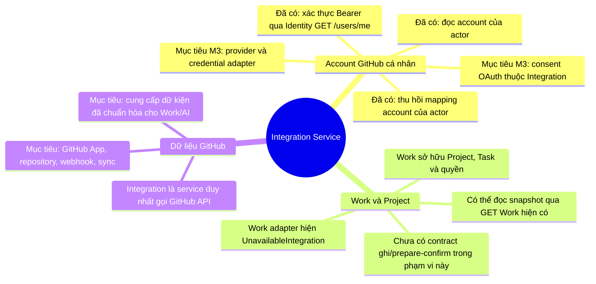

# Integration Service — BFD

**Trạng thái: Một phần.** Nhánh account cá nhân đã có persistence và API đọc/
thu hồi; GitHub consent/provider và các chức năng GitHub khác là mục tiêu.
Nguồn quyền tại [scope-access](../scope-access.md).

Identity xác thực tài khoản UTask và phiên; Integration sở hữu mapping
GitHub cá nhân, consent và credential sau khi các phần đó được triển khai.
Luồng link cá nhân không cần project hoặc quyền leader. Link account không
trao quyền truy cập repository và không cấp quyền Work.

Work sở hữu quyền Project/Task và mutation nghiệp vụ. Các API GET Work chỉ
cung cấp snapshot đọc, không bảo đảm authorization/CAS cho ghi. Không mở
luồng project mutation nếu contract Work tương ứng chưa có. Không có luồng
OAuth proof exchange giữa Integration và Identity.
