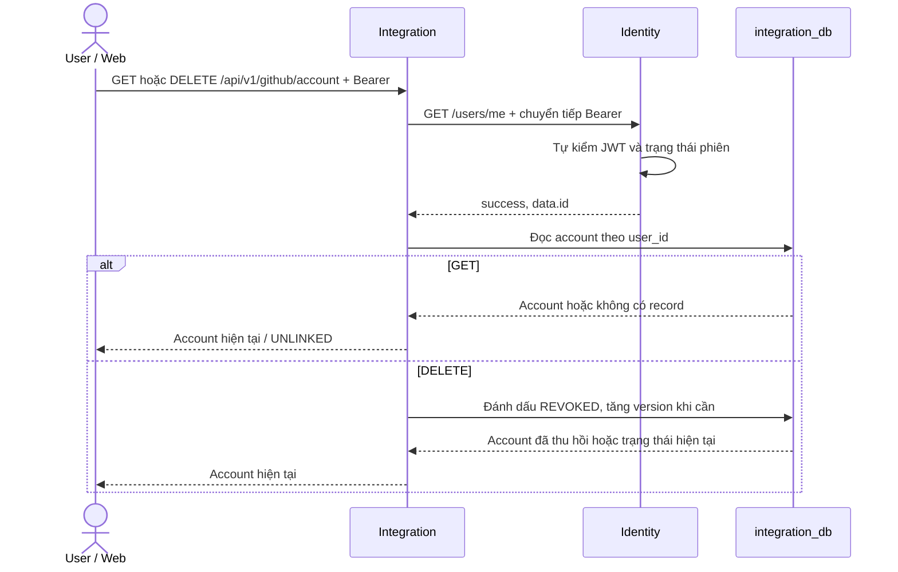
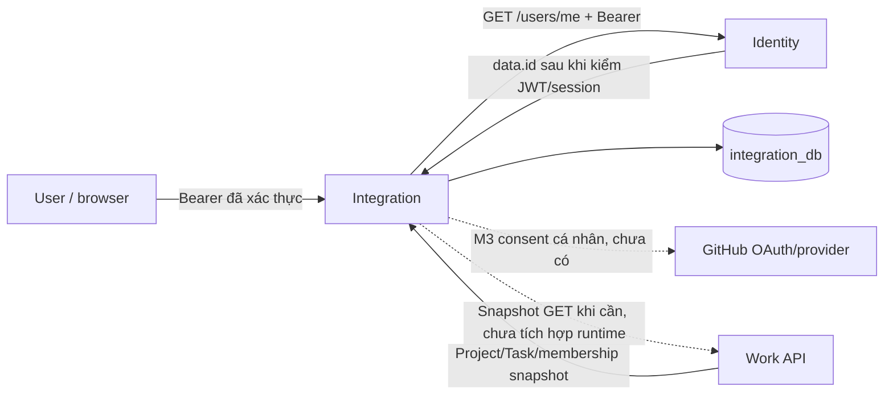

# Integration Service — DFD

**Trạng thái: Một phần.** Sơ đồ trên mô tả luồng account đã có trong source;
OAuth consent và trao đổi với GitHub là mục tiêu. Không mô tả schema/token flow
chưa có. Xem [API](../api.md) và [quyền truy cập](../scope-access.md).

## Luồng API account hiện có

DELETE hiện thu hồi mapping trong Integration; chưa gọi GitHub để thu hồi
token. `user_id` lấy từ Identity, không lấy từ body/query. Identity kiểm JWT
và session; Integration không gọi API mapping SocialAccount hay exchange
OAuth proof.

## Luồng mục tiêu

Consent tương lai sẽ do Integration sở hữu. Không yêu cầu Work project/leader
để liên kết account cá nhân. GitHub App/repository, webhook, đồng bộ, context
Work/AI và Kafka chưa được triển khai.

Work sở hữu Project, Task, quyền và các mutation nghiệp vụ. GET Work hiện có
cho `/projects/{id}/`, `/tasks/{id}/` và `/projects/{id}/members/` chỉ đủ cho
snapshot đọc, không bảo đảm authorization hoặc CAS cho ghi. Không có luồng
prepare/confirm hay mutation trong sơ đồ mục tiêu khi chưa có contract Work.
