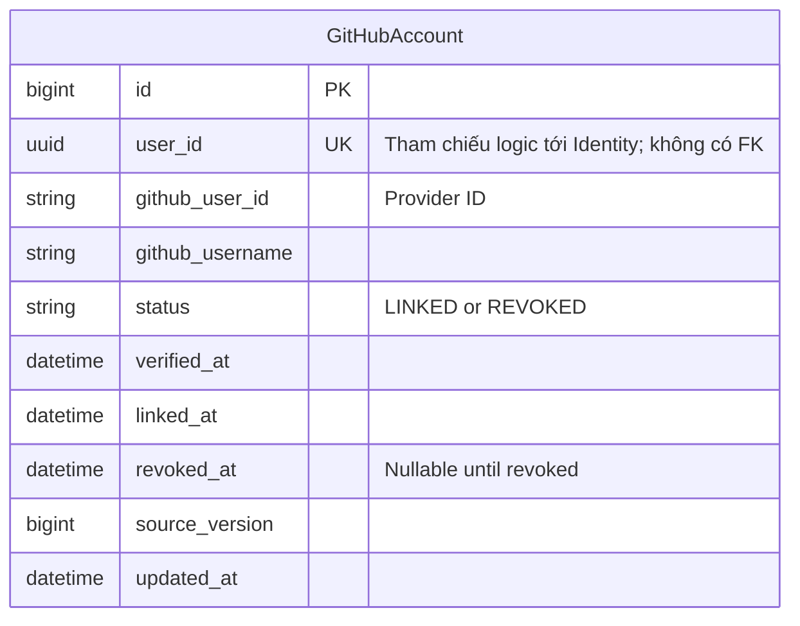

# Integration Service — ERD

**Trạng thái: Một phần.** `GitHubAccount` là bảng đã có model/migration;
OAuth consent, provider credential và dữ liệu GitHub khác chưa có schema trong
source. Đây là ERD duy nhất trong tài liệu phản ánh bảng hiện tại. Nguồn chuẩn
về ownership là [scope-access](../scope-access.md); migration tại
[`0001_initial.py`](../../../apps/integration-service/apps/github_accounts/migrations/0001_initial.py).

`user_id` là UUID tham chiếu logic tới Identity, không có FK. Không nhập hay
đọc mapping từ database Identity/Work. Bảng không lưu GitHub token.

Migration/model áp constraint: một record cho mỗi user UTask, tối đa một
mapping `LINKED` cho mỗi GitHub user ID, cặp status/thời điểm thu hồi hợp lệ,
version dương, UUID UTask khác zero và định dạng ID/login chuẩn. Source dùng
primary key số tự tăng bên cạnh unique `user_id`.

OAuth state, scopes, credential storage, refresh/revoke state, installations,
repositories, webhook deliveries, sync jobs and outbox are omitted: none has a
current Integration model/schema. They will be documented from an approved
contract và implementation; sơ đồ không đề xuất định nghĩa bảng cho các phần đó.
