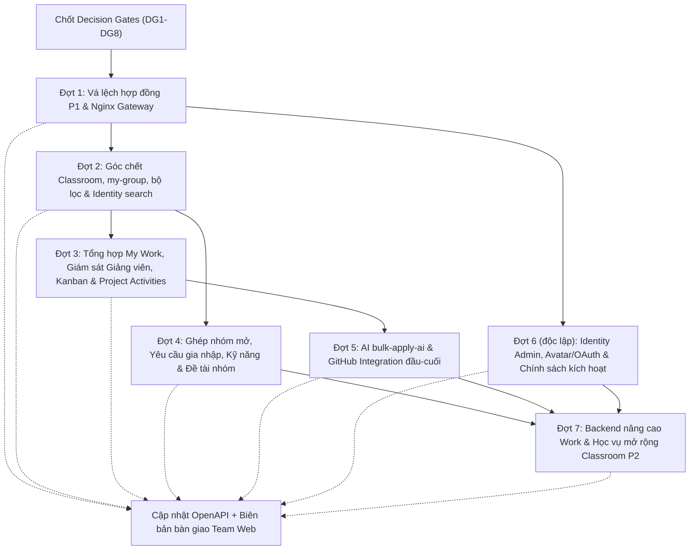

# Kế hoạch triển khai Backend xử lý khoảng trống API, Hợp đồng và Tích hợp (Identity · Classroom · Work · Integration · AI · Gateway)

> **Trạng thái tài liệu:** `Đang triển khai` (DG1–DG8 đã được phê duyệt ngày 2026-11-24; **Đợt 1, Đợt 2, Đợt 3 & Đợt 4:** `Đã triển khai (local)` — đạt toàn bộ unit/integration PostgreSQL/contract + kiểm chứng HTTP thật & Kafka Cloud và đã bàn giao biên bản Web, deploy staging `Chưa xác minh`; Đợt 5–7: `Chưa triển khai`).  
> **Phạm vi thực thi của Team Core Backend:** **CHỈ 3 SERVICE CỐT LÕI (`apps/identity-service`, `apps/classroom-service`, `apps/work-service`), GATEWAY, CẤU HÌNH ENV, HỢP ĐỒNG & TÀI LIỆU** (`infra/nginx/nginx.conf`, `.env.example`, `infra/env/{identity,classroom,work}-service.env`, `contracts/`, `docs/`). **KHÔNG chỉnh sửa mã nguồn thuộc các đội khác: `apps/web/**`, `apps/ai-service/**`, `apps/integration-service/**`, `apps/notification-service/**`.**  
> **Tài liệu bàn giao cho các đội khác:**
> - **Team Web (`apps/web`):** [Biên bản bàn giao & Hướng dẫn tích hợp cho Team Web](../web/backend-api-handoff-guide.md) (cập nhật sau mỗi đợt).
> - **Team AI (`ai-service`), Team Integration (`integration-service`) & Team Notification (`notification-service`):** [Hướng dẫn bàn giao & Phối hợp hợp đồng liên đội](ai-integration-team-handoff-guide.md) (đặc tả chi tiết phần provider cần làm ở Đợt 5–7 để khớp với Work/Identity/Classroom).  
> **Trạng thái hiện trạng hệ thống:** `Một phần` (đối chiếu thực tế trên checkout nhánh `feat/classroom-student-course-visibility`, commit gốc `be31707`).

Tài liệu này là kế hoạch triển khai **thuần phía Backend** nhằm lấp đầy toàn bộ khoảng trống API, góc chết vòng đời, adapter stub và lệch hợp đồng đã đối chiếu giữa 4 ứng dụng chính cùng `integration-service`, `ai-service` và Nginx Gateway. Mọi công việc phía giao diện `apps/web` — bao gồm cả việc nối các API Backend đã có sẵn — được tách hoàn toàn sang tài liệu bàn giao cho team Web để tránh trùng phạm vi trách nhiệm.

---

## 1. Đối chiếu hiện trạng và phân tách trách nhiệm Backend vs Team Web

Mọi nhận định dưới đây đã được kiểm chứng trực tiếp trên mã nguồn hiện tại (không suy diễn từ tài liệu cũ hay mock).

### 1.1. Thống kê năng lực API đã kiểm chứng

| Thành phần | Hiện trạng | Quy mô endpoint đã xác minh | Nguồn đối chiếu |
| --- | --- | --- | --- |
| Identity Service | `Một phần` | **27 thao tác OpenAPI / 25 path** mặc định (35 thao tác / 31 path khi bật đủ 3 cờ Avatar, Google, GitHub) + 3 route hạ tầng (`/healthz`, `/openapi/`, `/docs/`). Lưu ý: repo chưa lưu `contracts/api/identity-service.yaml` (sinh qua `manage.py export_identity_api`) và `docs/identity-service/api-specification.md:204` đang ghi cũ là 25 thao tác. | `apps/identity-service/config/urls.py`, `authentication/urls.py`, `accounts/urls.py`, `tests/fixtures/api_operations.py` |
| Classroom Service | `Một phần` | **37 thao tác / 32 path** (32 thao tác công khai / 27 path + 5 internal path cho Work) + 3 route hạ tầng — khớp 1:1 với `contracts/api/classroom-service.yaml`. | `apps/classroom-service/apps/{courses,groups,messaging}/urls.py`, `contracts/api/classroom-service.yaml` |
| Work Service | `Một phần` | **84 thao tác / 65 URL pattern** (76 thao tác công khai / 57 path + 5 internal path cho AI/Integration/Notification + 3 route hạ tầng); `contracts/api/work-service.yaml` v1.5 mô tả 61 path / 80 thao tác. | `apps/work-service/config/urls.py`, `apps/{projects,sprints,tasks,collaboration,integrations}/urls.py` |
| Integration Service | `Một phần` | Đã có public API quản lý GitHub account, OAuth PKCE, GitHub App installation/repositories, webhook inbox (`ping`, `installation`, `installation_repositories`, `github_app_authorization`), và 6 internal API cho Work/AI (`contracts/api/integration-service-v1.yaml` v1.4.0); **mặc định tắt cờ**, chưa xử lý webhook `push`/`pull_request` và chưa phát event tài khoản GitHub. | `apps/integration-service/config/urls.py`, `apps/github_connections/api.py`, `apps/github_jobs/webhooks.py` |
| AI Service | `Một phần` | Chỉ có 3 route: `/healthz`, `POST /api/ai/v1/requests`, `GET /api/ai/v1/requests/{request_id}`. **Chưa có** internal API xác thực proposal cho Work và output schema hiện chưa có `local_id`, `ai_revision`, `context_version` kiểu số. | `apps/ai-service/src/api/routes.py`, `src/models/{results,responses}.py`, `contracts/api/ai-service-v1.yaml` |
| Nginx Gateway | `Một phần` | Đã proxy 6 service và chặn đường `/internal` bằng `404`, nhưng **thiếu `OPTIONS -> 204`** trên `/api/integrations/` (`:140-144`) và `/api/ai/` (`:153-156`), chưa chặn `/api/ai/v1/internal`. | `infra/nginx/nginx.conf` |

### 1.2. Đính chính kỹ thuật và tách bạch hạng mục không làm ở Backend

| Chủ đề | Phát hiện thực tế trên mã nguồn | Phân tách trách nhiệm |
| --- | --- | --- |
| Đường dẫn file & vị trí hàm | `apply_account_fact` nằm tại `apps/work-service/apps/integrations/services/accounts.py:69-119` (không phải `links.py`); model `Activity` của Work nằm tại `apps/work-service/apps/messaging/models.py:8-113` (không phải `collaboration/models.py`); `teacherLoaders.ts` nằm tại `apps/web/src/lib/api/classroom/teacherLoaders.ts`. | **Backend:** sửa đúng vị trí nguồn. |
| P1 #1 (`mutations.py:76` vs `IssueEditForm.tsx`) | Phía Web đã thu hẹp `issueForm.ts:92-119` chỉ gửi `description_html` cho thành viên thường (chỉ còn comment cũ ở `IssueEditForm.tsx:23`). Tuy nhiên ở **Backend Work** tồn tại mâu thuẫn quyền: thành viên được tạo subtask với `{title, description_html, acceptance_criteria}` (`hierarchy.py:15,28`) và gọi `POST /tasks/<id>/labels/`, nhưng không sửa được `title`/`acceptance_criteria` của subtask vừa tạo qua `PATCH /tasks/<id>/`. | **Backend:** chốt quyền ở **DG7** rồi cập nhật `mutations.py` & bàn giao cho Web. |
| P1 #6 (`SYSTEM_ADMIN` trong Classroom) | Việc `SYSTEM_ADMIN` bị chặn ở `GET /groups/<id>/members/` (`NH07`), `POST /groups/<id>/transfer-leader/` (`NH10`) và `GET /groups/<id>/projects/` (`NH11`) là phần **cố ý chưa mở rộng** trong [bảng quyền Classroom](../classroom-service/role-permissions.md#L474-L540) và đang có unit test khóa cứng (`test_class_group_role_guards.py:105-116,190-228`). | **Backend:** chốt **DG2**, cập nhật bảng quyền chuẩn + code + test. |
| P1 #8 (`/docs/` của Work & Classroom) | Truy cập ẩn danh `GET /docs/` hiện vẫn trả `200`, nhưng vì không truyền `authentication_classes=[]`, request gửi kèm `Authorization: Bearer` hết hạn/sai hoặc khi Identity lỗi sẽ bị trả `401`/`503` (cùng lỗi ở cả Work `config/urls.py:27-30` và Classroom `config/urls.py:21`). | **Backend:** sửa cả Work và Classroom ở Đợt 1. |
| HTTP status của `GET /projects/<id>/dashboard/` | Từ chối query param lạ bằng HTTP **400** (`apps/work-service/apps/projects/views/dashboard.py:18-22`), không phải 422. | **Backend:** giữ mã 400 cho param ngoài allowlist khi mở bộ lọc ở Đợt 7. |
| Quyền sở hữu GitHub OAuth ([ADR-004](adr/004-integration-github-account-ownership.md)) | **Integration Service** là chủ sở hữu chính thức của liên kết tài khoản GitHub (`GitHubAccount`); các route `/oauth/github*` của Identity là **legacy**, không dùng cho luồng mới. | **Backend:** phát event tài khoản GitHub từ Integration → Work (`DG1`). **Web:** chuyển `/settings/integrations` sang Integration Service (ghi vào file bàn giao). |
| Phát hiện mới — Admin tự đình chỉ mình | `change_status` (`apps/identity-service/accounts/services/administration.py:11-56`) chưa chặn `SYSTEM_ADMIN` tự đình chỉ tài khoản của chính mình. | **Backend:** bổ sung guard ở Đợt 1. |
| Hạng mục thuần Web & API Backend ĐÃ CÓ SẴN (Mục 3) | Các API đã sẵn ở Backend (Kanban states CRUD, Project GitHub repo/task links/member username, Project attachments, AI `risk_analysis`, Course edit/archive, `PATCH /groups/<id>/`, `POST /classes/<id>/teachers/assign/` gỡ/đổi `PRIMARY`, `GET /groups/<id>/projects/`, `GET /csrf`, `POST /logout`, Avatar presign/confirm, Google OAuth, Integration GitHub account/installations) và các lỗi thuần UI (`csrf.ts`, `AuthProvider.tsx`, `SettingsIntegrationsPage.tsx`, chip PR, guard `RequireProjectManagePermission`, cờ `integrations`, nút AI chưa check cờ `ai`, disclaimer demo cũ). | **KHÔNG triển khai trong kế hoạch Backend.** Chuyển toàn bộ sang Mục 1 của [tài liệu bàn giao Team Web](../web/backend-api-handoff-guide.md#1-việc-team-web-có-thể-triển-khai-ngay-trên-backend-hiện-có-đợt-0). |

---

## 2. Các quyết định kiến trúc & phân quyền cần chốt trước khi lập trình (Decision Gates)

Trước khi triển khai mã nguồn từng đợt, **8 quyết định sau cần được duyệt** (có phương án khuyến nghị đi kèm):

| Mã | Vấn đề cần chốt | Phương án khuyến nghị (`Đề xuất`) | Đợt chịu ảnh hưởng |
| --- | --- | --- | --- |
| **DG1** | **Ranh giới GitHub OAuth & đồng bộ tài khoản GitHub** ([ADR-004](adr/004-integration-github-account-ownership.md)) | (1) Giữ nguyên quyền sở hữu liên kết GitHub tại **Integration Service** (`/api/integrations/api/v1/github/*`); không mở rộng legacy `/oauth/github*` của Identity và không tạo GitHub SSO login ở Identity (bàn giao yêu cầu gỡ nút "Đăng nhập bằng GitHub" cho team Web). (2) Integration phát event `integration.github.account.changed` v1 trên `utask.integration.events` để Work gọi `apply_account_fact()`. | Đợt 5 |
| **DG2** | **Cập nhật bảng phân quyền Classroom** ([role-permissions.md](../classroom-service/role-permissions.md)) | (1) Cấp quyền `SYSTEM_ADMIN` cho `NH07` (`GET /groups/<id>/members/`), `NH10` (`transfer-leader`), và `NH11` (`GET /groups/<id>/projects/` — chỉ trả metadata liên kết, giữ nguyên `CS05` không tự đọc nội dung Work). (2) Khôi phục sinh viên `LEFT`/`REMOVED`: **chỉ Giảng viên/Admin** thực hiện qua API khôi phục tường minh (không cho sinh viên bị `REMOVED` tự dùng `join_code` vào lại lớp). (3) Giữ `GET /classes/<id>/enrollments/` chỉ cho Giảng viên/Admin (`LH09`); mở endpoint chiếu tối giản riêng cho sinh viên ghép nhóm mở. | Đợt 1, Đợt 2, Đợt 4 |
| **DG3** | **Quyền sở hữu "Đề tài nhóm" (`GroupTopicProposal`)** | Classroom sở hữu bảng `group_topic_proposals` gắn `StudyGroup` (nhóm đề xuất đề tài, giảng viên duyệt/yêu cầu sửa; Classroom vẫn **không** lưu ngân hàng đề bài chung theo [README Classroom](../classroom-service/README.md#L37-L38)). Work tiếp tục sở hữu `Project` thực thi; không tạo FK hay sync bắt buộc giữa đề tài và Project. | Đợt 4 |
| **DG4** | **Chính sách "Trưởng nhóm duy nhất" & Lưu trữ nhóm (`ARCHIVED`)** | (1) Cho phép rời/loại/chuyển/rời lớp đối với Trưởng nhóm là **thành viên `ACTIVE` duy nhất** khi caller truyền cờ tường minh `dissolve_if_sole_member: true` → trong 1 transaction chuyển nhóm sang `ARCHIVED`, đóng membership cuối cùng, tắt mã mời và phát Kafka `classroom.group.membership.changed`. (2) `PATCH /groups/<id>/` với `status=ARCHIVED` (bắt buộc kèm `reason`) tự động đóng toàn bộ `GroupMember` đang `ACTIVE`, tắt mã mời và phát Kafka trong cùng transaction. (3) Cập nhật `membership_snapshot` và consumer Work xử lý an toàn nhóm đã lưu trữ (0 thành viên active). | Đợt 2 |
| **DG5** | **Phạm vi hợp đồng AI Proposal `bulk-apply-ai` (AI ↔ Work)** | (1) Triển khai xác thực proposal thật cho 2 intent đã có ở AI v1: **`backlog_generation`** (`POST /projects/<id>/tasks/bulk-apply-ai/`) và **`task_decomposition`** (`POST /tasks/<id>/subtasks/bulk-apply-ai/`). (2) Bổ sung `local_id` + `item_revision` (sinh ở tầng hậu xử lý AI, không dựa vào LLM) và internal endpoint verify phía AI; Work chuyển `context_version` sang chấp nhận chuỗi `source_version`. (3) **Hoãn `POST /projects/<id>/ai-actions/apply/`** sang AI v2 vì `risk_analysis` v1 chỉ trả văn bản `suggested_actions: list[str]`. | Đợt 5 |
| **DG6** | **Kiến trúc cung cấp dữ liệu GitHub Activity cho Tab Code** | Tách 2 tầng tuân thủ nguyên tắc chỉ Integration gọi GitHub API ([ADR-005](adr/005-integration-work-ai-contracts.md)): (1) **Tầng 1 (BFF trực tiếp):** Integration mở internal `GET /api/v1/internal/projects/{project_id}/github/activity` cho caller `work`; Work kiểm quyền đọc Project rồi gọi Integration và công bố `GET /projects/{project_id}/github/activity/` (có cache Redis ngắn 30–60s). (2) **Tầng 2 (Webhook → Kafka):** Integration xử lý webhook `push`/`pull_request`, phát `integration.github.reference.detected` v1 → Work consumer gọi `ingest_reference()` tạo `TaskGitHubLink(PENDING)`. | Đợt 5 |
| **DG7** | **Quyền sửa Task của `MEMBER` được giao (P1 #1)** | Chọn **Phương án A (khuyến nghị):** Nới `require_member_fields` tại `apps/work-service/apps/tasks/services/mutations.py:76` từ `{"description_html"}` sang `{"title", "description_html", "acceptance_criteria"}` cho nhất quán với quyền tạo subtask ở `hierarchy.py:15`. *(Hoặc Phương án B: giữ chặt chỉ `description_html` ở backend và thông báo rõ cho team Web.)* | Đợt 1 |
| **DG8** | **Chính sách kích hoạt email, BYOK AI key & Phạm vi P2** | (1) Đưa bypass kích hoạt ở Identity vào cờ cấu hình `IDENTITY_REQUIRE_EMAIL_ACTIVATION` (chấm dứt đặt mật khẩu ban đầu = email khi import sinh viên trước production). (2) **Không xây API BYOK AI key ở Work** (LLM key quản lý tập trung tại `ai-service` theo kiến trúc hiện hành; nếu cần BYOK theo dự án phải mở thiết kế bảo mật riêng ở AI Service). (3) Đưa 4 phân hệ học vụ Classroom P2 (`Attendance`, `Grades`, `Announcements`, `Materials`) và nhóm UX nâng cao Work vào **Đợt 7**. | Đợt 6, Đợt 7 |

---

## 3. Lộ trình 7 đợt triển khai Backend và sơ đồ phụ thuộc

**Nguyên tắc bắt buộc xuyên suốt 7 đợt Backend:**
1. **Bảo toàn quyền sở hữu dữ liệu:** Không đọc chéo DB (`identity_db`, `classroom_db`, `work_db`, `integration_db`, `ai_context_db`), không tạo khóa ngoại xuyên service, không tạo `progress-service` hay `progress_db`.
2. **Đúng cơ chế giao tiếp:** REST cho query/command đồng bộ; Kafka + Transactional Outbox (ghi sự kiện cùng giao dịch DB trước khi phát) cho sự kiện bất đồng bộ; Celery + Redis cho tác vụ nền nội bộ.
3. **Thông báo hướng người dùng (`[MANDATORY][CLIENT-MESSAGES]`):** Mọi `message` và `error.details[].issue` bằng tiếng Việt tự nhiên, không lộ tên service nội bộ, tên contract hay ngoại lệ thô; giữ ổn định HTTP status, `error.code` và tên trường JSON.
4. **Cấu hình theo chuẩn pipeline:** Mọi biến môi trường mới đi đúng đường `.env.example` → `infra/env/<service>.env` → Compose `env_file` → settings; giữ tắt mặc định các cờ tích hợp ngoài khi thiếu credential; tạo lại container (`--force-recreate`) sau khi đổi env.
5. **Migration an toàn:** Không sửa/xóa/đổi tên Django migration đã merge; mọi thay đổi schema tạo migration mới tương thích ngược.
6. **Cổng bàn giao bắt buộc sau mỗi đợt (`[BẮT BUỘC][WEB-HANDOFF-GATE]`):** Vì trong quá trình triển khai luôn có thể phát sinh điều chỉnh chi tiết (tên trường, tham số, mã lỗi, điều kiện quyền, hành vi biên...), **mỗi khi hoàn thành một đợt (hoặc phase con) có bất kỳ thay đổi nào liên quan đến Web**, **BẮT BUỘC** phải ghi mới hoặc cập nhật [Biên bản bàn giao & Hướng dẫn tích hợp cho Team Web](../web/backend-api-handoff-guide.md) khớp với hành vi thực tế **trước khi chốt commit và trước khi chuyển sang đợt tiếp theo**. Đợt có tác động tới Web **chưa được coi là hoàn tất** nếu chưa có bản cập nhật biên bản bàn giao kèm OpenAPI YAML tương ứng.

---

## 4. Đặc tả chi tiết 7 đợt triển khai Backend

### Đợt 1 — Vá lệch hợp đồng P1 và cấu hình Nginx Gateway *(Trạng thái: `Đã triển khai (local)` — đạt toàn bộ unit/integration PostgreSQL/contract/Docker Nginx và đã cập nhật Biên bản Đợt 1; deploy staging `Chưa xác minh`)*

**Mục tiêu:** Sửa dứt điểm các lỗi hợp đồng Backend rủi ro thấp, không thay đổi schema DB, mở khóa bàn giao sớm cho team Web.

| Mã | Service & File mục tiêu | Thay đổi kỹ thuật chi tiết | Kiểm thử & Hợp đồng |
| --- | --- | --- | --- |
| **1.1** | **Identity** — `apps/identity-service/accounts/views/profiles.py:35-47`, `accounts/services/administration.py:11-56` | (a) `CurrentUserView.patch` trả đủ dữ liệu bằng `CurrentUserSerializer(user).data` (khớp toàn bộ trường của `GET /users/me`, gồm `first_name`, `last_name`, `academic_year`, `faculty`, `timezone`, `avatar_url`, `roles`). (b) Trong `change_status`, chặn `SYSTEM_ADMIN` tự đình chỉ chính mình (`user.pk == actor.pk` và `status == SUSPENDED` → `400`/`403` `CANNOT_SUSPEND_SELF`, thông báo tiếng Việt rõ ràng). | Unit/integration test `accounts`; kiểm tra schema `PATCH /users/me` khớp `GET /users/me`; sinh kiểm tra OpenAPI. |
| **1.2** | **Classroom** — `apps/classroom-service/apps/courses/{urls.py,views/courses.py,services/courses.py,queries/courses.py}` | (a) Sửa `CourseUpdateView.patch` (`views/courses.py:50`) truyền `partial=True` vào `CourseInputSerializer` và kiểm tra payload không rỗng. (b) Mở `GET /courses/<uuid:course_id>/` qua `visible_courses(request)` (Student chỉ xem môn thuộc lớp ghi danh `ACTIVE`). (c) Thêm `POST /courses/<uuid:course_id>/unarchive/` (quyền theo CS01, xóa `archived_at`, hỗ trợ `Idempotency-Key`, ghi `Activity`). | Unit/integration/OpenAPI contract test `test_courses.py`; tái sinh `contracts/api/classroom-service.yaml`. |
| **1.3** | **Classroom** — `apps/classroom-service/apps/courses/services/classes.py:94-238` | Bổ sung `require_open(section)` cho `PATCH /classes/<id>/` (`update`), `POST /classes/<id>/lock-grouping/`, `POST /classes/<id>/teachers/assign/`, và `POST /classes/<id>/join-code/`. Riêng `POST /classes/<id>/state/` giữ logic chuyển `OPEN ↔ CLOSED → ARCHIVED` (chặn mở lại `ARCHIVED`); cân nhắc tự vô hiệu `join_code` khi đóng/lưu trữ lớp. | Integration test đủ 3 trạng thái `OPEN`/`CLOSED`/`ARCHIVED` trên 4 endpoint. |
| **1.4** | **Classroom (phụ thuộc DG2)** — `apps/classroom-service/apps/groups/{queries/groups.py:53,86, services/members.py:118-128}`, `docs/classroom-service/role-permissions.md` | Bật `admin_allowed=True` tại `GET /groups/<id>/members/` (`NH07`), `POST /groups/<id>/transfer-leader/` (`NH10`) và `GET /groups/<id>/projects/` (`NH11`, chỉ metadata liên kết). Cập nhật đồng bộ bảng quyền chuẩn, README Classroom và `tests/unit/test_class_group_role_guards.py`. | Unit + integration test đầy đủ 5 vai (`STUDENT`, `MEMBER`, `LEADER`, `TEACHER`, `SYSTEM_ADMIN`). |
| **1.5** | **Work (phụ thuộc DG7)** — `apps/work-service/apps/tasks/services/mutations.py:76` | Nếu chọn Phương án A: mở rộng tập trường cho thành viên được giao trên `PATCH /tasks/<id>/` thành `{"title", "description_html", "acceptance_criteria"}` (giữ nguyên khóa trường điều phối cho Leader); cập nhật `tests/integration/test_tasks.py` và OpenAPI Work. *(Nếu chọn Phương án B: giữ nguyên backend, chỉ ghi chú rõ trong biên bản bàn giao Web.)* | Pytest `tests/integration/test_tasks.py` kiểm tra đúng 2 nhóm trường được phép / bị `403 LEADER_PERMISSION_REQUIRED`. |
| **1.6** | **Work & Classroom** — `apps/work-service/config/urls.py:27-30`, `apps/classroom-service/config/urls.py:21` | Truyền `authentication_classes=[], permission_classes=[]` vào `SpectacularSwaggerView.as_view(...)` (đồng bộ với `SpectacularAPIView`) để `/docs/` không trả `401`/`503` khi client gửi kèm Bearer token hết hạn. | Contract test gọi `GET /docs/` ẩn danh và kèm Bearer token giả/hết hạn đều trả `200`. |
| **1.7** | **Nginx Gateway** — `infra/nginx/nginx.conf:140-156` | Thêm `if ($request_method = OPTIONS) { return 204; }` cho `location /api/integrations/` và `location /api/ai/`. Chuẩn bị sẵn block chặn `/api/ai/v1/internal` (`return 404`) cho Đợt 5. | Kiểm tra cú pháp `nginx -t` và test preflight `OPTIONS` qua gateway. |
| **Bàn giao** | **Đầu ra cho Team Web** | Cập nhật trạng thái Đợt 1 + danh sách API sẵn có vào [docs/web/backend-api-handoff-guide.md](../web/backend-api-handoff-guide.md). | OpenAPI diff sạch, ghi rõ thay đổi không phá tương thích ngược. |

---

### Đợt 2 — API `my-group`, sửa 4 góc chết vòng đời Classroom, bộ lọc `django_filters` & tra cứu User Identity *(Trạng thái: `Đã triển khai (local)` — đạt toàn bộ pytest PostgreSQL/Redis/contract và đã cập nhật Biên bản Đợt 2; lưu ý giữ `Class.course` là UUID string và bổ sung `course_summary: {id, code, name}` để bảo toàn tương thích ngược; deploy staging `Chưa xác minh`)*

**Mục tiêu:** Loại bỏ nguyên nhân gây N+1 phía client (`B5`, `B9`), tháo gỡ 4 góc chết nghiệp vụ không thể khôi phục trong Classroom (`B11`, `B12`), và chuẩn hóa lọc/tìm kiếm.

#### 2.1. Classroom — API `my-group` và dữ liệu tóm tắt lớp/nhóm (`B5`)
- **File mục tiêu:** `apps/classroom-service/apps/groups/{urls.py,views/groups.py,queries/groups.py,serializers/groups.py}`, `apps/classroom-service/apps/courses/{queries/classes.py,serializers/classes.py}`.
- **Đặc tả kỹ thuật (`Đề xuất`):**
  - Thêm `GET /classes/<uuid:class_id>/my-group/`:
    - Quyền: sinh viên có `Enrollment(status="ACTIVE")` trong lớp.
    - Trả `200` với `data: null` (nếu chưa vào nhóm nào) hoặc đối tượng nhóm kèm `members` đang `ACTIVE`, `leader_id`, `member_count`, `my_role`, `source_version` — không sinh `404` giả.
  - Làm giàu `ClassSerializer` trên `GET /classes/` và `GET /classes/<id>/` (dùng `Subquery`/`Count` có điều kiện để tránh N+1):
    - Thêm `course: {id, code, name}`, `enrolled_count`, `active_group_count`, `primary_teacher_id`, và (với actor là sinh viên) `my_group_id`, `my_group_name`.
  - Làm giàu `GroupSerializer`: thêm `member_count` và `leader_id` (annotated).
- **Kiểm chứng:** `assertNumQueries` chứng minh không N+1 khi lớp có nhiều nhóm; contract test + tái sinh `contracts/api/classroom-service.yaml`.

#### 2.2. Classroom — Khắc phục 4 góc chết vòng đời nghiệp vụ
1. **Khôi phục sinh viên đã `LEFT`/`REMOVED` (`B12`, tuân thủ DG2):**
   - Thêm `POST /classes/<uuid:class_id>/enrollments/<uuid:enrollment_id>/reactivate/` (Giảng viên phụ trách hoặc `SYSTEM_ADMIN`; yêu cầu lớp `OPEN`, `Idempotency-Key`, body `{reason}` 1–500 ký tự). Chuyển `status` → `ACTIVE`, ghi `Activity` (`enrollment.reactivated`) giữ nguyên lịch sử trước đó.
   - Trên `POST /classes/<id>/students/`: thêm cờ tùy chọn ở root `reactivate_inactive: boolean` (mặc định `false` giữ tương thích ngược; khi `true` khôi phục ghi danh cũ và trả `enrollment_result="REACTIVATED"`).
   - Giữ chặn `POST /classes/join/` với ghi danh đã bị `REMOVED`; thông báo tiếng Việt hướng dẫn liên hệ giảng viên để khôi phục.
2. **Giải quyết góc chết "Trưởng nhóm duy nhất" (`B11`, tuân thủ DG4):**
   - Bổ sung tham số boolean tường minh `dissolve_if_sole_member: boolean` (mặc định `false`) cho 4 lệnh: `POST /groups/<id>/leave/`, `POST /groups/<id>/remove-member/`, `POST /classes/<id>/adjust-member/`, `POST /classes/<id>/enrollments/<id>/exit/`.
   - Dưới khóa hàng `StudyGroup` (`SELECT ... FOR UPDATE`):
     - Nếu nhóm còn `>= 2` thành viên `ACTIVE` → giữ nguyên bắt buộc `successor_user_id` (`409 LEADER_SUCCESSOR_REQUIRED`).
     - Nếu là thành viên `ACTIVE` duy nhất:
       - `dissolve_if_sole_member=false` → trả `409 SOLE_LEADER_DISSOLVE_REQUIRED` kèm giải thích cần xác nhận giải thể nhóm.
       - `dissolve_if_sole_member=true` → trong 1 transaction nguyên tử đóng `GroupMember` cuối (`LEFT`/`REMOVED`), đặt `StudyGroup.status="ARCHIVED"`, tắt mã mời, tăng `source_version`, ghi `Activity` (`group.dissolved`), phát outbox `classroom.group.membership.changed`.
   - **Đồng bộ phía Work (`apps/work-service/apps/messaging/classroom_consumer.py` & `apps/projects/services/membership.py`):** cập nhật `membership_snapshot` (`apps/classroom-service/apps/groups/queries/scope.py:28-31`) cho phép nhóm `ARCHIVED` có 0 thành viên `ACTIVE`, và viết integration/wire test chứng minh consumer Work nhận snapshot nhóm đã lưu trữ (0 thành viên active) cập nhật trạng thái thành viên an toàn, không crash và giữ toàn bộ lịch sử dự án.
3. **Lưu trữ nhóm (`PATCH /groups/<id>/` với `status=ARCHIVED`) giải phóng thành viên (tuân thủ DG4):**
   - Trong `apps/classroom-service/apps/groups/services/groups.py:122-149` (`update_group`): khi chuyển `ACTIVE → ARCHIVED`, yêu cầu `reason`, khóa hàng `StudyGroup` + `GroupMember(status="ACTIVE")`, chuyển toàn bộ thành viên `ACTIVE` sang `REMOVED` (giải phóng constraint `uq_active_group_per_enrollment`), tắt mã mời, ghi `Activity` và gọi `publish_membership(...)` vào Outbox trong cùng transaction.
4. **Mở khóa chia nhóm (`unlock-grouping`) & kiểm tra trước khi khóa (`lock-grouping`):**
   - Nâng cấp `POST /classes/<id>/lock-grouping/`: trước khi chốt, đếm số sinh viên `ACTIVE` chưa có nhóm và danh sách nhóm `ACTIVE` có sĩ số `< group_min_size`. Nếu có vi phạm và body không gửi `force: true`, trả `409 GROUPING_PRECONDITIONS_UNMET` kèm chi tiết vi phạm (số sinh viên chưa có nhóm, các nhóm thiếu người); nếu lớp đã `LOCKED`, trả idempotent không tăng `version`.
   - Thêm `POST /classes/<id>/unlock-grouping/` (Giảng viên phụ trách hoặc `SYSTEM_ADMIN`; yêu cầu lớp `OPEN`, `version`, `Idempotency-Key`, `reason`). Đặt lại `grouping_phase="FORMING"`, `grouping_locked_at=None`, tăng `version`, ghi `Activity` (`class.grouping_unlocked`).

#### 2.3. Classroom — Tìm kiếm & bộ lọc chuẩn hóa bằng `django_filters`
- Khai thác `django_filters` đã cài ở `apps/classroom-service/config/settings/base.py:9`, tạo `filters.py` cho `courses`, `groups`, `messaging` và gắn hash bộ lọc vào cursor pagination (`common/pagination.py`):
  - `GET /courses/`: `?search=`, `?archived=true|false|all`.
  - `GET /classes/`: `?search=`, `?course_id=`, `?term=`, `?status=`, `?grouping_phase=`.
  - `GET /classes/<id>/enrollments/`: `?status=`, `?has_group=true|false`, `?user_id=` (lưu ý: Classroom không lưu bảng User của Identity nên tìm kiếm theo email/tên/MSSV thực hiện qua `GET /api/auth/users/search` phía Identity rồi lọc, ghi rõ trong OpenAPI).
  - `GET /groups/`, `GET /classes/<id>/groups/`: `?search=`, `?status=`.
  - `GET /classes/<id>/activities/`, `GET /groups/<id>/activities/` (`B13`): `?verb=`, `?actor_user_id=`, `?created_from=`, `?created_to=`; chuẩn hóa tài liệu hóa cấu trúc `Activity.changes` trong OpenAPI (`B4`).
- Thêm migration index PostgreSQL phù hợp cho các truy vấn lọc mới.

#### 2.4. Identity — API tra cứu người dùng cho Giảng viên / Admin (`B9`)
- **File mục tiêu:** `apps/identity-service/accounts/{urls.py,views/profiles.py,serializers/profiles.py,permissions.py}`.
- Thêm `GET /users/search`:
  - Quyền: `[IsAuthenticated, TeacherOrAdminPermission]` (`TEACHER` hoặc `SYSTEM_ADMIN`).
  - Query: `q` (bắt buộc, tối thiểu 2 ký tự; tìm trên `email`, `username`, `student_id`, `profile.display_name`), `role` (tùy chọn: `TEACHER` | `STUDENT` | `SYSTEM_ADMIN`), `limit` (mặc định 10, tối đa 20).
  - Bảo mật: chỉ trả user `account_status=ACTIVE` và `deleted_at IS NULL`; chỉ trả tập trường công khai (`id`, `display_name`, `email`, `student_id`, `avatar_url`, `roles`); áp dụng DRF throttle chặt (`30/min` mỗi user) chống quét danh bạ.
- **Đầu ra bàn giao Đợt 2:** Cập nhật `contracts/api/classroom-service.yaml`, xuất schema Identity và ghi biên bản bàn giao Đợt 2 trong [docs/web/backend-api-handoff-guide.md](../web/backend-api-handoff-guide.md).

---

### Đợt 3 — Tổng hợp xuyên dự án (My Work), Thống kê & Giám sát Giảng viên, Thẻ Kanban & Nhật ký dự án

**Mục tiêu:** Cung cấp đầy đủ API tổng hợp cho Trang chủ Sinh viên (`/my-work`), Trang chủ & Giám sát Giảng viên (`/teacher`, `/teacher/courses/:id/oversight`), làm giàu thẻ `/kanban/` và mở nhật ký hoạt động cấp dự án.

#### 3.1. Classroom — API Tổng hợp thống kê lớp học cho Giảng viên
- Thêm `GET /classes/<uuid:class_id>/summary/` và `GET /teacher/classes/summary/` (`apps/classroom-service/apps/courses/{urls.py,views/classes.py,queries/summary.py}`):
  - Quyền: Giảng viên phụ trách `ACTIVE` (hoặc `SYSTEM_ADMIN` cho chi tiết từng lớp).
  - Trả mỗi lớp 1 bản ghi tổng hợp từ `classroom_db`: `class_id`, `enrolled_active_count`, `active_group_count`, `students_without_team_count`, `groups_below_min_size_count`, `groups_without_project_count` (tính từ `StudyGroup` chưa có `GroupProjectLink`), `group_ids` (danh sách nhóm `ACTIVE` để client gọi tiếp Work oversight theo lô).

#### 3.2. Work — API Tổng hợp xuyên dự án cho `/my-work` (`B15`, `B20`)
- Thêm `GET /me/tasks/` (`apps/work-service/apps/tasks/{urls.py,views/my_work.py,queries/my_work.py}`):
  - Truy vấn duy nhất trong `work_db` trên các dự án chưa lưu trữ mà actor là `ProjectMember(status="ACTIVE")` và được gán `TaskAssignment(user_id=actor.id)` (loại task đã xóa/lưu trữ).
  - Hỗ trợ lọc: `project_id`, `priority`, `is_blocked`, `due_bucket` (`overdue|today|this_week|upcoming|no_due`), `include_completed` (mặc định `false`), `search`, `ordering` (`due_date|-due_date|priority|updated_at`), cursor pagination (`page_size <= 100`).
  - Trả kèm tóm tắt `project: {id, identifier, name, classroom_class_id, classroom_group_id}`, `state: {id, name, color, group}`, `sprint: {id, name, end_date} | null`, `labels`.
- Thêm `GET /me/overview/` (`apps/work-service/apps/projects/{urls.py,views/my_work.py,queries/my_work.py}`):
  - Trả 1 response gọn: `task_counts` (`total_open`, `overdue`, `due_today`, `due_this_week`, `no_due`, `blocked`), `projects` (danh sách dự án active của actor kèm `active_sprint` và tiến độ tính bằng `work-metrics-v1`), `upcoming_tasks` (tối đa 20 việc sắp tới hạn).
- Thêm index PostgreSQL trên `TaskAssignment(user_id)` và `Task(due_date)` partial chưa xóa/chưa lưu trữ.

#### 3.3. Work — API Giám sát tiến độ & tín hiệu rủi ro theo lớp cho Giảng viên (`B6`)
- **Nguyên tắc ranh giới:** Work tính toàn bộ chỉ số & tín hiệu bằng quy tắc rõ ràng (`apps/work-service/apps/projects/metrics.py`), không dùng AI, không đọc `classroom_db`. Work xác minh quyền giảng viên qua Classroom internal API hiện có `GET /internal/teachers/groups/`.
- Thêm `GET /teacher/oversight/projects/` (`apps/work-service/apps/projects/{urls.py,views/oversight.py,queries/oversight.py}`):
  - Tham số: `class_id` (tùy chọn) hoặc `classroom_group_ids` (tối đa 100 UUID; Work **luôn giao** với tập `group_ids` mà Classroom xác nhận giảng viên đang phụ trách, fail-closed `503 CLASSROOM_UNAVAILABLE` nếu Classroom lỗi), `inactive_days` (mặc định 7, giới hạn 1..90).
  - Cột hỗ trợ hiệu năng: thêm trường `Project.last_activity_at` (migration mới, cập nhật tự động trong `record_activities` của `apps/messaging/services/audit.py` + backfill từ `MAX(Activity.created_at)`) và index `Activity(project_id, created_at DESC)`.
  - Dữ liệu trả về cho từng dự án/nhóm: `project_id`, `identifier`, `name`, `classroom_class_id`, `classroom_group_id`, `archived_at`, `progress` (`total_tasks`, `completed_tasks`, `completion_rate`, `total_points`, `completed_points`), `overdue_count`, `blocked_count`, `unassigned_count`, `last_activity_at`, `active_sprint`, `signals` (`OVERDUE_TASKS`, `BLOCKED_TASKS`, `NO_RECENT_ACTIVITY`, `BEHIND_SPRINT_SCHEDULE` kèm `severity` và `message` tiếng Việt). Kèm đối tượng `summary` tổng lớp.

#### 3.4. Work — Nâng cấp `/projects/<id>/kanban/`, mở `GET /projects/<id>/activities/` & lọc `is_teacher_feedback`
1. **Nâng cấp `/projects/<id>/kanban/`** (`apps/work-service/apps/projects/{serializers/board.py:29-35, queries/board.py, filters.py}`):
   - Mở rộng `BoardCardSerializer` trả đầy đủ: `id`, `code`, `title`, `type`, `priority`, `story_points`, `due_date`, `is_blocked`, `blocked_reason`, `epic_id`, `parent_id`, `sort_order`, `version`, `assignees` (`user_id`, `display_name`, `avatar_url` từ `UserProjection`), `labels` (`id`, `name`, `color`), `subtasks_count`, `comments_count`, `attachments_count`, `has_pull_request` (dựa trên `TaskGitHubLink(link_type="PULL_REQUEST", status="CONFIRMED")`).
   - Bổ sung filter: `epic_id`, `label_id`, `type`, `search`, `include_subtasks` (mặc định `false`). Đảm bảo tối ưu query (`prefetch_related` + `annotate`, kiểm `assertNumQueries`).
2. **Mở `GET /projects/<uuid:project_id>/activities/`** (`apps/work-service/apps/collaboration/{urls.py,views/activities.py,queries.py,serializers/activities.py}`):
   - Đọc từ `apps/messaging/models.py:8-113` (`Activity`, đã ghi đủ 8 loại đối tượng), kiểm quyền `readable_project`.
   - Hỗ trợ lọc `?subject_type=`, `?verb=`, `?actor_user_id=`, `?created_from=`, `?created_to=`, cursor pagination, làm giàu `actor_display_name` & `actor_avatar_url` theo lô từ `UserProjection`.
3. **Lọc phản hồi giảng viên trên Comment** (`apps/work-service/apps/collaboration/{views/comments.py:114-133, queries.py:49-52}`):
   - Bổ sung tham số tùy chọn `?is_teacher_feedback=true|false` cho cả `GET /projects/<id>/comments/` và `GET /tasks/<id>/comments/`.
- **Đầu ra bàn giao Đợt 3:** Cập nhật `contracts/api/classroom-service.yaml`, `contracts/api/work-service.yaml` và biên bản bàn giao Đợt 3 trong [docs/web/backend-api-handoff-guide.md](../web/backend-api-handoff-guide.md).

---

### Đợt 4 — Ghép nhóm mở, Yêu cầu gia nhập, Kỹ năng thành viên và Đề tài nhóm (Classroom) *(Trạng thái: `Đã triển khai (local)` — đạt toàn bộ pytest PostgreSQL/contract + kiểm chứng HTTP thật & Kafka Cloud và đã cập nhật Biên bản Đợt 4; deploy staging `Chưa xác minh`)*

**Mục tiêu:** Xây dựng đầy đủ mô hình dữ liệu và API nghiệp vụ ghép nhóm mở & đề tài nhóm trong `classroom_db`, giữ chặt bảo mật `LH09` (DG2) và ranh giới với Work (DG3).

| Mã | Hạng mục | Migration & Ràng buộc DB (`classroom_db`) | API & Quy tắc nghiệp vụ |
| --- | --- | --- | --- |
| **4.1** | **Ghép nhóm mở & Bạn học chưa có nhóm** (DG2) | `StudyGroup`: thêm `is_recruiting` (`bool`, default `False`), `recruitment_note` (`TextField`, default `""`), `needed_skills` (`JSONField`, default `list`). `ClassSection`: thêm `formation_deadline` (`DateTimeField`, null). Index trên `(class_section_id, status, is_recruiting)`. | Mở rộng `PATCH /groups/<id>/` & `PATCH /classes/<id>/` nhận các trường mới. Thêm 2 endpoint chỉ đọc cho sinh viên `ACTIVE` trong lớp: (1) `GET /classes/<id>/open-groups/` (chỉ nhóm `ACTIVE`, `is_recruiting=True`, còn chỗ; trả `id`, `name`, `member_count`, `max_size`, `leader_profile`, `recruitment_note`, `needed_skills`, `my_request_status`); (2) `GET /classes/<id>/unassigned-students/` (chỉ sinh viên `ACTIVE` chưa thuộc nhóm `ACTIVE` nào; trả `user_id`, `display_name`, `student_id`, `avatar_url` — không lộ lịch sử ghi danh hay `LEFT`/`REMOVED`). |
| **4.2** | **Yêu cầu gia nhập nhóm (`GroupJoinRequest`)** | Tạo bảng `group_join_requests`: `id`, `class_section_id`, `group_id` (FK ghép cùng lớp), `enrollment_id` (FK ghép cùng lớp), `user_id`, `status` (`PENDING\|APPROVED\|REJECTED\|CANCELLED`), `message` (≤500), `review_note`, `reviewed_by_user_id`, `reviewed_at`, `created_at`, `updated_at`. Partial unique constraint trên `(class_section_id, enrollment_id)` khi `status='PENDING'` (mỗi sinh viên có tối đa 1 yêu cầu đang chờ trong một lớp). | - `POST /groups/<id>/join-requests/` (Sinh viên chưa có nhóm, lớp `OPEN`, chưa chốt nhóm, nhóm `ACTIVE` & `is_recruiting` & còn chỗ, `Idempotency-Key`) - `GET /groups/<id>/join-requests/` (Leader, Giảng viên phụ trách, Admin) - `GET /classes/<id>/my-join-requests/` (Sinh viên xem yêu cầu của mình) - `POST /groups/<id>/join-requests/<req_id>/approve/` (Leader/Teacher/Admin; dưới row lock `StudyGroup` kiểm lại sĩ số + sinh viên chưa có nhóm → tạo `GroupMember`, tự chuyển các request `PENDING` khác sang `CANCELLED`, ghi `Activity`, phát Kafka `classroom.group.membership.changed`) - `POST .../reject/` (Leader/Teacher/Admin) - `POST .../cancel/` (chính sinh viên tạo yêu cầu). Khi nhóm bị `ARCHIVED` hoặc lớp `lock-grouping`, tự động hủy các request `PENDING`. |
| **4.3** | **Kỹ năng & Vai trò chuyên môn trong nhóm** | `GroupMember`: thêm `skills` (`JSONField` list ≤10 mục ngắn, default `list`) và `responsibility` (`CharField(200)`, default `""`). Giữ nguyên enum `role` (`LEADER\|MEMBER`). | Thêm `PATCH /groups/<id>/members/me/` (thành viên `ACTIVE` tự sửa `skills`/`responsibility`) và `PATCH /groups/<id>/members/<user_id>/` (Leader sửa `responsibility`). Trả kèm 2 trường này trong `GET /groups/<id>/members/` và `GET /classes/<id>/my-group/`. |
| **4.4** | **Đề xuất & Duyệt đề tài nhóm (`GroupTopicProposal`, DG3)** | Tạo bảng `group_topic_proposals`: `id`, `class_section_id`, `group_id` (unique 1-1 trên `StudyGroup`, giữ lịch sử duyệt trong `Activity`), `title` (≤200), `summary` (≤5000), `objectives` (`TextField`), `status` (`DRAFT\|PENDING\|APPROVED\|REVISION_REQUESTED\|REJECTED`), `teacher_feedback`, `submitted_by_user_id`, `submitted_at`, `reviewed_by_user_id`, `reviewed_at`, `version`, `updated_at`. | - `GET /groups/<id>/topic/` (thành viên nhóm, giảng viên lớp, Admin) - `PUT /groups/<id>/topic/` (Leader sửa bản nháp hoặc sau khi bị `REVISION_REQUESTED`/`REJECTED`, kiểm `version`) - `POST /groups/<id>/topic/submit/` (Leader gửi duyệt → `PENDING`, lớp `OPEN`) - `POST /groups/<id>/topic/review/` (Giảng viên phụ trách; `{decision: APPROVED\|REVISION_REQUESTED\|REJECTED, feedback, version}`, ghi `Activity`). |

- **Đầu ra bàn giao Đợt 4:** Cập nhật `contracts/api/classroom-service.yaml`, tài liệu Classroom và biên bản bàn giao Đợt 4 trong [docs/web/backend-api-handoff-guide.md](../web/backend-api-handoff-guide.md).

---

### Đợt 5 — Tích hợp đầu-cuối AI Proposal (`bulk-apply-ai`) và GitHub Integration (Phần `work-service` `Đã triển khai (local)` + Bàn giao Team AI & Team Integration)

> **Phân tách thực thi (cập nhật phạm vi sở hữu):** Trong kế hoạch này, **Team Core Backend chỉ triển khai phần `apps/work-service/`** (`RemoteProposals`, mở rộng consumer `integration.github.account.changed` & `integration.github.reference.detected`, và public BFF `GET /projects/{id}/github/activity/`). Toàn bộ công việc phía `apps/ai-service/` (mục 5.1.1) và `apps/integration-service/` (mục 5.2, 5.3 phía provider) thuộc trách nhiệm **Team AI** và **Team Integration**, được bàn giao chi tiết hợp đồng wire tại [Hướng dẫn bàn giao cho Team AI & Team Integration](ai-integration-team-handoff-guide.md).

**Mục tiêu:** Mở khóa thực sự luồng áp dụng đề xuất AI nguyên tử (`bulk-apply-ai`) và hoàn thiện đường truyền dữ liệu GitHub hai chiều giữa Integration Service và Work Service theo [ADR-004](adr/004-integration-github-account-ownership.md) và [ADR-005](adr/005-integration-work-ai-contracts.md).

#### 5.1. AI Proposal Verification & `bulk-apply-ai` (`B31`, `B32`, tuân thủ DG5)
1. **Phía `apps/ai-service/`:**
   - Mở rộng schema kết quả `backlog_generation.v1` và `task_decomposition.v1` (`src/models/results.py`, `contracts/api/ai-service-v1.yaml`):
     - Tầng hậu xử lý tự gắn `local_id` ổn định (`item-1..N` / `subtask-1..N`) và `item_revision` (SHA-256 rút gọn của nội dung chuẩn hóa item) trước khi lưu vào `ai_request.response` (tương thích ngược).
     - Lưu kèm `context_source_versions` (bản đồ `domain -> source_version` thu được từ Work Context).
   - Thêm internal endpoint `POST /api/ai/v1/internal/requests/{request_id}/verify-proposal` (`src/api/routes.py`, `src/api/internal_auth.py`):
     - Chặn `/api/ai/v1/internal` và `/api/ai/v1/internal/` trả `404` tại `infra/nginx/nginx.conf`.
     - Xác thực bắt buộc `X-Service-Key` khớp `AI_INBOUND_SERVICE_KEYS["work"]` + `Authorization: Bearer <actor JWT>` (kiểm JWKS + Identity session-status).
     - Kiểm tra: `ai_request` tồn tại, `status == "succeeded"`, `intent` khớp `proposal_type`, target khớp `project_id`/`parent_task_id`, actor là `requester_user_id` (hoặc có quyền theo contract), chưa quá hạn retention 30 ngày.
     - Trả `VerifiedProposal` gồm `proposal_id`, `proposal_type`, `target_project_id`, `target_task_id`, `requester_user_id`, `item_revisions`, `context_version`, `expires_at`.
   - Khai báo biến `AI_INBOUND_SERVICE_KEYS` theo pipeline `.env.example` → `infra/env/ai-service.env` → `src/config.py`.
   - Rà soát & đồng bộ cấu hình JWT staging của AI Service (`B32`: `AI_JWT_ISSUER`, `AI_JWT_AUDIENCE`, `AI_IDENTITY_BASE_URL`, `AI_IDENTITY_SERVICE_KEY`, `AI_WORK_SERVICE_AUTH_ENABLED=true`) giữa `docker-compose.staging.yml` và `infra/env/ai-service.env`.
2. **Phía `apps/work-service/`:**
   - Triển khai `RemoteProposals` trong `apps/work-service/infrastructure/ai.py`: HTTP client gọi `POST {WORK_AI_BASE_URL}/api/ai/v1/internal/requests/{proposal_id}/verify-proposal` ngoài DB transaction, truyền `X-Service-Key: WORK_AI_SERVICE_KEY` + forwarded actor `Authorization: Bearer`, timeout chặt, ánh xạ lỗi `404/409/410/503` sang `WorkError` tiếng Việt an toàn.
   - Giữ `WORK_AI_ADAPTER=infrastructure.ai.UnavailableProposals` làm mặc định/rollback an toàn; thêm `WORK_AI_BASE_URL`, `WORK_AI_SERVICE_KEY` vào `.env.example` → `infra/env/work-service.env` → `config/settings/base.py`.
   - Điều chỉnh `VerifiedProposal` và `apps/tasks/services/ai_verification.py`: chấp nhận `context_version` từ AI dạng số nguyên `>= 0` hoặc chuỗi số nguyên dương (`"42" -> 42`), giữ tương thích ngược với `BacklogApplySerializer`/`SubtaskApplySerializer`, và xác minh đầy đủ việc tạo nguyên tử task/subtask + quan hệ `BLOCKS` + `source="AI_BACKLOG"` / `source="AI_DECOMPOSED"` + `ai_proposal_id` trên `POST /projects/<id>/tasks/bulk-apply-ai/` và `POST /tasks/<id>/subtasks/bulk-apply-ai/`.
   - Giữ `POST /projects/<id>/ai-actions/apply/` ở trạng thái hoãn cho AI v2 (ghi rõ trong OpenAPI Work).
   - Viết wire test thật AI ↔ Work (PostgreSQL riêng, HTTP thật).

#### 5.2. Đồng bộ trạng thái xác minh tài khoản GitHub (Integration → Work, tuân thủ DG1 / ADR-004)
- **Phía `apps/integration-service/`:**
  - Trong `apps/github_accounts/services.py` (khi complete authorization, đổi login, unlink hoặc nhận webhook `github_app_authorization` revoke), ghi sự kiện `integration.github.account.changed` v1 vào outbox hiện có (cùng transaction DB), phát lên `utask.integration.events` (khóa phân vùng `user_id`).
  - Định nghĩa schema máy đọc được tại `contracts/events/integration.github.account.changed.v1.json`.
- **Phía `apps/work-service/`:**
  - Cập nhật `apps/work-service/apps/messaging/integration_consumer.py` tiếp nhận `integration.github.account.changed` v1 (dedupe theo `event_id` trong `ConsumedEvent`) và gọi `apply_account_fact()` tại `apps/work-service/apps/integrations/services/accounts.py:69-119` → tự động cập nhật `ProjectMember.is_github_verified` và `github_username` trên các dự án hoạt động của người dùng.

#### 5.3. API hoạt động GitHub cấp Project & Đồng bộ ứng viên liên kết Task (Integration ↔ Work, tuân thủ DG6 / ADR-005)
1. **Tầng 1 — API Live GitHub Activity (BFF qua Work):**
   - *Integration (`apps/github_connections/api.py`, `infrastructure/github_project.py`):*
     - Thêm internal endpoint `GET /api/v1/internal/projects/{project_id}/github/activity` chỉ cho caller `work` (`X-Service-Key` + actor Bearer). Tái dùng `GitHubProjectClient.activity()` (top commits, PRs, issues), mở rộng thêm danh sách branches gần nhất và bộ đếm `open_pull_requests_count`; trả rõ trạng thái `CONNECTED | PARTIAL | STALE | REAUTH_REQUIRED`, không trả token hay raw payload nhạy cảm.
     - Cập nhật `contracts/api/integration-service-v1.yaml` lên v1.5.0.
   - *Work (`apps/work-service/infrastructure/integration.py`, `apps/integrations/{views,urls.py}`):*
     - Mở rộng `RemoteIntegration` thêm `fetch_project_activity(project_id, actor_token)`.
     - Mở public endpoint `GET /projects/<uuid:project_id>/github/activity/`: kiểm quyền `readable_project` (thành viên dự án hoặc giảng viên phụ trách lớp); nếu chưa kết nối trả trạng thái `DISCONNECTED`/`PENDING` ngay từ `work_db`; nếu `CONNECTED` gọi Integration (kèm cache Redis ngắn 30–60 giây theo `project_id + connection_generation`), gộp kèm metadata `linked_task_ids` từ `TaskGitHubLink` đã xác nhận.
2. **Tầng 2 — Webhook `push` / `pull_request` → Ứng viên liên kết Task (`ingest_reference`):**
   - *Integration (`apps/github_jobs/webhooks.py`, worker job):*
     - Xử lý webhook `push` và `pull_request` (thay vì đánh dấu `IGNORED` ở `webhooks.py:62-63`), đối chiếu với các `ProjectConnection(status="CONNECTED")` khớp `github_repo_id`, trích xuất mã task theo pattern `[A-Z0-9]{2,10}-\d+`, chuẩn hóa metadata allowlist và phát event `integration.github.reference.detected` v1 lên `utask.integration.events` (`contracts/events/integration.github.reference.detected.v1.json`).
   - *Work (`apps/work-service/apps/messaging/integration_consumer.py`):*
     - Tiêu thụ `integration.github.reference.detected` v1 và gọi `ingest_reference()` tại `apps/work-service/apps/integrations/services/links.py:89-162` để tự động tạo `TaskGitHubLink(status="PENDING")` làm đầu vào cho endpoint `POST /tasks/<id>/github-links/<link_id>/confirm/` hiện có.
- **Đầu ra bàn giao Đợt 5:** Cập nhật OpenAPI AI/Work/Integration, 2 Event JSON Schemas mới, hướng dẫn bật cờ env và biên bản bàn giao Đợt 5 trong [docs/web/backend-api-handoff-guide.md](../web/backend-api-handoff-guide.md).

---

### Đợt 6 — Hoàn thiện Identity (Quản trị `SYSTEM_ADMIN`, Avatar/Google OAuth & Chính sách Kích hoạt)

**Mục tiêu:** Xây dựng trọn vẹn bộ API quản trị `SYSTEM_ADMIN`, đóng toàn bộ lỗ hổng vòng đời Avatar & Google OAuth (bẫy không đặt được mật khẩu), và chuẩn hóa chính sách kích hoạt tài khoản trước production.

#### 6.1. Bộ API Quản trị `SYSTEM_ADMIN` (`apps/identity-service/accounts/`)
1. `POST /admin/users`: tạo tài khoản mới qua HTTP (hỗ trợ gán `roles` gồm `STUDENT`/`TEACHER`/`SYSTEM_ADMIN`, chọn chế độ gửi email kích hoạt hoặc đặt mật khẩu ban đầu; kiểm tra uniqueness email/username/student_id; ghi `AuditLog` + outbox `identity.user.created`).
2. `GET /admin/users/<uuid:user_id>` & `PATCH /admin/users/<uuid:user_id>`: xem chi tiết tài khoản (gồm `deleted_at` và trạng thái khóa đăng nhập Axes) và cập nhật hồ sơ/MSSV cho người dùng khác (chuẩn hóa chữ hoa MSSV, kiểm uniqueness, ghi `AuditLog` + `identity.user.updated`).
3. `DELETE /admin/users/<uuid:user_id>`: xóa mềm đặt `deleted_at = timezone.now()`, thu hồi toàn bộ phiên đang hoạt động, chặn Admin tự xóa chính mình, ghi `AuditLog` + outbox.
4. Mở rộng `GET /admin/users`: thêm tham số `?deleted=active|deleted|all` (mặc định `active` giữ tương thích ngược) để lọc và dùng kèm `PATCH /admin/users/<uuid>/status {restore_deleted: true}`.
5. Sửa lỗi không mở khóa được `django-axes` (`accounts/services/administration.py:28-41`):
   - Thêm `POST /admin/users/<uuid:user_id>/unlock-login` (luôn gọi `reset_axes(username=str(user.pk))`, ghi `AuditLog`).
   - Cho phép `PATCH /admin/users/<uuid>/status` với `status="ACTIVE"` và `reset_lockout: true` vẫn thực thi `reset_axes` kể cả khi `account_status` không đổi.
6. `GET /admin/audit-logs`: tra cứu phân trang `AuditLog` theo `actor_id`, `target_user_id`, `action`, `created_from`, `created_to`.
7. `GET /admin/users/<uuid:user_id>/sessions`, `DELETE /admin/users/<uuid:user_id>/sessions/<uuid:session_id>`, và `POST /admin/users/<uuid:user_id>/sessions/revoke-all`: xem và thu hồi phiên thiết bị của người dùng bất kỳ.
8. Xuất và lưu trữ `contracts/api/identity-service.yaml` vào repository (`manage.py export_identity_api`), đồng bộ lại `docs/identity-service/api-specification.md`.

#### 6.2. Avatar R2, Google OAuth, Bẫy mật khẩu Google-only & Chính sách Kích hoạt (`apps/identity-service/`)
1. `DELETE /users/me/avatar` (bật cùng `IDENTITY_AVATAR_ENABLED=true`): xóa `avatar_url` trên hồ sơ, dọn object trên R2 (hoặc ghi tác vụ dọn), phát `identity.user.updated`.
2. Bổ sung vào `CurrentUserSerializer` (`GET /users/me`): `linked_providers: string[]` (ví dụ `["google"]`) và `has_usable_password: boolean`.
3. **Giải bẫy khóa cứng Google-only:**
   - Thêm `POST /password-set` (yêu cầu `IsAuthenticated`, chỉ cho phép khi `not user.has_usable_password()`, kiểm tra `new_password1`/`new_password2` qua Django password validators, ghi `AuditLog`, không đòi `old_password`) → sau khi đặt mật khẩu người dùng có thể hủy liên kết Google bình thường.
4. **Tự phục vụ tài khoản (tùy chọn theo quyết định sản phẩm):**
   - `DELETE /users/me` (tự vô hiệu hóa / xóa mềm cần xác nhận mật khẩu hiện tại hoặc phiên đăng nhập gần đây; chặn `SYSTEM_ADMIN` cuối cùng của hệ thống).
   - Luồng đổi email có xác minh email mới (`POST /users/me/email-change/request` & `POST /users/me/email-change/confirm`).
5. **Chuẩn hóa chính sách kích hoạt tài khoản (tuân thủ DG8):**
   - Đưa bypass kích hoạt hiện hành ở `authentication/serializers/registration.py:25-29` và `accounts/services/provisioning.py:75-88` về cờ môi trường `IDENTITY_REQUIRE_EMAIL_ACTIVATION` (`.env.example` → `infra/env/identity-service.env` → `config/settings.py`; mặc định `true` trên staging/production khi Notification + SMTP đã nghiệm thu).
   - Khi bật `true`: tự đăng ký tạo `PENDING_ACTIVATION` + phát `identity.activation.requested`; import sinh viên tạo `PENDING_ACTIVATION` + `set_unusable_password()` + phát `identity.student.imported` (chấm dứt chính sách tạm đặt mật khẩu = email).
   - Chuẩn hóa mã lỗi đăng nhập email chưa xác minh trả nhất quán `ACCOUNT_PENDING_ACTIVATION` kèm thông báo tiếng Việt (thay vì `VALIDATION_ERROR` `"E-mail is not verified."`).
6. **Phối hợp hạ tầng Cloudflare R2 (`B30`):** xác nhận/cập nhật CORS bucket R2 cho origin Web (cho phép `PUT`, `GET`, `HEAD` và header `Content-Type`) phục vụ đồng thời Avatar Identity và Attachment Work.
- **Đầu ra bàn giao Đợt 6:** Cập nhật `contracts/api/identity-service.yaml` và biên bản bàn giao Đợt 6 trong [docs/web/backend-api-handoff-guide.md](../web/backend-api-handoff-guide.md).

---

### Đợt 7 — Hoàn thiện Backend quản lý nâng cao (Work) và Học vụ mở rộng (Classroom P2)

**Mục tiêu:** Bổ sung nhóm tính năng quản lý dự án chuyên sâu của Work và 4 phân hệ học vụ P2 của Classroom. **Triển khai từng sub-module độc lập sau khi Đợt 1–6 đã hoàn tất và ổn định.**

#### 7.1. Work — Các thao tác Quản lý Project / Sprint / Task nâng cao (`apps/work-service/`)

| Nhóm | Đặc tả Backend chi tiết |
| --- | --- |
| **Phân cấp & Thao tác hàng loạt** | - **Nối `reparent_task`:** gắn route `PATCH /tasks/<uuid:task_id>/parent/` trỏ tới service đã cài đặt sẵn tại `apps/work-service/apps/tasks/services/hierarchy.py:43-66` (cập nhật serializer, view, OpenAPI, integration test). - **Bulk task actions:** thêm `POST /projects/<uuid:project_id>/tasks/bulk/` hỗ trợ `TRANSITION`, `ASSIGN`, `SET_PRIORITY`, `MOVE_SPRINT`, `ARCHIVE`, `DELETE` (tối đa 50 task/lần, giao dịch nguyên tử, kiểm quyền từng item, hỗ trợ `Idempotency-Key`). |
| **Vòng đời & Báo cáo Sprint** | - `DELETE /projects/<id>/sprints/<sid>/` (chỉ xóa Sprint `DRAFT` chưa từng chạy). - `POST /projects/<id>/sprints/<sid>/archive/` & `unarchive/` (khai thác cột `archived_at` đã có ở `apps/sprints/models.py:29`). - `POST /projects/<id>/sprints/<sid>/reopen/` (chỉ khi dự án chưa có Sprint `ACTIVE`, bắt buộc `reason`, ghi `Activity`). - `GET /sprints/<sid>/tasks/` (mở method `GET` trên `SprintScopeView`, tái dùng bộ lọc task). - `GET /sprints/<sid>/snapshot/` (đọc `closure_snapshot.task_facts`, `scope_history`, `totals` của Sprint `COMPLETED`). - `GET /projects/<id>/velocity/` (tổng hợp `committed_points` vs `completed_points` qua N sprint đã hoàn thành gần nhất). |
| **Project & Epic** | - `DELETE /projects/<id>/` (xóa mềm đặt `Project.deleted_at`, Leader-only, `B18`). - Mở rộng `GET /projects/`: thêm `?search=`, `?class_id=`, và cho phép `STUDENT` lọc `?classroom_group_id=` thuộc nhóm mình đang tham gia (`B16`). - Mở rộng `GET /projects/<id>/dashboard/`: cho phép lọc tùy chọn `?sprint_id=`, `?date_from=`, `?date_to=` (giữ `400` cho tham số lạ). - Thêm `GET /projects/<id>/epics/<eid>/` kèm tiến độ (`total_tasks`, `completed_tasks`, `total_points`, `completed_points`). - **Sửa lỗi xóa Epic sót `Task.epic_id`:** trong `apps/work-service/apps/tasks/services/metadata.py:73-86`, khi xóa mềm Epic tự động gỡ `Task.objects.filter(epic=subject).update(epic=None)` trong cùng transaction và ghi `Activity`. |
| **Task UX nâng cao** | - Thêm `?ordering=` (`created_at|-created_at|due_date|-due_date|priority|sort_order|updated_at`) trên `GET /projects/<id>/tasks/` (tương thích cursor pagination). - Cho phép đổi `Task.type` giữa `TASK\|BUG\|STORY` trên `PATCH /tasks/<id>/` (Leader-only; không đổi qua lại với `SUBTASK`). - **Global Search:** `GET /search/?q=...&types=project,task,epic` (chỉ trong các dự án actor có quyền đọc; index `pg_trgm` / `SearchVector`). - **Export báo cáo:** `GET /projects/<id>/export/?format=csv` (đồng bộ có giới hạn số dòng; PDF/tập lớn xử lý qua Celery job trả presigned download URL R2). - **Checklist, Watchers, Comment replies/reactions, Worklogs:** bổ sung các bảng mới trong `work_db` (`task_checklist_items`, `task_watchers`, `comment_reactions`, `Comment.parent_id`, `task_worklogs`), chia thành các PR nhỏ độc lập. |

#### 7.2. Classroom P2 — 4 phân hệ học vụ mở rộng (`apps/classroom-service/`, cần duyệt spec P2 riêng trước khi mở code)
Toàn bộ bảng thuộc `classroom_db`, dùng `user_id` dạng UUID logic theo [data-ownership.md](data-ownership.md):
1. **Điểm danh (`Attendance`):** `AttendanceSession`, `AttendanceRecord` (`PRESENT|LATE|ABSENT|EXCUSED`), mã điểm danh băm HMAC, tổng hợp chuyên cần theo sinh viên/lớp.
2. **Điểm số & Rubric (`Grades`):** `RubricCriterion` (`weight`, `max_score`), `GradeEntry` (nhóm/cá nhân, trạng thái công bố `published_at`), tổng hợp bảng điểm lớp.
3. **Thông báo lớp (`Announcements`):** `ClassAnnouncement` + phát sự kiện qua Outbox/Kafka để `notification-service` gửi thông báo đến sinh viên `ACTIVE` (cần mở hợp đồng consumer Classroom phía Notification theo [hướng dẫn Notification](../notification-service/implementation.md)).
4. **Tài liệu môn/lớp (`Materials`):** `ClassMaterial` dùng presign → PUT Cloudflare R2 → confirm + download URL (bổ sung adapter R2 và biến `CLASSROOM_R2_*` theo pipeline env).

- **Đầu ra bàn giao Đợt 7:** Cập nhật OpenAPI Work/Classroom và biên bản bàn giao Đợt 7 trong [docs/web/backend-api-handoff-guide.md](../web/backend-api-handoff-guide.md).

---

## 5. Quy chuẩn Kiểm thử Backend, Quản trị Hợp đồng và Quy trình Bàn giao

### 5.1. Quy chuẩn DB, Migration & Hợp đồng
- Tuân thủ `supabase-postgres-best-practices` cho mọi index, partial unique constraint và query tối ưu (kiểm `assertNumQueries` cho mọi API tổng hợp ở Đợt 2–3).
- Mọi thay đổi API/event cập nhật đồng bộ:
  - `contracts/api/identity-service.yaml` (xuất mới từ Đợt 6), `contracts/api/classroom-service.yaml`, `contracts/api/work-service.yaml`, `contracts/api/integration-service-v1.yaml`, `contracts/api/ai-service-v1.yaml`.
  - `contracts/events/integration.github.account.changed.v1.json`, `contracts/events/integration.github.reference.detected.v1.json`, và cập nhật `contracts/events/classroom.group.membership.changed.v1.json` nếu mở rộng trường cho nhóm giải thể/lưu trữ.

### 5.2. Ma trận kiểm thử bắt buộc phía Backend

| Lớp kiểm tra | Lệnh / Công cụ chuẩn | Điều kiện đạt |
| --- | --- | --- |
| Phân tích ảnh hưởng (trước sửa & trước commit) | GitNexus `impact({target, direction: "upstream"})` và `detect_changes({scope: "all"})` | Không bỏ qua cảnh báo `HIGH`/`CRITICAL`; kết quả `detect_changes` sạch (không `partial`/`truncated`). |
| Service Python (`identity`, `classroom`, `work`, `integration`, `ai`) | `ruff check`, `ruff format --check`, `python manage.py check`, `python manage.py makemigrations --check --dry-run`, `uv run pytest` (unit + integration + contract) | 100% test liên quan xanh; đủ ca kiểm phân quyền theo từng vai trò, lỗi 400/403/404/409/422, thông báo tiếng Việt chuẩn `[MANDATORY][CLIENT-MESSAGES]`, idempotency, và số query SQL. |
| Tích hợp liên service (Đợt 2, 3, 5) | Wire test HTTP/PostgreSQL/Kafka (Classroom↔Work, AI↔Work, Integration↔Work) | Kiểm end-to-end không dựa hoàn toàn vào stub; ghi rõ giới hạn những gì chưa xác minh với provider thật (GitHub live, R2 CORS, SMTP, LLM, staging VPS). |
| Gateway & Compose | `docker compose -p utask config --quiet` và `nginx -t` | Không lỗi nội suy biến môi trường; route `/internal` bị chặn `404` qua Nginx; preflight `OPTIONS` trả `204`. |

### 5.3. Cổng bàn giao bắt buộc cho Team Web sau mỗi đợt (`[BẮT BUỘC][WEB-HANDOFF-GATE]`)

Mọi đợt (hoặc phase con) **có bất kỳ điểm nào liên quan đến Web** (thêm/sửa/gỡ endpoint, đổi trường request/response, đổi HTTP status hoặc `error.code`, đổi quy tắc quyền/validation/header/CORS/CSRF, hoặc bật cờ tính năng mới) **không được phép đóng đợt hoặc chuyển sang đợt kế tiếp** cho tới khi hoàn tất đủ 5 bước sau:

1. **Đối chiếu thực tế vs kế hoạch ban đầu:** Rà soát toàn bộ các điểm đã điều chỉnh phát sinh trong lúc sửa Backend (tên trường, mã lỗi, hành vi biên, quyết định phụ mới phát sinh) để đảm bảo tài liệu bàn giao phản ánh **đúng mã nguồn thực tế**, không sao chép mù quáng thiết kế dự kiến ban đầu.
2. **Đồng bộ hợp đồng máy đọc được:** Xuất/cập nhật file OpenAPI YAML tương ứng trong `contracts/api/` (và JSON Schema trong `contracts/events/` nếu có).
3. **Ghi/cập nhật [Biên bản bàn giao & Hướng dẫn tích hợp cho Team Web](../web/backend-api-handoff-guide.md):**
   - Cập nhật trạng thái đợt ở **Bảng theo dõi đầu tài liệu** từ `Chưa triển khai` sang `Đã triển khai (local)` hoặc `Đã triển khai (staging)` (chỉ ghi `staging` sau khi thực sự deploy & smoke HTTP qua gateway).
   - Cập nhật lại nội dung của đợt tương ứng ở **Mục 2** nếu có thay đổi so với dự kiến ban đầu.
   - Điền dòng tương ứng ở **Mục 4 (Nhật ký bàn giao)** và tạo mục chi tiết **Biên bản Đợt X** ghi rõ: ngày bàn giao, nhánh/commit, URL qua gateway `/api/...`, **các điểm điều chỉnh phát sinh so với kế hoạch**, payload request/response thực tế, bảng `HTTP status + error.code`, cờ env/phụ thuộc hạ tầng và danh sách việc team Web cần điều chỉnh.
4. **Đóng gói cùng commit/PR của đợt:** Đưa phần cập nhật [docs/web/backend-api-handoff-guide.md](../web/backend-api-handoff-guide.md) và OpenAPI YAML vào cùng đợt commit trước khi thực hiện `[MANDATORY][COMMIT-GATE]`. *(Trường hợp một đợt con thuần nội bộ Backend, không có bất kỳ tác động nào tới API/hành vi nhìn thấy từ Web thì vẫn ghi rõ `Không tác động Web` trong báo cáo hoàn thành đợt.)*
5. **Chuyển giao rõ ràng:** Gửi team Web đọc trực tiếp mục **Biên bản Đợt X** để đối chiếu & tích hợp mà Backend không đụng vào mã nguồn `apps/web/**`.

### 5.4. Chiến lược tách nhánh và Commit nguyên tử
- Không commit trực tiếp vào `main`; tách nhánh theo từng đợt/service từ `dev`:
  - `fix/backend-p1-contract-mismatches` (Đợt 1)
  - `feat/classroom-lifecycle-and-discovery` & `feat/identity-user-search` (Đợt 2)
  - `feat/work-my-work-and-teacher-oversight` (Đợt 3)
  - `feat/classroom-open-teams-and-topics` (Đợt 4)
  - `feat/ai-bulk-apply-proposals` & `feat/github-integration-activity` (Đợt 5)
  - `feat/identity-admin-and-self-service` (Đợt 6)
  - `feat/work-advanced-management` & `feat/classroom-academic-p2` (Đợt 7)
- Mỗi nhánh chia commit nguyên tử (code + migration + test + OpenAPI/event contract + tài liệu/biên bản bàn giao) theo Conventional Commits và qua `[MANDATORY][COMMIT-GATE]`.

---

## 6. Tài liệu liên quan cần cập nhật song hành

- [Biên bản bàn giao & Hướng dẫn tích hợp cho Team Web](../web/backend-api-handoff-guide.md) — kênh bàn giao chính thức sang team Web sau từng đợt.
- [Chỉ mục tài liệu hệ thống](README.md) — bổ sung liên kết tới kế hoạch này sau khi phê duyệt.
- [Bảng quyền Classroom](../classroom-service/role-permissions.md) & [Classroom README](../classroom-service/README.md).
- [Identity README](../identity-service/README.md) & [Identity API specification](../identity-service/api-specification.md).
- [Work README](../project-service/README.md), [Work GitHub integration](../project-service/github-integration.md), [Work AI context guide](../project-service/ai-service-integration-guide.md).
- [Integration API](../integration-service/api.md) & [AI API](../ai-service/api.md).
- [Tích hợp API thật vào Web](../web/api-integration.md) — team Web đối chiếu & đóng dần các mã `B1–B32` sau mỗi đợt bàn giao.
