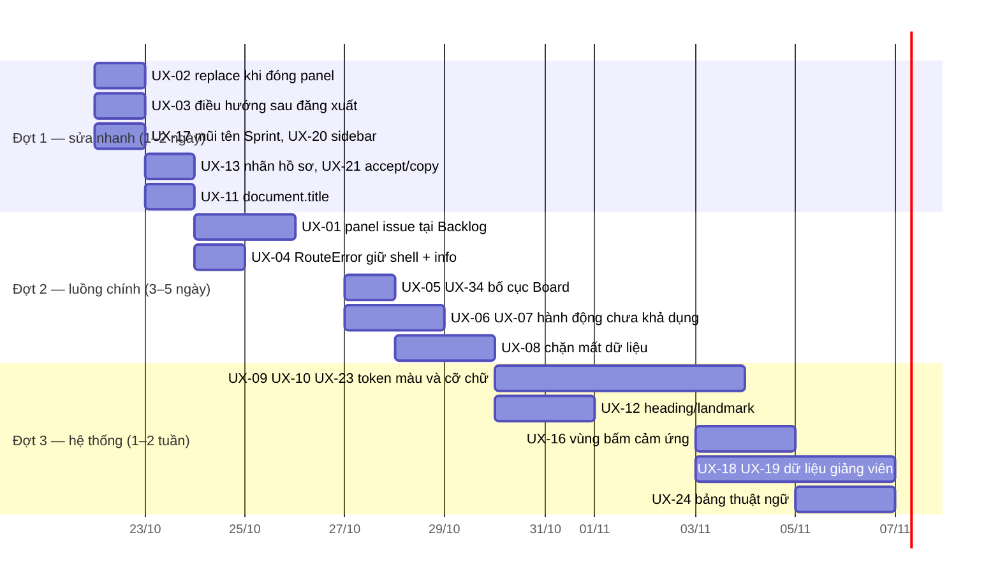

# Báo cáo đánh giá UI/UX — UTask Web

**Ngày đánh giá:** 2026-10-21 · **Phạm vi:** `apps/web` (React 18 + Vite) ·
**Trạng thái tài liệu:** Ảnh chụp hiện trạng tại commit `ea23a69` cộng các thay
đổi chưa commit trong `features/teacher/**`. Báo cáo này không thay thế các
tài liệu luồng chuẩn ([student-flow.md](student-flow.md),
[teacher-flow.md](teacher-flow.md), [kanban-board.md](kanban-board.md)); nó
đánh giá trải nghiệm người dùng của những gì đang chạy.

Mỗi phát hiện ghi nguồn bằng chứng:

- **Trình duyệt**: tái hiện trên Chromium headless chạy app Demo MSW.
- **Mã nguồn**: đọc trực tiếp file:dòng, chưa tái hiện trên trình duyệt.
- **Chưa xác minh**: chỉ suy ra từ mã hoặc chỉ đúng ở chế độ Demo MSW.

---

## 1. Tóm tắt

UTask Web đã có nền tảng UI khá vững: có bộ token màu, shadcn/Radix cho dialog,
menu và sheet, link “Bỏ qua điều hướng”, form có nhãn và lỗi ngay dưới ô nhập,
đủ ba trạng thái tải/rỗng/lỗi ở hầu hết màn hình, Board có menu thay thế cho
kéo thả và vùng thông báo cho trình đọc màn hình. Kiểm thử tự động sạch:
typecheck không lỗi, **97 file / 1154 test pass**, build thành công.

Các vấn đề lớn nhất nằm ở **luồng điều hướng hằng ngày của sinh viên** và
**độ tương phản/cỡ chữ**:

1. Mở issue từ Backlog bị chuyển sang Board; đóng panel tạo thêm mục lịch sử,
   nên phải bấm Back hai lần mới về được Backlog (UX-01, UX-02).
2. Sau khi đăng xuất, người đăng nhập tiếp theo trên cùng trình duyệt được đưa
   tới trang cuối cùng của người trước. Giảng viên có thể rơi vào Trang chủ sinh
   viên rỗng có nút bị vô hiệu (UX-03).
3. Board 4 cột tràn ngang ở màn 1440px khi sidebar mở; cột “Hoàn thành” bị cắt
   (UX-05).
4. Có 32 nút bị vô hiệu chỉ giải thích bằng `title`. Người dùng cảm ứng hoặc bàn
   phím không thấy lý do. Ví dụ: nút “Tạo Issue” của Leader trên Board Demo
   (UX-06).
5. axe-core báo lỗi tương phản ở 5/25 trang đã quét. Mã có 125 chỗ chữ
   9–11px, và trang Mã nguồn có 208 đoạn chữ hiển thị dưới 12px (UX-09, UX-10).
6. Trang lỗi route (`RouteError`) bỏ cả shell, không có nút quay lại hoặc thử
   lại. `/projects/:id/info` hiện bị lỗi này trong Demo MSW (UX-04).

### Điểm theo nhóm tiêu chí

Thang 10, chấm theo bằng chứng trong báo cáo. Nhóm tiêu chí theo thứ tự ưu
tiên của bộ quy tắc UI/UX Pro Max.

| Nhóm tiêu chí | Điểm | Lý do chính |
|---|---:|---|
| Trợ năng (Accessibility) | 6.0 | Có skip link, focus trap, live region; thiếu h1 ở 7 trang, tiêu đề tài liệu không đổi, lỗi tương phản, 2 ô nhập thiếu nhãn |
| Chạm & tương tác | 6.0 | Nút mặc định 36px, `sm` 32px (81 chỗ), `xs` 24px (19 chỗ); token 44px có nhưng không dùng; nút vô hiệu chỉ có tooltip |
| Hiệu năng cảm nhận | 7.0 | Lazy route, cache React Query, CLS 0; entry chunk 666 KB, khung chờ chung không khớp bố cục |
| Chọn phong cách | 7.0 | Phong cách phẳng, mật độ cao, hợp sản phẩm quản lý công việc; một emoji lẫn icon Lucide |
| Bố cục & responsive | 7.0 | Bảng thành thẻ trên mobile; tràn ngang ở My Work (375px) và Board (1440px) |
| Chữ & màu | 5.5 | 123 cỡ chữ tùy ý dưới 12px, 288 màu palette thô, 41 class token không tồn tại |
| Chuyển động | 8.0 | Tôn trọng `prefers-reduced-motion`, chuyển động nhẹ |
| Form & phản hồi | 7.0 | Kiểm tra ngay tại ô, focus về ô lỗi đầu tiên; form no-op, chưa chặn mất dữ liệu |
| Điều hướng | 6.0 | Có deep link `?issue=`; lịch sử bị nhiễu, Backlog → Board, `returnTo` lọt qua đăng xuất |
| Biểu đồ & dữ liệu | 7.0 | Progressbar có ARIA; tín hiệu giảng viên gây “mỏi cảnh báo” |

---

## 2. Phạm vi và phương pháp

### 2.1 Đã làm

| Hạng mục | Cách làm | Kết quả |
|---|---|---|
| Kiểm tra tĩnh | `tsc --noEmit` | Sạch |
| Unit/integration test | `vitest run` | 97 file, 1154 test pass, 31.6 s |
| Build production | `vite build` | Thành công; cảnh báo chunk > 500 KB |
| Smoke trình duyệt | Chromium headless, Demo MSW (mọi service mock), 3 kịch bản: `default`, `slow-network`, `student-partial-error` | 25 route, 2 vai trò (Leader, giảng viên `teacher3`) |
| Quét trợ năng | axe-core 4.10.2, tag `wcag2a/aa`, `wcag21a/aa`, `wcag22aa`, `best-practice` | 25 route ở 1440px, thêm 3 route ở 375px |
| Đo DOM | Script đếm h1, phần tử tương tác, kích thước vùng bấm, chữ < 12px, tràn ngang | Cùng các lần quét axe |
| Responsive | 1440×900 và 375×812 (mobile, touch) | My Work, Môn học, Board, Giảng viên |
| Bàn phím | Thứ tự Tab, Esc, menu di chuyển issue, trả focus | Board, panel issue, drawer mobile |
| Review mã | 3 subagent đọc theo lát (shell/auth/sinh viên, project, giảng viên); agent chính đối chiếu lại các phát hiện quan trọng | ~28.500 dòng UI |
| Tra cứu hướng dẫn | `ui-ux-pro-max` (`--design-system`, `--domain ux`) | Mục 8 |

### 2.2 Giới hạn

- Toàn bộ smoke chạy trên **Demo MSW**, không gọi backend thật. Hành vi phụ
  thuộc API thật (ghi Work, AI polling, GitHub) chỉ được đánh giá qua mã.
- Chưa thử với trình đọc màn hình thật (NVDA/VoiceOver). Kết luận trợ năng dựa
  trên axe, cây DOM và thao tác bàn phím.
- Chưa đo trên thiết bị di động thật hoặc Safari/Firefox.
- Không đánh giá giao diện tối (dark mode): app chỉ có token sáng
  (`globals.css:16-56`). 21 class `dark:` trong mã là phần còn lại từ shadcn.

---

## 3. Tổng quan sản phẩm và giao diện

### 3.1 Người dùng và bối cảnh

| Persona | Mục tiêu chính | Tần suất | Màn hình dùng nhiều |
|---|---|---|---|
| Sinh viên — Thành viên | Xem việc được giao, cập nhật trạng thái, bình luận | Hằng ngày | Trang chủ, Board, panel issue |
| Sinh viên — Trưởng nhóm | Lập nhóm, lên Backlog/Sprint, giao việc, cấu hình AI | Hằng tuần | Backlog, Board, Cài đặt dự án, Môn học → Nhóm |
| Sinh viên chưa có nhóm | Tìm/lập nhóm trước hạn | Đầu kỳ | Môn học, Thành lập nhóm |
| Giảng viên | Theo dõi lớp, phát hiện nhóm rủi ro, quản lý sinh viên | Hằng tuần | Bàn làm việc GV, Giám sát, Nhóm, Sinh viên |

### 3.2 Công nghệ giao diện

- React 18, React Router 7 (data router, `lazy` theo route), TanStack Query 5.
- Tailwind CSS 4 với token trong `src/styles/globals.css`; primitive shadcn
  trên `radix-ui` (`src/components/ui/*`); `sonner` cho toast; `cmdk`.
- Kéo thả: `@atlaskit/pragmatic-drag-and-drop` và gói live-region.
- Font Inter Variable tự host (`@fontsource-variable/inter`), có subset tiếng
  Việt.
- Mock: MSW 3 với 30 kịch bản (`src/mocks/scenarios.ts`).

### 3.3 Bản đồ màn hình

| Khu vực | Route | File chính | Trạng thái |
|---|---|---|---|
| Xác thực | `/login`, `/register`, `/forgot-password`, `/auth/reset`, `/auth/activate` | `features/auth/**` | Đã triển khai; SSO Google/GitHub bị vô hiệu |
| Trang chủ sinh viên | `/my-work` | `features/my-work/**` | Đã triển khai |
| Môn học | `/courses`, `/courses/:id/team` | `features/courses/**` (`CourseTeamRoute.tsx` 1105 dòng) | Một phần: soạn đề tài chưa ghi được |
| Dự án | `/projects`, `/projects/:id/{backlog,board,code,settings,info}` | `features/projects/**` | Một phần: ghi task chỉ khi dùng Work thật hoặc trong mock; `info` lỗi trong Demo |
| Thông báo & cài đặt | `/notifications`, `/settings/{profile,integrations,security}` | `features/notifications/**` | Đã triển khai trên Demo |
| Giảng viên | `/teacher`, `/teacher/courses/:id/{,students,students/import,teams,teams/:teamId,oversight,settings}` | `features/teacher/**` | Một phần: nhiều thao tác ghi chỉ là bản nháp hoặc bị vô hiệu |

```mermaid
flowchart LR
  L[Đăng nhập] -->|sinh viên| H[Trang chủ /my-work]
  L -->|chỉ giảng viên| T[/teacher]
  H --> C[Môn học] --> CT[Thành lập nhóm / Hub nhóm]
  H -->|Vào Board| B[Board]
  H -->|task hôm nay| P[Panel issue ?issue=KEY]
  H --> PR[Dự án] --> B
  B <--> BL[Backlog]
  BL -->|mở issue| B
  B --> P
  PR --> CODE[Mã nguồn] & SET[Cài đặt dự án]
  T --> TC[Lớp] --> OV[Tổng quan] & ST[Sinh viên] & TM[Nhóm] & GS[Giám sát] & CS[Cài đặt lớp]
  ST --> IMP[Nhập CSV]
  TM --> TD[Chi tiết nhóm]
```

---

## 4. Đánh giá các luồng chính

### 4.1 Đăng nhập → Trang chủ (mọi người dùng)

**Trình duyệt.** Submit form rỗng → hai lỗi tiếng Việt ngay dưới ô, focus nhảy
về ô email. Sai mật khẩu → hộp lỗi có `role="alert"`. Khi đang gửi, nút chuyển
thành “Đang đăng nhập” và bị vô hiệu. Nếu đã đăng nhập mà vào `/login` thì
được chuyển thẳng về trang chủ.

- Tốt: nhãn rõ, có `autoComplete`, nút hiện/ẩn mật khẩu có nhãn, đường dẫn
  `returnTo` được kiểm tra an toàn (`features/auth/utils.ts:43-48`).
- Vấn đề: chữ phụ `#787586` trên nền `#faf9f8` chỉ đạt 4.26:1 (8 phần tử);
  nút SSO bị vô hiệu chỉ có tooltip; 4 link chân trang là `<span>` không bấm
  được (`AuthLayout.tsx:39-45`); `returnTo` lọt qua đăng xuất (UX-03).

### 4.2 Trang chủ sinh viên → việc hôm nay → panel issue

Từ Trang chủ tới chi tiết một việc: **2 lần bấm**. `TaskRow.tsx:72` link thẳng
tới `/projects/:id/board?issue=KEY`. Bộ lọc “Hôm nay / Tuần này / Quá hạn /
Chưa đặt hạn” là `role="tablist"`.

- Tốt: ưu tiên việc theo hạn, thẻ Sprint có phần trăm tiến độ, có
  CTA “Vào Board”.
- Vấn đề: ở 375px dải tab tràn 54px, tab “Chưa đặt hạn” bị đẩy ra ngoài màn
  hình (UX-15). Một đoạn chữ cảnh báo màu `amber-500` chỉ đạt 2.14:1. H1 thật
  là “Bàn làm việc của tôi” nhưng bị ẩn (`sr-only`), còn thanh trên hiển thị
  “Trang chủ” bằng thẻ `<p>`.

### 4.3 Board — cập nhật trạng thái hằng ngày

**Trình duyệt.** Board có 4 cột theo trạng thái, lọc nhanh (Chỉ việc của tôi,
Có PR, Bugs, Bị chặn, Quá hạn, người thực hiện, ưu tiên), menu “⋯” trên từng
thẻ: chuyển trạng thái, lên đầu/xuống cuối, đánh dấu bị chặn. Menu mở bằng
Enter, focus vào mục đầu tiên. Panel issue mở bằng URL `?issue=`; Esc đóng
panel và trả focus về nút “⋯” của thẻ. Đổi trạng thái trong panel cập nhật cột
ngay (Demo MSW).

- Tốt: có menu thay thế cho kéo thả; live region thông báo khi thả
  (`useIssueMover.tsx:169`); deep link tới issue; focus trap đúng mẫu dialog.
- Vấn đề:
  - Tràn ngang 24px ở 1440px, cột “Hoàn thành” bị cắt (UX-05).
  - Thanh lọc xuống 3 dòng ở 1440px; không có số lượng bộ lọc đang bật.
  - Nút “⋯” chỉ 24×24px. Đạt mức tối thiểu WCAG 2.2 (2.5.8) nhưng khó bấm
    trên cảm ứng.
  - “Tạo Issue” bị vô hiệu trong Demo; lý do chỉ có ở `title` (UX-06).
  - Nhãn loại/ưu tiên 10px, `rose-600` trên `rose-50` đạt 4.26:1.
  - Đóng panel đẩy thêm mục lịch sử (UX-02).

### 4.4 Backlog & lập kế hoạch Sprint (Trưởng nhóm)

**Trình duyệt.** Bố cục hai cột: danh sách Epic bên trái; bên phải là bộ lọc,
dải “Trợ lý AI Scrum Copilot”, từng Sprint với tiến độ, rồi Product Backlog.

- Tốt: thanh tiến độ Sprint, trạng thái “Đang diễn ra/Kế hoạch”, số ngày còn
  lại, lọc theo Epic có số lượng.
- Vấn đề:
  - Bấm một issue thì bị chuyển sang `/board?issue=`; đóng panel thì đứng ở
    Board; Back lần 1 mở lại panel, lần 2 mới về Backlog (UX-01, UX-02).
  - Mũi tên thu gọn Sprint có cùng góc xoay ở cả hai trạng thái (UX-17).
  - 22 phần tử tương tác nhỏ hơn 24px; nút thu gọn Sprint chỉ có icon
    `size-4`, không padding, tức 16×16px (`ProjectBacklogRoute.tsx:309-323`).
  - Nhiều nút (Tạo Epic, Hoàn thành Sprint, hai nút AI) hiển thị mờ, không
    giải thích tại chỗ.

### 4.5 Môn học → Thành lập nhóm (sinh viên chưa có nhóm)

**Trình duyệt.** Có breadcrumb, banner hạn chót lập nhóm, bảng nhóm còn
chỗ (kỹ năng cần, sĩ số), bảng sinh viên chưa có nhóm có ô tìm kiếm, nút “Tạo
nhóm mới” nổi bật.

- Tốt: thông tin đủ để quyết định, hạn chót nổi bật, axe sạch.
- Vấn đề: nút “Xin gia nhập” bị vô hiệu, chỉ giải thích bằng tooltip;
  `TopicDraftForm` cho nhập đủ form rồi bỏ dữ liệu (`onSubmit` chỉ
  `preventDefault`, `CourseTeamRoute.tsx:597`, UX-07); nhãn “Leader/Member”
  tiếng Anh trong sidebar.

### 4.6 Thông báo & cài đặt

- Thông báo: chuông có nhãn “Thông báo (8 chưa đọc)”, popover có “Xem tất cả”;
  trang đầy đủ có tab, lọc chưa đọc, tìm kiếm, CTA cho từng loại. Khi lỗi
  (`student-partial-error`): vùng lỗi có `role="alert"` và nút “Thử lại”. Lỗi
  nằm gọn trong vùng nội dung, shell vẫn dùng được.
- Vấn đề: hàng thông báo là `<article onClick>`, không dùng được bằng bàn phím,
  và mọi hàng đều có cùng `aria-label` (UX-14); khi lỗi, các tab vẫn hiện số 0
  như thể không có dữ liệu; cả 3 trang cài đặt không có h1 và dùng chung một
  tiêu đề route; MSSV và email trong Hồ sơ thiếu nhãn liên kết (axe
  `label`, mức critical).

### 4.7 Giảng viên — từ tổng quan tới nhóm rủi ro

**Trình duyệt** (tài khoản `teacher3`, lớp SE360 có 100 sinh viên, 19 nhóm).
Bàn làm việc có thẻ số liệu và bảng “Cần chú ý”; trong lớp có 5 tab (Tổng
quan, Sinh viên, Nhóm, Giám sát, Cài đặt) và mã tham gia có nút sao chép.

- Tốt: bảng sinh viên chuyển thành thẻ trên mobile; lọc nhanh theo trạng thái
  nhóm; có lời nhắc “không có tín hiệu không có nghĩa là nhóm đang tốt”; axe
  không báo vi phạm ở cả 9 trang giảng viên đã quét.
- Vấn đề:
  - **Mỏi cảnh báo:** cả 19/19 nhóm có cùng tín hiệu “CHƯA ÁNH XẠ · Chưa có
    project · Nguồn không cho biết thời điểm”. Danh sách “Cần chú ý” vì vậy
    không giúp phân biệt nhóm nào cần xử lý trước (UX-18).
  - Bảng 100 dòng không phân trang, không sắp xếp theo cột; tab lớp không cố
    định khi cuộn (UX-19).
  - Sidebar con của lớp thiếu mục “Cài đặt” (UX-20).
  - Nhập CSV: ô chọn file nhận `.xlsx` nhưng sau đó từ chối; nút chọn file gốc
    của trình duyệt hiện chữ tiếng Anh “Choose File / No file chosen”; hai đoạn
    hướng dẫn mâu thuẫn về email kích hoạt (UX-21).
  - Thêm giảng viên phụ yêu cầu nhập UUID (UX-22).
  - Không có lớp nào chặn mất dữ liệu đang nhập (UX-08).

---

## 5. Kết quả kiểm thử

### 5.1 Quét axe-core

| Trang | Vi phạm | Chi tiết |
|---|---:|---|
| `/login` | 1 | `color-contrast` ×8 (`#787586` trên `#faf9f8`, 4.26:1) |
| `/my-work` (sinh viên) | 1 | `color-contrast` ×1 (`amber-500` 2.14:1); lặp lại ở 375px |
| `/my-work` (giảng viên chưa có lớp sinh viên) | 1 | `page-has-heading-one` |
| `/courses`, `/courses/:id/team` | 0 | — |
| `/projects` | 1 | `page-has-heading-one` |
| `/projects/:id/board` | 1 | `color-contrast` ×2 (nhãn ưu tiên 10px, 4.26:1); lặp lại ở 375px |
| Panel issue (`?issue=`) | 1 | `color-contrast` ×5 (thêm nhãn Epic `#f59e0b` trên `#fef5e7`, 1.98:1) |
| `/projects/:id/backlog` | 1 | `landmark-unique` |
| `/projects/:id/code` | 2 | `color-contrast` ×2 (`amber-600` 3.05:1), `link-in-text-block` ×5 (link chỉ khác chữ xung quanh 1.15:1) |
| `/projects/:id/settings` | 0 | — |
| `/projects/:id/info` | 1 | `page-has-heading-one` (trang lỗi) |
| `/notifications` | 1 | `page-has-heading-one` |
| `/settings/profile` | 2 | `label` ×2 (critical), `page-has-heading-one` |
| `/settings/integrations` | 1 | `page-has-heading-one` |
| `/settings/security` | 1 | `page-has-heading-one` |
| 404 | 3 | `landmark-no-duplicate-main`, `landmark-main-is-top-level`, `landmark-unique` |
| `/teacher`, `/teacher/courses`, 7 trang trong lớp (tổng quan, sinh viên, nhập CSV, nhóm, giám sát, cài đặt, chi tiết nhóm) | 0 | — |

### 5.2 Đo DOM theo trang (1440×900)

| Trang | h1 | Phần tử tương tác | < 24px | < 44px | Đoạn chữ < 12px | Tràn ngang |
|---|---:|---:|---:|---:|---:|---:|
| `/my-work` | 1 (ẩn) | 26 | 8 | 21 | 33 | 0 |
| `/my-work` @375 | 1 (ẩn) | 17 | 8 | 16 | 22 | **54px** |
| `/courses` | 1 (ẩn) | 26 | 9 | 21 | 13 | 0 |
| `/courses/:id/team` | 1 | 17 | 2 | 12 | 27 | 0 |
| `/projects` | **0** | 23 | 1 | 18 | 16 | 0 |
| Board | 1 (ẩn) | 36 | 6 | 31 | 54 | **24px** trong vùng Board (1224/1200) |
| Board + panel issue | 1 (ẩn) | 44 | 10 | 39 | 74 | 0 |
| Backlog | 1 (ẩn) | 64 | **22** | 59 | 55 | 0 |
| Mã nguồn | 1 (ẩn) | 32 | 7 | 27 | **208** | 0 |
| Cài đặt dự án | 1 (ẩn) | 19 | 2 | 14 | 15 | 0 |
| Thông báo | **0** | 28 | 2 | 23 | 17 | 0 |
| Cài đặt hồ sơ | **0** | 23 | 1 | 18 | 13 | 0 |
| `/teacher` | 1 (ẩn) | 25 | 14 | 23 | 37 | 0 |
| Nhóm của lớp (19 nhóm) | 1 | 43 | 3 | 41 | 32 | 0 |
| Giám sát lớp | 1 | 62 | **41** | 60 | 93 | 0 |

Cột “< 24px” tính cả link chữ trong dòng. Phần lớn các link này thuộc ngoại lệ
inline của WCAG 2.5.8, nhưng vẫn khó bấm trên cảm ứng. `document.title` luôn là
“UTask” trên mọi trang đã đo.

### 5.3 Trạng thái tải, lỗi, rỗng

| Tình huống | Quan sát | Đánh giá |
|---|---|---|
| Tải lại trang khi đang đăng nhập (`slow-network`) | Màn khung chờ toàn trang, không có shell, chỉ là 3 thẻ chung chung | Khung chờ không khớp bố cục đích (Board có 4 cột); shell xuất hiện muộn |
| Chuyển route trong app | Dữ liệu cache hiện ngay, sau đó làm mới ngầm | Tốt |
| Lỗi 500 cục bộ (thông báo, mã nguồn) | `ErrorState` có `role="alert"`, nút “Thử lại”, shell giữ nguyên | Tốt |
| Lỗi render route (`/projects/:id/info` trong Demo) | `RouteError` toàn màn hình, mất sidebar, không có nút | Kém (UX-04) |
| Giảng viên chưa có lớp vào `/my-work` | Trạng thái rỗng sinh viên với CTA bị vô hiệu | Sai ngữ cảnh (UX-03) |
| 404 | Có shell, h1, nút “Về trang chủ”; `<main>` lồng nhau | Tốt, cần sửa landmark |

Web vitals đo ở kịch bản `slow-network` (mỗi request chậm 1.2 s), trang
`/my-work`: LCP 4.1 s, CLS 0, INP 8 ms. Thời gian chủ yếu do độ trễ giả lập,
không phải do render.

### 5.4 Build

| Chunk | Kích thước | gzip |
|---|---:|---:|
| `index` (entry) | 666.5 KB | 207.3 KB |
| `browser` (MSW, tải động khi bật mock) | 343.0 KB | 112.5 KB |
| `ProjectBoardRoute` | 57.7 KB | 17.5 KB |
| `useIssueMover` | 49.8 KB | 17.4 KB |
| `ProjectBacklogRoute` | 43.0 KB | 12.8 KB |
| `CourseTeamRoute` | 40.6 KB | 11.1 KB |
| CSS | 86.0 KB | — |

`enableMocking.ts:2` import tĩnh `personaBridge`, file này import
`mocks/data/database`. Vì vậy dữ liệu mock, gồm email demo và chuỗi
`demo1234`, nằm trong entry chunk của **mọi** bản build, kể cả khi tắt mock
(UX-26).

---

## 6. Danh sách phát hiện

Mức độ: **Cao** = chặn hoặc làm sai luồng chính, hoặc vi phạm WCAG AA trên
màn hình dùng nhiều; **Trung bình** = gây khó dùng, có cách vòng; **Thấp** =
chưa nhất quán hoặc trau chuốt.

### 6.1 Điều hướng và luồng

| ID | Mức | Màn hình | Bằng chứng | Vấn đề | Đề xuất |
|---|---|---|---|---|---|
| UX-01 | Cao | Backlog | Trình duyệt; `ProjectBacklogRoute.tsx:473` | Mở issue từ Backlog gọi `navigate('/projects/:id/board?issue=KEY')`; người dùng mất vị trí cuộn, bộ lọc và ngữ cảnh lập kế hoạch. Issue trong Product Backlog mở trên một Board không chứa nó. My Work cũng luôn link về Board. | Render `IssuePanel` ngay trên Backlog bằng cùng tham số `?issue=` của route hiện tại; link từ My Work nên trỏ đúng nơi issue đang nằm. |
| UX-02 | Cao | Board, Backlog | Trình duyệt; `ProjectBoardRoute.tsx:231-241` | Cả mở và đóng panel đều `setSearchParams` kiểu push. Đóng panel tạo thêm mục lịch sử, nên Back mở lại panel vừa đóng. | Đóng bằng `{ replace: true }`, hoặc `navigate(-1)` khi mục trước chính là route không có `issue`. |
| UX-03 | Cao | Đăng xuất → đăng nhập | Trình duyệt; `AuthenticatedLayout.tsx:230-232`, `RequireAuth.tsx:15-16` | `signOut()` không điều hướng. `RequireAuth` thấy phiên rỗng tại trang hiện tại, nên chuyển sang `/login` kèm `returnTo`. Người đăng nhập tiếp theo được đưa tới trang của người trước. Đã tái hiện: sinh viên đăng xuất ở `/my-work`, giảng viên đăng nhập và rơi vào Trang chủ sinh viên rỗng. Trên máy dùng chung ở phòng lab, đường dẫn của người trước (dự án, issue) lộ ra cho người sau. | Sau `signOut()`, `navigate('/login', { replace: true })` không kèm state; hoặc xóa `returnTo` khi phiên kết thúc do đăng xuất chủ động. |
| UX-04 | Cao | Mọi route | Trình duyệt; `RouteError.tsx:5-18`; `ProjectInfoRoute.tsx:387` | Lỗi render bất kỳ thay toàn bộ layout bằng một hộp lỗi trống: không sidebar, không nút “Thử lại/Về trang chủ”, không h1. `/projects/:id/info` ném lỗi `useRealProjectContext must be used inside RealProjectLayout` trong Demo MSW. | Đặt `errorElement` ở cấp route con để giữ shell; thêm nút “Thử lại” và “Về trang chủ”; sửa `ProjectInfoRoute` để có nhánh Demo hoặc chặn route khi không dùng Work thật. |
| UX-20 | Trung bình | Giảng viên | Trình duyệt; `TeacherSidebar.tsx:13-18` | Sidebar con của lớp có 4 mục, tab bar có 5 mục; thiếu “Cài đặt”. | Thêm mục “Cài đặt” để hai nơi điều hướng khớp nhau. |
| UX-15b | Thấp | Lớp GV @375 | Trình duyệt | Dải tab lớp cuộn ngang; khi đang ở “Giám sát/Cài đặt”, tab đang chọn nằm ngoài màn hình. | `scrollIntoView({ inline: "nearest" })` cho tab đang chọn, hoặc dùng menu chọn trên mobile. |
| UX-29 | Thấp | Panel issue | Trình duyệt; `IssuePanel.tsx:526` | Breadcrumb hiện “Sprint” cho issue nằm trong Product Backlog; nút “Quay lại Bảng công việc Sprint” lặp chức năng nút đóng. | Hiện “Product Backlog” khi không có sprint; bỏ nút thừa. |

### 6.2 Trợ năng

| ID | Mức | Màn hình | Bằng chứng | Vấn đề | Đề xuất |
|---|---|---|---|---|---|
| UX-09 | Cao | Login, My Work, Board, panel issue, Mã nguồn | Trình duyệt (axe) | Lỗi tương phản: `#787586` 4.26:1; `amber-500` 2.14:1; `#f59e0b`/`#fef5e7` 1.98:1; `amber-600` 3.05:1; `rose-600`/`rose-50` 10px 4.26:1. Link GitHub trong bảng chỉ khác chữ xung quanh 1.15:1. | Tạo token ngữ nghĩa `--warning-foreground` (≥ `amber-800`), `--danger-foreground`; gạch chân link trong đoạn chữ; thay `#787586` bằng `text-muted-foreground`. |
| UX-11 | Trung bình | Mọi trang | Trình duyệt; không có `document.title` trong `src` | Tiêu đề tab luôn là “UTask” (WCAG 2.4.2). Route đã có `handle.title` nhưng chỉ hiện ở thanh trên. | Cập nhật `document.title = \`${title} · UTask\`` trong `AuthenticatedLayout` từ `handle.title`. |
| UX-12 | Trung bình | Dự án, Thông báo, 3 trang Cài đặt, `/my-work` của giảng viên, trang lỗi route; 404 | Trình duyệt (axe, đo DOM) | 7 trang không có h1. Phần lớn trang còn lại dùng h1 ẩn (`sr-only`), có khi khác chữ thanh trên (“Bàn làm việc của tôi” và “Trang chủ”). Tiêu đề thanh trên là `<p>`. Trang 404 lồng `<main>` trong `<main>`. | Một nguồn tiêu đề: thanh trên render `<h1>` từ `handle.title`, bỏ h1 ẩn trùng; `NotFoundRoute` dùng `<section>`. |
| UX-13 | Trung bình | Cài đặt hồ sơ | Trình duyệt (axe critical); `SettingsProfilePage.tsx:152-155` | Ô MSSV và email chỉ đọc có `<Label>` nhưng không có `htmlFor`/`id`. | Gắn `id` và `htmlFor`. |
| UX-14 | Trung bình | Thông báo | Mã nguồn; `NotificationsPage.tsx:255-261` | `<article onClick>` (đánh dấu đã đọc) không focus được, không có phím tắt; mọi hàng có cùng nhãn “Thông báo đã đọc/chưa đọc”. | Chuyển hành động vào nút thật hoặc đánh dấu đã đọc khi bấm CTA; nhãn gồm tiêu đề thông báo. |
| UX-15c | Trung bình | Drawer điều hướng mobile | Trình duyệt | Mở drawer thì focus vào khối hồ sơ ở cuối; Esc đóng drawer thì focus rơi về `<body>` thay vì nút ☰. | Dùng `SheetTrigger` hoặc trả focus thủ công về nút mở; focus ban đầu vào mục điều hướng đang chọn. |
| UX-10 | Trung bình | Toàn app | Mã nguồn (grep) + Trình duyệt | 87 `text-[11px]`, 36 `text-[10px]`, 2 `text-[9px]`; nhãn sidebar, nhãn loại issue, nhãn tín hiệu GV đều dưới 12px. | Cỡ tối thiểu `text-xs` (12px) cho chữ mang thông tin; chỉ dùng nhỏ hơn cho bộ đếm trang trí. |
| UX-31 | Thấp | Board/Backlog | Mã nguồn; `features/projects/dnd/useDraggableIssue.ts` | Kéo thả chỉ dùng chuột. Menu “⋯” thay được việc chuyển trạng thái, lên đầu và xuống cuối, nhưng không đưa issue tới một vị trí cụ thể ở giữa. | Thêm “Lên một bậc / Xuống một bậc” và “Chuyển tới Sprint…” trong menu. |

### 6.3 Chạm, tương tác và phản hồi

| ID | Mức | Màn hình | Bằng chứng | Vấn đề | Đề xuất |
|---|---|---|---|---|---|
| UX-06 | Cao | Board, Backlog, Môn học, Login, Cài đặt | Trình duyệt; 32 chỗ `title="…Chưa…"`; `DisabledAction` chỉ dùng 7 lần | Nút bị vô hiệu chỉ giải thích bằng `title`; trên cảm ứng hoặc bàn phím người dùng không biết lý do. Trong Demo, Leader không tạo được issue từ Board (“Chưa có API tạo issue”). | Dùng thống nhất `DisabledAction` (lý do hiện tại chỗ hoặc gắn `aria-describedby`); ẩn hẳn tính năng chưa có nếu không cần quảng bá. |
| UX-07 | Cao | Hub nhóm — đề tài | Mã nguồn; `CourseTeamRoute.tsx:594-636` | Form soạn đề tài cho nhập đủ nhưng submit chỉ `preventDefault`; dữ liệu mất. | Không render form khi chưa có API; thay bằng `EmptyState` giải thích, hoặc lưu nháp cục bộ như `features/teacher/lib/drafts.ts`. |
| UX-16 | Trung bình | Toàn app | Mã nguồn; `button.tsx:22-30`, `globals.css:23` | Nút mặc định `h-9` (36px), `sm` 32px (81 chỗ), `xs` 24px (19 chỗ), `icon-xs` 24px. Token `--control-height: 2.75rem` (44px) được khai báo nhưng không dùng. Nút “⋯” trên thẻ issue 24×24px, nút thu gọn Sprint 16×16px. | Trên `pointer: coarse`, nâng `sm/xs/icon-*` lên tối thiểu 40–44px bằng padding vô hình; dùng `--control-height` cho control chính. |
| UX-17 | Trung bình | Backlog | Mã nguồn; `ProjectBacklogRoute.tsx:316-320` | `-rotate-90` và `rotate-[-90deg]` là cùng một góc, nên mũi tên không đổi giữa mở và thu gọn. | Dùng `rotate-0` hoặc `-rotate-90` với `ChevronDown`. |
| UX-30 | Thấp | Đóng Sprint | Mã nguồn; `RealSprintTools.tsx:239-241` | Câu “không thể mở lại” chỉ hiện khi mọi issue đã xong; khi còn issue dở thì không nhắc. | Luôn nêu tính không đảo ngược trong mô tả. Không cần nút màu đỏ vì đóng Sprint là thao tác bình thường. |
| UX-32 | Thấp | AI | Mã nguồn; `ai/AiProposalDialog.tsx:82-103,215` | “Hủy” chỉ gọi `AbortController.abort()` ở trình duyệt; mã không gửi yêu cầu hủy tác vụ AI tới server. | Đổi nhãn thành “Ngừng chờ” và nói rõ kết quả sẽ bị bỏ qua. |
| UX-33 | Thấp | Thông báo (lỗi) | Trình duyệt | Khi API lỗi, các tab hiện bộ đếm “0”. | Ẩn bộ đếm hoặc hiện “—” khi chưa có dữ liệu. |

### 6.4 Bố cục và responsive

| ID | Mức | Màn hình | Bằng chứng | Vấn đề | Đề xuất |
|---|---|---|---|---|---|
| UX-05 | Cao | Board | Trình duyệt; `ProjectBoardRoute.tsx:80,368` | Mỗi cột `w-72 min-w-[18rem]` cộng `p-6` → 1224px trong vùng 1200px ở màn 1440px có sidebar mở. Cột “Hoàn thành” bị cắt, phải cuộn ngang. | `min-w-[15rem]` cùng `flex-1`, hoặc giảm padding ở `xl`; đặt `scroll-snap` nếu vẫn cần cuộn. |
| UX-15 | Trung bình | My Work @375 | Trình duyệt; `MyTasksSection.tsx:24,99` | Dải tab lọc tràn 54px, “Chưa đặt hạn” nằm ngoài màn hình và không có dấu hiệu cuộn. | Cho tab xuống dòng hoặc `overflow-x-auto` có fade ở mép; trên mobile có thể dùng `<Select>`. |
| UX-34 | Trung bình | Board | Trình duyệt | Thanh lọc xuống 3 dòng ở 1440px, đẩy cột xuống dưới. | Gom “Người thực hiện/Ưu tiên” vào popover “Bộ lọc (n)”, hiển thị số bộ lọc đang bật. |
| UX-35 | Thấp | Mã nguồn | Mã nguồn; `ProjectCodeRoute.tsx:449-473` | Bảng đóng góp 7 cột chỉ có cuộn ngang trên mobile. | Dạng thẻ dưới `sm`, như bảng sinh viên của giảng viên. |

### 6.5 Chữ, màu và hệ thống thiết kế

| ID | Mức | Phạm vi | Bằng chứng | Vấn đề | Đề xuất |
|---|---|---|---|---|---|
| UX-23 | Trung bình | Toàn app | Mã nguồn (grep) | 41 class `border-outline-subtle`/`bg-outline-subtle` dùng token **không tồn tại** trong `@theme`, nên không sinh CSS (viền rơi về `--border` mặc định); 70+ mã hex thô trong TSX (19×`#787586`, khác `--muted-foreground: #666766`); 288 class màu palette (`amber/rose/emerald…`) thay cho token ngữ nghĩa; `<select>` gốc ở 8 file và Radix Select ở 3 file; badge loại issue cài đặt hai lần. | Thêm token `--success/--warning/--info/--danger` (nền + chữ), thay hex thô bằng token, xóa hoặc định nghĩa `outline-subtle`, tách component `IssueTypeBadge`/`PriorityBadge`. |
| UX-24 | Trung bình | Copy | Trình duyệt + mã nguồn | Lẫn Anh–Việt: “Leader/Member”, “Academic Portal”, “Mô tả công việc (Description)”, “GitHub Development”, “Jira Tasks & PR”, “workspace Jira” (`ProjectsRoute.tsx:350`), nút chọn file “Choose File”. “Jira” là tên sản phẩm khác, dễ gây hiểu nhầm. | Lập bảng thuật ngữ (Trưởng nhóm, Thành viên, Bảng công việc, Không gian dự án) và áp dụng toàn app; tự làm nút chọn file có nhãn tiếng Việt. |
| UX-28 | Thấp | Mã nguồn | `ProjectCodeRoute.tsx:184` | Emoji 💡 lẫn với icon Lucide. | Dùng `Lightbulb` của Lucide. |

### 6.6 Form và bảo vệ dữ liệu

| ID | Mức | Màn hình | Bằng chứng | Vấn đề | Đề xuất |
|---|---|---|---|---|---|
| UX-08 | Cao | Tạo lớp, Cài đặt lớp, Điều chỉnh nhóm, Sửa issue | Mã nguồn; `CreateClassButton.tsx:26-34`; grep `useBlocker\|beforeunload` = 0 | Dialog tạo lớp chỉ chặn bấm ra ngoài khi đã nhập, còn **Esc** vẫn đóng và mất dữ liệu. `ClassInfoForm`, `TeamAdjustDialog`, `IssueEditForm` không cảnh báo khi rời đi. `UnsavedChangesGuard.tsx` đang bị xóa trong working tree. | Thêm `onEscapeKeyDown` có kiểm tra `dirty`; dùng `useBlocker` của React Router cho form trang; xác nhận trước khi đóng panel khi `IssueEditForm` có thay đổi. |
| UX-21 | Trung bình | Nhập CSV | Mã nguồn; `TeacherStudentImportRoute.tsx:232,257,269`; `csvImport.ts:175-185` | `accept` có `.xlsx` nhưng file Excel luôn bị từ chối; dòng 232 nói sinh viên mới “nhận email kích hoạt”, dòng 269 nói giao diện “không gửi thư kích hoạt”. | Bỏ `.xlsx` khỏi `accept`; thống nhất một câu mô tả đúng hành vi. |
| UX-22 | Trung bình | Cài đặt lớp | Mã nguồn; `ClassTeachersCard.tsx:97` | Thêm giảng viên phụ bằng UUID; giảng viên không có cách tra UUID trong app. | Cần API tra cứu theo email (báo backend Classroom/Identity); trong lúc chờ, dùng `DisabledAction` có lý do. |
| UX-36 | Thấp | Đăng ký | Mã nguồn; `RegisterForm.tsx:38` | “Tên đăng nhập” không có gợi ý (MSSV? email?); không có thước đo độ mạnh mật khẩu như form đặt lại mật khẩu. | Thêm `FormDescription`; tái dùng thước đo từ `ResetPasswordForm`. |
| UX-37 | Thấp | Bảo mật | Mã nguồn; `IdentitySecurityPage.tsx:259-268` | “Đăng xuất” và “Đăng xuất mọi thiết bị” trông giống hệt nhau. | Phân biệt kiểu nút; thêm icon cảnh báo cho thao tác rộng hơn. |

### 6.7 Dữ liệu cho giảng viên

| ID | Mức | Màn hình | Bằng chứng | Vấn đề | Đề xuất |
|---|---|---|---|---|---|
| UX-18 | Trung bình | Bàn làm việc GV, Giám sát | Trình duyệt | 19/19 nhóm có cùng một tín hiệu, nên danh sách “Cần chú ý” dài và không có thứ tự ưu tiên. Thuật ngữ “CHƯA ÁNH XẠ”, “Nguồn không cho biết thời điểm” khó hiểu. Chữ nhãn tín hiệu 10px, màu `amber-900/80`. | Gom theo loại tín hiệu (“19 nhóm chưa tạo project” thành một dòng có link lọc); chỉ liệt kê từng nhóm khi tín hiệu khác nhau; viết lại thuật ngữ bằng lời thường. |
| UX-19 | Trung bình | Sinh viên, Nhóm, Giám sát | Trình duyệt; grep `aria-sort`/pagination = 0 | 100 dòng một trang, không sắp xếp theo cột; thẻ nhóm hiện đủ thành viên nên 19 nhóm rất dài; tab lớp không cố định khi cuộn. Hiệu năng render không có vấn đề quan sát được; vấn đề là khó dò tìm. | Sắp xếp theo cột có `aria-sort`; chế độ xem gọn cho danh sách nhóm; tab lớp `sticky`. |

### 6.8 Hiệu năng và vận hành

| ID | Mức | Bằng chứng | Vấn đề | Đề xuất |
|---|---|---|---|---|
| UX-25 | Trung bình | Trình duyệt (`slow-network`) | Khi tải lại trang, khung chờ khôi phục phiên không có shell và có hình dạng chung chung, không khớp trang đích. | Render shell ngay khi biết có phiên trong bộ nhớ; khung chờ riêng cho Board (4 cột), Backlog (danh sách). |
| UX-26 | Thấp | Mã nguồn + build | Entry chunk 666 KB (207 KB gzip). `personaBridge` và dữ liệu mock bị import tĩnh vào entry, nên bản build tắt mock vẫn chứa email demo và `demo1234`. `apps/web/README.md` nói “Production builds never register MSW”, trong khi `enableMocking.ts` cho phép bật mock ở production qua `VITE_ENABLE_MOCKS`. | Chuyển `installPersonaBridge` vào nhánh `import()` động; sửa câu trong README cho khớp hành vi. |
| UX-38 | Thấp, chỉ Demo | Trình duyệt; `AuthProvider.tsx:204-221` | Trong Demo MSW, sau khi đăng xuất rồi tải lại trang, phiên được khôi phục (cookie refresh mock còn nguyên, không có `DELETE /sessions`). Khi `listSessions` không trả phiên `is_current`, `logout()` vẫn báo `revoked: true` mà không gọi server. Với Identity thật: **Chưa xác minh**. | Khi không tìm thấy phiên hiện tại, gọi endpoint đăng xuất phiên theo cookie hoặc báo `revoked: false`; sửa handler mock. |

---

## 7. Điểm mạnh cần giữ

| Điểm mạnh | Bằng chứng |
|---|---|
| Link “Bỏ qua điều hướng” và `#main-content` | `AuthenticatedLayout.tsx:249-254`; phần tử đầu tiên trong cây tương tác của trang |
| Rail sidebar tự mở khi focus bằng bàn phím; nút ghim có `aria-pressed` | `AuthenticatedLayout.tsx:164,267` |
| Form xác thực: nhãn, lỗi tại ô, focus về ô lỗi đầu, nút gửi có trạng thái đang xử lý | Trình duyệt `/login` |
| Panel issue: focus trap, Esc, trả focus về thẻ, deep link `?issue=` | Trình duyệt Board |
| Menu thay thế kéo thả, có live region khi thả | `IssueActionsMenu.tsx`, `useIssueMover.tsx:169` |
| Ba trạng thái tải/rỗng/lỗi phổ biến: 57 `Skeleton`, 48 `EmptyState`, 23 `ErrorState`, 44 `role="alert"` | grep `src` |
| Lỗi cục bộ không phá shell, có “Thử lại” | Trình duyệt `student-partial-error` |
| Idempotency key cho thao tác ghi, xử lý `VERSION_CONFLICT` | `CreateIssueDialog.tsx:51`, `IssueEditForm.tsx:19,64` |
| Bảng → thẻ trên mobile (sinh viên của giảng viên) | Trình duyệt @375 |
| Tôn trọng `prefers-reduced-motion`, focus ring 2px dùng token `--ring` | `globals.css:127-146` |
| Lời nhắc trung thực cho tín hiệu: “Không có tín hiệu không có nghĩa là nhóm đang tốt” | Trình duyệt Giám sát |
| Font tự host có subset tiếng Việt, không phụ thuộc Google Fonts | `main.tsx:1` |

---

## 8. Đối chiếu với hướng dẫn UI/UX Pro Max

`--design-system` cho truy vấn “productivity task management kanban app” đề
xuất phong cách **Flat Design**, mật độ cao, chuyển động nhẹ. Phong cách này
khớp với UTask hiện tại. Bảng màu (teal/cam) và font (Plus Jakarta Sans) được
đề xuất **không áp dụng**: UTask đã có nhận diện tím `#5645d4` với Inter có
subset tiếng Việt; đổi màu chỉ tạo rủi ro mà không sửa được vấn đề nào ở trên.
Phần “pattern” của kết quả là mẫu landing page, không hợp với app nên bỏ qua.

Các quy tắc `--domain ux` liên quan trực tiếp:

| Quy tắc (mức) | Áp dụng cho UTask | Phát hiện |
|---|---|---|
| Dragging Movements — cần cách thay thế bằng một lần bấm (High) | Đạt một phần: có menu, thiếu “lên/xuống một bậc” | UX-31 |
| Target Size (Minimum) — web ≥ 24×24px (High) | Phần lớn đạt; nút thu gọn Sprint 16px không đạt | UX-16, UX-17 |
| Color Only — không truyền tin chỉ bằng màu (High) | Chấm chưa đọc/đã đọc trong popover chỉ dựa màu; trạng thái thành viên ở sidebar dựa chấm màu, kèm chữ 11px | UX-10, UX-14 |
| Content Jumping — giữ chỗ cho trạng thái bất đồng bộ (High) | CLS đo được 0; khung chờ không khớp bố cục | UX-25 |
| Empty States — luôn có thông điệp và hành động (Medium) | Đa số đạt; trạng thái rỗng của GV ở `/my-work` có CTA bị vô hiệu | UX-03 |
| Table Handling — cuộn ngang hoặc dạng thẻ (Medium) | Đạt ở trang GV; bảng Mã nguồn chưa có dạng thẻ | UX-35 |
| Submit Feedback — loading rồi success/error (High) | Đạt ở login và dialog ghi | — |

---

## 9. Lộ trình khắc phục đề xuất



Ưu tiên theo tác động lên người dùng hằng ngày: sinh viên mở Board/Backlog
nhiều lần mỗi ngày, nên UX-01, UX-02, UX-05 đem lại lợi ích lớn nhất trên mỗi
giờ công. UX-03 nên làm sớm vì phòng máy dùng chung là bối cảnh phổ biến của
sinh viên.

### Việc cần backend (báo đội backend)

| Nhu cầu | Service | Liên quan |
|---|---|---|
| Tra cứu người dùng theo email để phân công giảng viên phụ | Identity/Classroom | UX-22 |
| API ghi đề tài (topic draft) của nhóm | Classroom | UX-07 |
| Hủy tác vụ AI phía server | AI Service | UX-32 |

---

## 10. Phát hiện đã loại hoặc điều chỉnh khi đối chiếu

Subagent nêu các ý dưới đây; agent chính kiểm tra lại và loại hoặc hạ mức:

| Ý ban đầu | Kết luận | Lý do |
|---|---|---|
| Lỗi đăng nhập thiếu `role="alert"` | Loại | Trình duyệt thấy hộp lỗi có `role="alert"` |
| Board không có cách thay thế kéo thả bằng bàn phím | Hạ thành Thấp (UX-31) | Menu “⋯” mở bằng Enter, có chuyển trạng thái/lên đầu/xuống cuối |
| Nút “⋯” 24px là lỗi nghiêm trọng | Hạ thành Trung bình (UX-16) | 24×24px đạt WCAG 2.2 AA 2.5.8; chỉ kém thoải mái trên cảm ứng |
| Select trạng thái trong panel bị nhảy về giá trị cũ | Chưa xác minh | Không tái hiện ở Demo MSW; chưa thử với Work thật |
| Nút “Hoàn thành sprint” nên màu đỏ | Điều chỉnh (UX-30) | Đóng Sprint là thao tác bình thường; vấn đề thật là thiếu cảnh báo không đảo ngược |
| Bảng 100 sinh viên render giật | Điều chỉnh (UX-19) | Không quan sát thấy chậm; vấn đề là khó dò tìm và sắp xếp |

---

## Phụ lục A — Cách tái hiện smoke trên WSL

Node trên máy là bản Windows (`node.exe`), nên dev server lắng nghe phía
Windows và biến môi trường WSL phải truyền qua `WSLENV`:

```bash
cd apps/web
WSLENV=VITE_ENABLE_MOCKS:VITE_REAL_SERVICES:VITE_MOCK_SCENARIO \
VITE_ENABLE_MOCKS=true VITE_REAL_SERVICES=, VITE_MOCK_SCENARIO=default \
node node_modules/vite/bin/vite.js --host 0.0.0.0 --port 5299 --strictPort
```

- `VITE_REAL_SERVICES=,` ghi đè `.env.local` (đang bật `auth,classroom,work`)
  thành danh sách rỗng; giá trị lạ như `none` làm app ném lỗi
  (`lib/config/services.ts:17-19`).
- Service Worker của MSW chỉ chạy trong secure context (`localhost`). Khi trình
  duyệt chạy ở phía Linux, cần chuyển tiếp `127.0.0.1:<port>` sang IP gateway
  WSL (`ip route show default`) thay vì mở thẳng IP đó.
- Tài khoản demo và kịch bản: `apps/web/README.md`.

## Phụ lục B — Số liệu grep (`apps/web/src`, không tính test)

| Chỉ số | Mẫu | Số lượng |
|---|---|---:|
| Chữ 11px | `text-[11px]` | 87 |
| Chữ 10px | `text-[10px]` | 36 |
| Chữ 9px | `text-[9px]` | 2 |
| Hex thô trong TSX | `#[0-9a-fA-F]{6}` | 70+ |
| Màu palette thô | `(text\|bg\|border)-(amber\|rose\|emerald\|…)-NNN` | 288 |
| Token không tồn tại | `outline-subtle` | 41 |
| `<select>` gốc / Radix Select | file | 8 / 3 |
| Nút `size="sm"` / `"xs"` | — | 81 / 19 |
| Nút vô hiệu giải thích bằng `title` | `title="…Chưa…"` | 32 |
| `DisabledAction` | — | 7 |
| `role="alert"` / `aria-live` | — | 44 / 5 |
| `Skeleton` / `EmptyState` / `ErrorState` | — | 57 / 48 / 23 |
| Chặn rời trang | `useBlocker\|beforeunload` | 0 |
| `document.title` | — | 0 |
